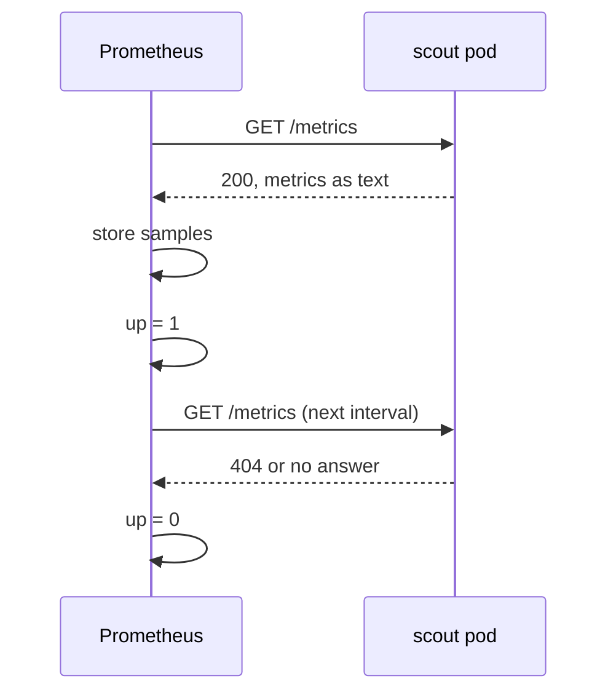

# Targets And The up Metric

Before you add anything to Prometheus, you need to see what it collects now and how it reports a success or a failure. This part shows where metrics come from, what Prometheus does with them, and the one metric that tells you whether each collection worked. Every later part of this module proves its result with that metric.

## What a scrape is

A **metric** is a number a program reports about itself, for example the count of HTTP requests it has served. Programs that work with Prometheus publish their metrics as plain text on an HTTP endpoint, usually `/metrics`. Prometheus does not wait for programs to send data. It **scrapes**: on a fixed interval it sends an HTTP `GET` to each endpoint, reads the text, and stores every number with the time it read it.

Each endpoint Prometheus scrapes is called a **target**. A target is one address, such as `http://10.244.0.9:9898/metrics`, so a Deployment with two pods is two targets. After every scrape, Prometheus writes one more number for that target, called `up`: `1` if the scrape worked and `0` if it failed.



The diagram shows two scrape cycles: one that returns the metrics and sets `up` to `1`, and one that fails and sets `up` to `0`.

## Look at the text Prometheus reads

Start with the `scout` endpoint itself, so you know what Prometheus would receive. Send a request from the `shuttle` pod and keep only the lines for the request counter:

<!-- astrona:playground:renew -->

```sh
kubectl -n starfleet exec deploy/shuttle -- curl -s http://scout.starfleet:9898/metrics | grep http_requests_total
```

You should see something like:

```text
# HELP http_requests_total The total number of HTTP requests.
# TYPE http_requests_total counter
http_requests_total{status="200"} 71
```

The `# HELP` line describes the metric, and the `# TYPE` line says it is a **counter**: a number that only goes up. The last line is the value, with one **label**, `status="200"`, a key-value pair that splits the metric into separate series. The number grows with every request `scout` serves, including the readiness checks the kubelet sends, so yours will differ.

## Reach Prometheus

There is no load balancer on `kind`, so you reach Prometheus with a port-forward. Run this in a second terminal and leave it running:

```sh
kubectl -n monitoring port-forward svc/kps-prometheus 9090:9090
```

You can now open `http://127.0.0.1:9090` in a browser. The page **Status → Target health** lists every target. The same list is available from Prometheus's HTTP API, which is what you use in scripts and in the exam terminal. Paste these two helpers into your first terminal. `show_targets` prints each target's job, address, health and last error. `query_up` runs the query `up`, with an optional label filter, and prints one line per target:

```sh
show_targets() {
  curl -s http://127.0.0.1:9090/api/v1/targets |
    jq -r '.data.activeTargets[] | "\(.labels.job)\t\(.scrapeUrl)\t\(.health)\t\(.lastError)"'
}
query_up() {
  curl -s http://127.0.0.1:9090/api/v1/query --data-urlencode "query=up$1" |
    jq -r '.data.result[] | "\(.metric.job)\t\(.metric.pod)\t\(.value[1])"'
}
```

Now list the targets:

```sh
show_targets
```

You should see something like:

```text
kps-operator	https://10.244.0.6:10250/metrics	up
kps-prometheus	http://10.244.0.7:9090/metrics	up
kps-prometheus	http://10.244.0.7:8080/metrics	up
```

Prometheus scrapes three targets, all in `monitoring`: the operator, Prometheus itself, and the configuration reloader that runs next to Prometheus in the same pod. The IP addresses will differ on your cluster. `scout` is not in the list. Its endpoint works, as the `curl` above showed, but nothing has told Prometheus about it.

## Read the up metric

The targets list shows the current state. The `up` metric shows the same thing as data you can query, filter and alert on:

```sh
query_up
```

You should see something like:

```text
kps-operator	kps-operator-f4889cfbd-ld8f6	1
kps-prometheus	prometheus-kps-prometheus-0	1
kps-prometheus	prometheus-kps-prometheus-0	1
```

Each line is one time series of `up`, the value is `1`, and the labels `job` and `pod` say which target it belongs to. Prometheus added those labels itself while it found the targets. The full series carries more labels, such as `namespace`, `service`, `endpoint` and `instance`, and you can filter on any of them; `query_up '{namespace="monitoring"}'` returns the same three lines.

An empty result is also an answer. `query_up '{namespace="starfleet"}'` prints nothing at all, because Prometheus has never scraped anything in `starfleet`. Keep the two cases apart: `up` with the value `0` means Prometheus tried and failed, and no `up` series at all means Prometheus never tried.

## Where the Prometheus Operator fits

None of the three targets came from a hand-written Prometheus configuration file. The Helm chart created two ServiceMonitors in `monitoring`, and the operator turned them into scrape configuration:

```sh
kubectl get servicemonitors,podmonitors -A
```

You should see something like:

```text
NAMESPACE    NAME                                                  AGE
monitoring   servicemonitor.monitoring.coreos.com/kps-operator     8m27s
monitoring   servicemonitor.monitoring.coreos.com/kps-prometheus   8m27s
```

That is the whole job of the operator for this module. It watches ServiceMonitors and PodMonitors, writes the matching Prometheus configuration into a Secret, and Prometheus reloads it. To collect `scout`, you do not edit Prometheus; you create a monitor.

You can now read what Prometheus collects in two ways: the targets list for the current state of each endpoint, and the `up` metric for the same facts as queryable data. You also know that a missing `up` series means "never tried", not "failed". The open question is what makes Prometheus try: what a ServiceMonitor must contain, and which ServiceMonitors Prometheus reads at all.

## Common pitfalls

> [!WARNING]
> - **Reading "no data" as "down".** `up == 0` means the scrape failed. No `up` series at all means Prometheus has no target for that workload.
> - **Forgetting the port-forward.** The helpers talk to `127.0.0.1:9090`. If the port-forward terminal was closed, `curl` fails with a connection error, not a Prometheus error.
> - **Expecting a Deployment to be scraped because it serves `/metrics`.** A working endpoint is not a target until a monitor selects it.
> - **Comparing IP addresses with the page.** Pod IP addresses change with every restart; compare `job`, `namespace` and `pod` instead.
