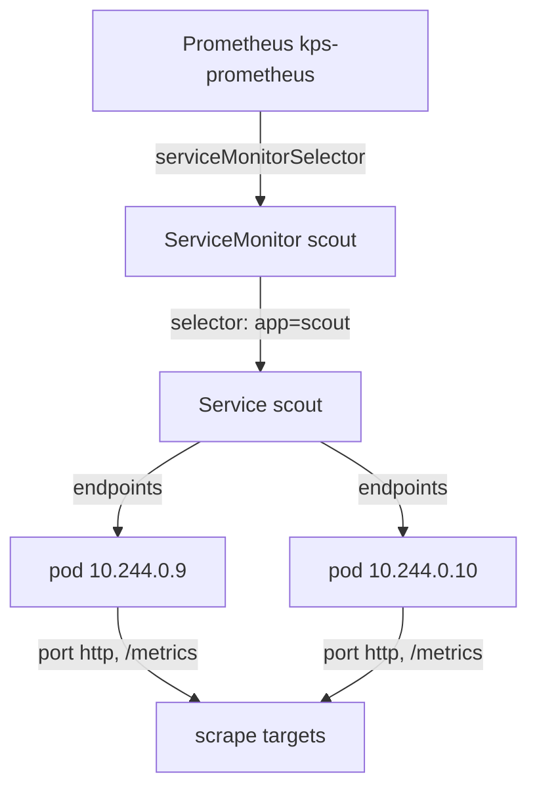

# Select A Service With A ServiceMonitor

`scout` serves metrics, and Prometheus does not scrape it. This part writes the ServiceMonitor that connects the two. The first version looks correct and is ignored, because a second selection decides which monitors Prometheus reads at all. Once you know both selections, a missing target stops being a mystery.

## Two selections, not one

A **ServiceMonitor** is a Prometheus Operator resource that says: scrape the endpoints behind every Service that matches this label selector, on this named port and path. It does not name pods or IP addresses. The operator follows the chain from the ServiceMonitor to the Service, and from the Service to its endpoints: the list of IP addresses and ports of the ready pods behind it, which Kubernetes keeps up to date.

A **Prometheus** resource is the operator's description of one Prometheus server: its version, its storage, and which monitors it reads. Its field `serviceMonitorSelector` is a label selector on ServiceMonitors, and `serviceMonitorNamespaceSelector` limits the namespaces they may live in. A ServiceMonitor that this selector does not match is ignored, however correct it is.



The diagram shows the chain the operator follows: the Prometheus resource selects the ServiceMonitor, the ServiceMonitor selects the Service, and the Service's endpoints become the targets.

## Read the Prometheus selector first

Check what this Prometheus selects before you write a monitor. It takes one command, and it answers the most common question about missing targets:

<!-- astrona:playground:renew -->

```sh
kubectl -n monitoring get prometheus kps-prometheus -o yaml | grep -A3 -E "serviceMonitorSelector|serviceMonitorNamespaceSelector"
```

You should see:

```text
  serviceMonitorNamespaceSelector: {}
  serviceMonitorSelector:
    matchLabels:
      release: kps
  shards: 1
```

The last line, `shards: 1`, is just the next field in the file. `serviceMonitorNamespaceSelector: {}` is an empty selector, which matches every namespace, so a ServiceMonitor may live in `starfleet`. `serviceMonitorSelector` is not empty: it only matches ServiceMonitors with the label `release: kps`. The `kube-prometheus-stack` chart sets this by default to the name of its Helm release, here `kps`, so that one Prometheus only reads the monitors meant for it.

## A ServiceMonitor without the label

To see the effect, first write the ServiceMonitor the way most examples show it, without that label. Save this as `servicemonitor-scout.yaml`:

```yaml
apiVersion: monitoring.coreos.com/v1
kind: ServiceMonitor
metadata:
  name: scout
  namespace: starfleet
spec:
  selector:
    matchLabels:
      app: scout
  endpoints:
    - port: http
      path: /metrics
      interval: 15s
```

The fields map one to one onto the chain above:

- `spec.selector` matches Services by their labels. The `scout` Service has the label `app: scout`. By default the ServiceMonitor only looks for Services in its own namespace; `spec.namespaceSelector` changes that.
- `endpoints[].port` is the **name** of a port in the Service, not a number. The `scout` Service names its port `http`.
- `endpoints[].path` is the HTTP path to scrape, `/metrics` by default.
- `endpoints[].interval` overrides how often this endpoint is scraped.

Apply it:

```sh
kubectl apply -f servicemonitor-scout.yaml
```

Wait a minute, then list the targets with the helper from the start of this module (paste `show_targets` and `query_up` again in a new terminal, and keep the port-forward to `svc/kps-prometheus` on `9090` running):

```sh
show_targets
```

You should see something like:

```text
kps-operator	https://10.244.0.6:10250/metrics	up
kps-prometheus	http://10.244.0.7:9090/metrics	up
kps-prometheus	http://10.244.0.7:8080/metrics	up
```

Nothing changed. The object exists, `kubectl apply` reported `created`, and there is no error anywhere: the ServiceMonitor has no status that reports a problem, and the operator writes no log line about it. The operator never considered it, because it does not carry `release: kps`.

## Add the label Prometheus selects

Add the label in `servicemonitor-scout.yaml`, so that the `metadata` block reads:

```yaml
apiVersion: monitoring.coreos.com/v1
kind: ServiceMonitor
metadata:
  name: scout
  namespace: starfleet
  labels:
    release: kps
spec:
  selector:
    matchLabels:
      app: scout
  endpoints:
    - port: http
      path: /metrics
      interval: 15s
```

Apply it again:

```sh
kubectl apply -f servicemonitor-scout.yaml
```

The new target does not appear at once. The operator rewrites Prometheus's configuration within seconds, but it stores that configuration in a Secret, and the kubelet takes up to about a minute to update a Secret mounted in a running pod. In this playground the new job reached Prometheus about 60 seconds after the apply. Wait a minute, then check:

```sh
show_targets
query_up '{namespace="starfleet"}'
```

You should see something like:

```text
kps-operator	https://10.244.0.6:10250/metrics	up
kps-prometheus	http://10.244.0.7:9090/metrics	up
kps-prometheus	http://10.244.0.7:8080/metrics	up
scout	http://10.244.0.10:9898/metrics	up
scout	http://10.244.0.9:9898/metrics	up
scout	scout-674cfb4855-tnb6r	1
scout	scout-674cfb4855-845v6	1
```

There are two new targets, one per `scout` pod, and `up` is `1` for both. This is the proof that the scrape works: one `up` series per endpoint of the workload, each with the value `1`. The `job` label is `scout`, taken from the Service name.

## What the operator generated

The operator turned the ServiceMonitor into a block of Prometheus scrape configuration called a **job**. Prometheus shows its running configuration on the page **Status → Configuration**, and the API returns it too. List the job names:

```sh
curl -s http://127.0.0.1:9090/api/v1/status/config | jq -r .data.yaml | grep job_name
```

You should see:

```text
- job_name: serviceMonitor/monitoring/kps-operator/0
- job_name: serviceMonitor/monitoring/kps-prometheus/0
- job_name: serviceMonitor/monitoring/kps-prometheus/1
- job_name: serviceMonitor/starfleet/scout/0
```

The real output also prints a line with `target_label: __tmp_prometheus_job_name` under each job; it is left out here. The job name follows the pattern `serviceMonitor/<namespace>/<name>/<endpoint index>`, so `/0` is the first entry of `endpoints`. When a ServiceMonitor has no job in this list, Prometheus never read it, and the first thing to check is the selector label.

You can now write a ServiceMonitor, check which ServiceMonitors a Prometheus reads, and prove the scrape with one `up == 1` series per endpoint. You have also seen that a ServiceMonitor without the selected label fails silently. The open question is the workload that has no Service at all, the `scout` copy in `outpost`.

## Common pitfalls

> [!WARNING]
> - **Leaving out the label the Prometheus resource selects.** The ServiceMonitor is ignored with no error. Read `serviceMonitorSelector` first.
> - **Putting a port number in `endpoints[].port`.** The field takes the name of a Service port. Use `targetPort` only when you must scrape a container port the Service does not name.
> - **Checking the targets right after `kubectl apply`.** The configuration reaches Prometheus through a mounted Secret, which can take about a minute.
> - **Selecting Services in another namespace without `namespaceSelector`.** A ServiceMonitor looks only in its own namespace unless `spec.namespaceSelector` says otherwise.
