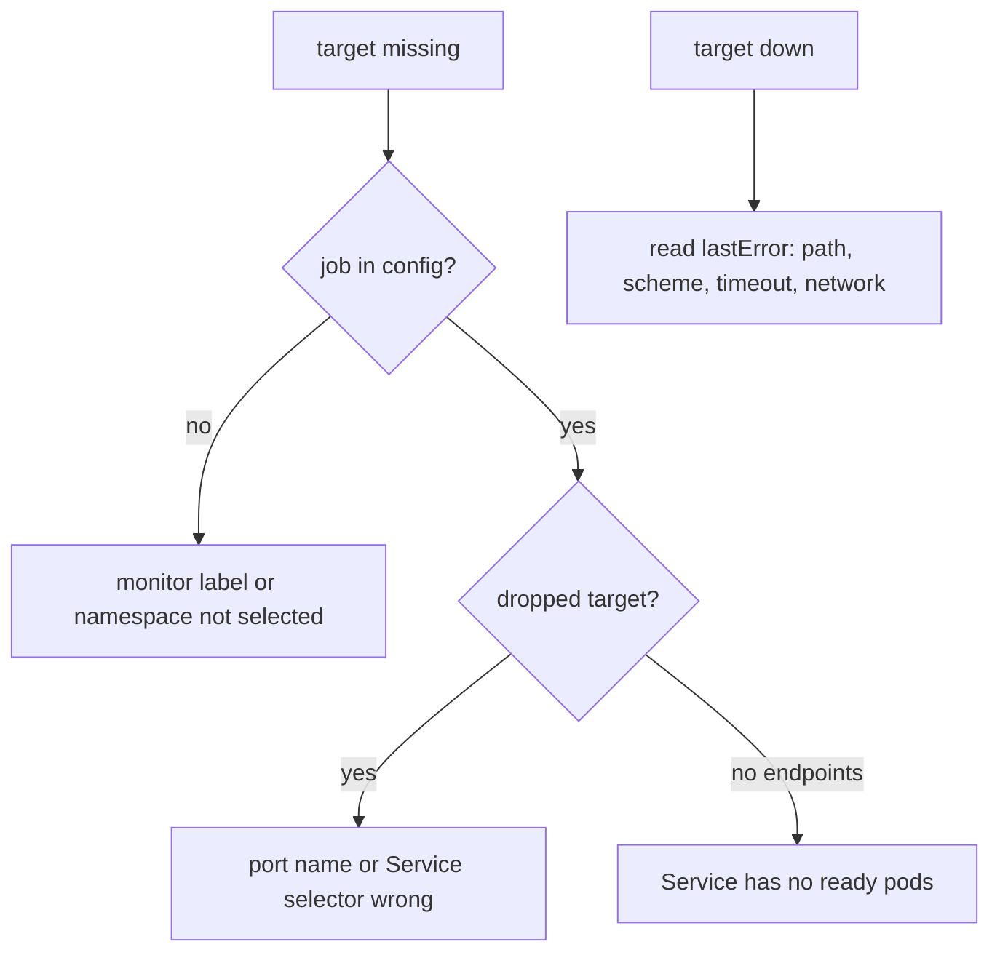

# Finding A Missing Target

On a real platform, someone reports that a dashboard is empty, and you have to work back from there. Monitor mistakes show up in two very different places: some leave a target that fails, and others leave no target at all. This part breaks the working ServiceMonitor in the two most common ways, reads where each mistake appears, and ends with a fixed order of checks.

## A wrong path: the target fails

Change the path in `servicemonitor-scout.yaml` from `/metrics` to `/metrix`, then apply it:

<!-- astrona:playground:renew -->

```sh
kubectl apply -f servicemonitor-scout.yaml
```

Wait about a minute for the change to reach Prometheus, then check the targets and the `up` series:

```sh
show_targets
query_up '{namespace="starfleet"}'
```

You should see something like:

```text
outpost/scout	http://10.244.0.12:9898/metrics	up
kps-operator	https://10.244.0.6:10250/metrics	up
kps-prometheus	http://10.244.0.7:9090/metrics	up
kps-prometheus	http://10.244.0.7:8080/metrics	up
scout	http://10.244.0.10:9898/metrix	down	server returned HTTP status 404 Not Found
scout	http://10.244.0.9:9898/metrix	down	server returned HTTP status 404 Not Found
scout	scout-674cfb4855-tnb6r	0
scout	scout-674cfb4855-845v6	0
```

This is the easy kind of mistake. Prometheus found both endpoints, tried them, and failed: the targets are `down`, `up` is `0`, and the last error names the cause, an HTTP `404` from `/metrix`. A wrong scheme, a timeout or a network policy that blocks Prometheus shows up the same way, with a different error text. Whenever a target is `down`, read its last error first.

## A wrong port name: the target disappears

Put the path back to `/metrics`, and change the port from `http` to `metrics`, a name the `scout` Service does not have. Apply it, wait about a minute, and check again:

```sh
kubectl apply -f servicemonitor-scout.yaml
show_targets
query_up '{namespace="starfleet"}'
```

You should see something like:

```text
servicemonitor.monitoring.coreos.com/scout configured
outpost/scout	http://10.244.0.12:9898/metrics	up
kps-operator	https://10.244.0.6:10250/metrics	up
kps-prometheus	http://10.244.0.7:9090/metrics	up
kps-prometheus	http://10.244.0.7:8080/metrics	up
```

The pod names in the outputs on this page come from more than one run of the playground, so they differ between blocks; yours will differ too.

The `scout` targets are gone, and `query_up` prints nothing for `starfleet`. This is the hard kind of mistake: no target is `down`, no error is shown, and an alert on `up == 0` would never fire. The job still exists in the running configuration, but every endpoint it discovered was thrown away, because none of them has a port named `metrics`.

Prometheus keeps a list of such discarded endpoints, called **dropped targets**. Ask for the ones from `starfleet`, with the port name each one really has:

```sh
curl -s 'http://127.0.0.1:9090/api/v1/targets?state=dropped' |
  jq -r '.data.droppedTargets[] | select(.discoveredLabels.__meta_kubernetes_namespace=="starfleet")
    | "\(.scrapePool)\t\(.discoveredLabels.__meta_kubernetes_pod_name)\t\(.discoveredLabels.__meta_kubernetes_endpoint_port_name)"'
```

You should see something like:

```text
serviceMonitor/starfleet/scout/0	scout-674cfb4855-qb8fj	http
serviceMonitor/starfleet/scout/0	scout-674cfb4855-4fbxc	http
```

Both `scout` pods were discovered by the job `serviceMonitor/starfleet/scout/0`, and both were dropped. The last column shows the port name the Service's endpoints really carry, `http`, which is not the `metrics` the ServiceMonitor asked for. The `__meta_kubernetes_...` labels are what Prometheus learned about each endpoint from the Kubernetes API before it decided to keep or drop it. The operator configures Prometheus's `endpoints` discovery, so the port name is in `__meta_kubernetes_endpoint_port_name`.

Put the port back to `http` and apply the file. After about a minute, `query_up '{namespace="starfleet"}'` shows two series with the value `1` again.

## Where each mistake shows up

The two experiments add up to a simple rule: a mistake in **how** to scrape (path, scheme, timeout, network) leaves a target that is `down` with an error, and a mistake in **what** to scrape (selector label, namespace, port name) leaves no target at all. The second kind needs you to walk the chain from the Prometheus resource down to the endpoints.



The diagram shows the two starting points, a missing target and a target that is down, and the question that leads to the cause from each one.

When a target is missing, check in this order:

1. **Does Prometheus read the monitor?** Compare the monitor's labels with `serviceMonitorSelector` or `podMonitorSelector`, and its namespace with the namespace selector. If `curl -s http://127.0.0.1:9090/api/v1/status/config | jq -r .data.yaml | grep job_name` has no job for it, this is the cause.
2. **Does the monitor select the Service or the pods?** Compare `spec.selector` with `kubectl get service --show-labels` or `kubectl get pods --show-labels`, in the namespaces the monitor looks in.
3. **Does the port name exist?** Compare `endpoints[].port` with the Service's port names, or `podMetricsEndpoints[].port` with the container port names. The dropped targets show the names Prometheus really saw.
4. **Are there ready endpoints?** `kubectl get endpointslices -l kubernetes.io/service-name=<service>` must list ready addresses; a Service with no ready pods gives no targets.

When the cause is in the operator's output rather than in your monitor, the generated configuration is also stored in the cluster. The operator writes it, compressed, into the Secret `prometheus-kps-prometheus` in `monitoring`:

```sh
kubectl -n monitoring get secret prometheus-kps-prometheus -o jsonpath='{.data.prometheus\.yaml\.gz}' | base64 -d | gunzip | grep job_name
```

The output lists the same jobs as the running configuration, one `- job_name:` line each (with a `target_label: __tmp_prometheus_job_name` line after each, which you can ignore). If a job is in the Secret but not in the running configuration, Prometheus has not reloaded yet.

You can now tell from the targets list whether a monitor fails to scrape or never selects anything, and you can follow the chain from the Prometheus resource to the endpoints to find which selection is wrong. You prove the fix the same way every time: one `up` series per endpoint, each with the value `1`.

## Common pitfalls

> [!WARNING]
> - **Alerting only on `up == 0`.** A wrong selector or port name produces no `up` series at all, so that alert stays silent. Also check that the expected targets exist.
> - **Reading only the active targets.** A port name mismatch only shows in the dropped targets.
> - **Changing two things at once.** Every change takes about a minute to reach Prometheus; change one field, wait, and check.
> - **Fixing the Service to match a wrong monitor.** Other tools may rely on the Service's port names. Fix the monitor unless the Service is really wrong.
