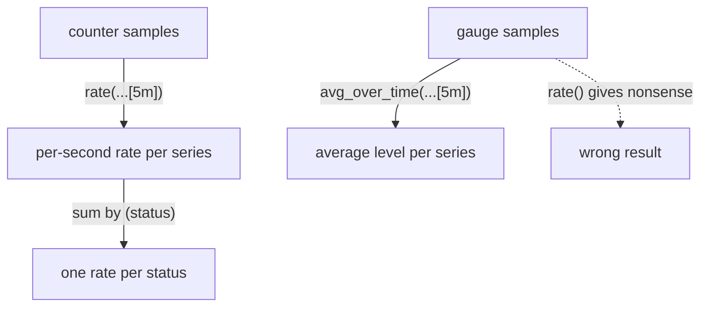

# Counters, Gauges And rate()

A request total that only grows tells you little about now. What an operator wants is a speed: requests per second, errors per second. PromQL gets there with `rate()`, but only if the metric is the right type. This part reads the types in `scout`'s own metrics, turns a counter into a rate, and shows what goes wrong when `rate()` meets a value of the wrong kind.

## The metric types in scout

Every metric has a type, and the program that serves it declares the type in a `# TYPE` line. Look at the types `scout` declares for its own HTTP metrics, leaving out the many Go runtime metrics:

<!-- astrona:playground:renew -->

```sh
kubectl -n starfleet exec deploy/shuttle -- curl -s http://scout.starfleet:9898/metrics | grep '^# TYPE http_'
```

You should see:

```text
# TYPE http_request_duration_seconds histogram
# TYPE http_requests_total counter
```

The three types you need for this module are these:

- A **counter** only goes up, and goes back to zero when the process restarts. `http_requests_total` counts every answered request. By convention, counter names end in `_total`.
- A **gauge** goes up and down and shows a current level. `go_goroutines`, the number of goroutines the Go program is running right now, is a gauge.
- A **histogram** counts observations into buckets by size. `http_request_duration_seconds` records how long each request took, and Prometheus stores it as several counters: `_bucket` (one per upper bound `le`), `_sum` and `_count`.

## From a total to a rate

`rate()` takes a range vector of a counter and returns its average increase per second over that window. It also handles counter resets: when the value drops because a pod restarted, `rate()` treats the drop as a restart instead of a negative change.

```sh
promql 'rate(http_requests_total{namespace="starfleet"}[5m])'
```

You should see something like:

```text
container=scout,endpoint=http,instance=10.244.0.9:9898,job=scout,namespace=starfleet,pod=scout-674cfb4855-4fbxc,service=scout,status=200	0.6771929824561402
container=scout,endpoint=http,instance=10.244.0.9:9898,job=scout,namespace=starfleet,pod=scout-674cfb4855-4fbxc,service=scout,status=500	0.10526315789473684
container=scout,endpoint=http,instance=10.244.0.10:9898,job=scout,namespace=starfleet,pod=scout-674cfb4855-qb8fj,service=scout,status=200	0.6491228070175438
container=scout,endpoint=http,instance=10.244.0.10:9898,job=scout,namespace=starfleet,pod=scout-674cfb4855-qb8fj,service=scout,status=500	0.07017543859649122
```

The same four series now hold requests per second, averaged over the last five minutes. The two `500` series add up to about `0.18`: the traffic loop sends one failing request every five seconds, `0.2` per second, and the result is close to that because the window started before the loop had filled it. The metric name is gone from the result, because the value is no longer the counter itself.

`increase()` is the same calculation multiplied by the window: the total growth over the range. `increase(x[5m])` is `rate(x[5m]) * 300`, which reads better in a report ("53 failed requests in the last five minutes"):

```sh
promql 'increase(http_requests_total{namespace="starfleet", status="500"}[5m])'
```

You should see something like:

```text
container=scout,endpoint=http,instance=10.244.0.9:9898,job=scout,namespace=starfleet,pod=scout-674cfb4855-4fbxc,service=scout,status=500	31.57894736842105
container=scout,endpoint=http,instance=10.244.0.10:9898,job=scout,namespace=starfleet,pod=scout-674cfb4855-qb8fj,service=scout,status=500	21.052631578947366
```

The values are not whole numbers, although requests come in whole numbers. Prometheus extrapolates from the samples at the edges of the window, so `rate()` and `increase()` are estimates. That is expected; do not round them in a query.

The range must hold at least two samples for `rate()` to return anything. With a 15-second scrape interval, `[1m]` holds four samples and `[5m]` about twenty. A common rule is a range of at least four times the scrape interval; `[5m]` is the usual choice for alerts and dashboards.

## Why rate() does not belong on a gauge

Nothing stops you from writing `rate()` around a gauge. Try it on `go_goroutines` through the raw API, so you also see what Prometheus says about it:

```sh
curl -s http://127.0.0.1:9090/api/v1/query \
  --data-urlencode 'query=rate(go_goroutines{namespace="starfleet"}[5m])' | jq '{status, infos}'
```

You should see:

```text
{
  "status": "success",
  "infos": [
    "PromQL info: metric might not be a counter, name does not end in _total/_sum/_count/_bucket: \"go_goroutines\" (1:6)"
  ]
}
```

The query succeeds and returns numbers such as `0.2175` for one pod. They mean nothing. A gauge goes down whenever goroutines finish, and `rate()` reads every drop as a counter reset, so it adds up rises and treats falls as restarts. Prometheus only notices because of the name, and it reports that as an `infos` note next to the result, not as an error. For a gauge, use the value itself, or functions made for levels, such as `avg_over_time()`, `max_over_time()` or `delta()`.



The diagram shows the path from raw counter samples through `rate()` to an aggregated value, and the separate path a gauge must take.

You can now tell the metric types apart from their `# TYPE` line and their name, turn a counter into a rate or an increase over a window, and avoid `rate()` on a gauge. The rates still come per pod and per status, though, and nobody wants four lines when they asked one question. The open question is how to combine series into the one number you need.

## Common pitfalls

> [!WARNING]
> - **Using `rate()` on a gauge.** The query works and returns numbers, but they are wrong. Watch for the `infos` note.
> - **Choosing a range shorter than two scrapes.** `rate(x[15s])` with a 15-second interval often returns nothing. Use at least four times the interval.
> - **Reading `increase()` as an exact count.** It is extrapolated from samples and is usually not a whole number.
> - **Wrapping a sum in `rate()`.** Take the rate first, then sum; summing counters first breaks the reset handling.
