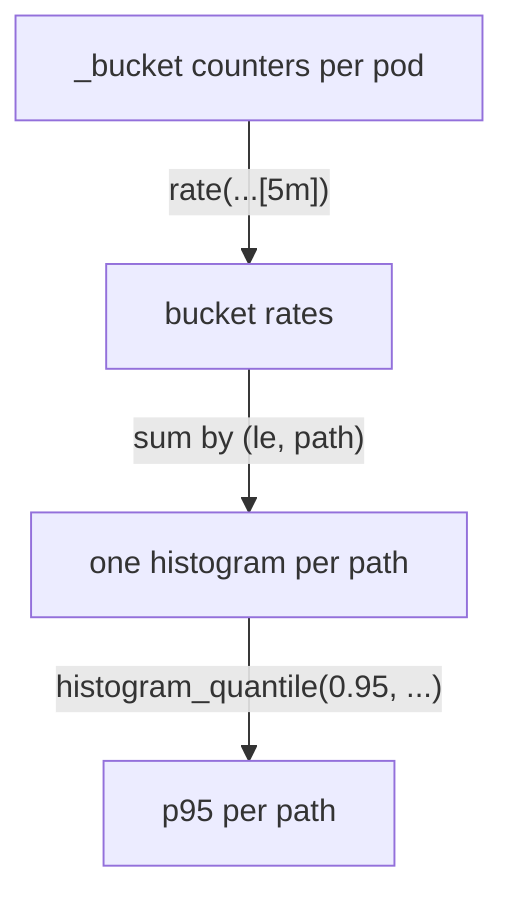

# Aggregation, Error Ratio And Latency

A rate per pod and per status code is too detailed for most questions. "How many requests per second does each namespace serve?" needs one number per namespace, and "what share of requests fail?" needs one number in total. This part combines series with aggregation operators, then builds the two queries that alerts and service level objectives reuse again and again: the error ratio and a latency percentile.

## Sum by and sum without

An **aggregation operator** combines many series into fewer. `sum`, `avg`, `min`, `max` and `count` work the same way, and each one takes a clause that says which labels survive. `by (...)` keeps only the labels you list; `without (...)` keeps every label except the ones you list.

Start with one rate per namespace:

<!-- astrona:playground:renew -->

```sh
promql 'sum by (namespace) (rate(http_requests_total[5m]))'
```

You should see something like:

```text
namespace=starfleet	1.501754385964912
namespace=outpost	1.0596491228070175
```

Every series of `http_requests_total`, from every pod and every status, was turned into a rate and then added up per namespace. `starfleet` serves more, because the traffic loop sends it extra failing and slow requests. A `sum` with no clause would return one number for everything.

Now split the `starfleet` traffic by status code:

```sh
promql 'sum by (status) (rate(http_requests_total{namespace="starfleet"}[5m]))'
```

You should see something like:

```text
status=200	1.326315789473684
status=500	0.17543859649122806
```

The same result with `without` keeps more context. Remove only the labels that differ per pod:

```sh
promql 'sum without (instance, pod) (rate(http_requests_total{namespace="starfleet"}[5m]))'
```

You should see something like:

```text
container=scout,endpoint=http,job=scout,namespace=starfleet,service=scout,status=200	1.326315789473684
container=scout,endpoint=http,job=scout,namespace=starfleet,service=scout,status=500	0.17543859649122806
```

The values are the same, but the result still carries `job`, `namespace` and `service`. Use `by` when you know exactly which labels you want in the answer, and `without` when you want to drop only the per-pod detail and keep everything else for a later filter or a dashboard legend.

## The error ratio

The **error ratio** is the share of requests that failed: failed requests per second divided by all requests per second. Both sides are sums of rates over the same window and the same selector, apart from the status filter:

```sh
promql 'sum(rate(http_requests_total{namespace="starfleet", status=~"5.."}[5m])) / sum(rate(http_requests_total{namespace="starfleet"}[5m]))'
```

You should see something like:

```text
	0.11682242990654207
```

About 11.7% of the `starfleet` `scout` requests fail. The line has no labels, which is why it starts with a tab: both `sum`s dropped every label, so the division returns one plain number. That is what you want for an alert threshold or a service level.

Division in PromQL matches series by their labels. If you write `sum by (namespace)` on one side and plain `sum` on the other, the label sets do not match and the result is empty. Keep the same `by (...)` on both sides, for example `sum by (namespace) (...) / sum by (namespace) (...)` for one ratio per namespace.

## A latency percentile from a histogram

An average latency hides the slow requests that users notice. A **percentile** answers the better question: "95% of requests were faster than how long?" Prometheus computes it from a histogram with `histogram_quantile()`. It needs the rate of the `_bucket` counters, summed with the `le` label kept, because `le` holds each bucket's upper bound:

```sh
promql 'histogram_quantile(0.95, sum by (le) (rate(http_request_duration_seconds_bucket{namespace="starfleet"}[5m])))'
```

You should see something like:

```text
	1.2653846153846122
```

Across all `starfleet` requests, 95% finished in about 1.27 seconds or less. Most requests take a few milliseconds, but `/delay/1` requests arrive at 0.1 per second out of about 1.5 per second, which is more than 5% of all requests. So the slowest 5% reach into the slow requests, and the 95th percentile lands above one second. Split it by path to see where the time goes; the `path` label comes from `scout` itself:

```sh
promql 'histogram_quantile(0.95, sum by (le, path) (rate(http_request_duration_seconds_bucket{namespace="starfleet"}[5m])))'
```

You should see something like:

```text
path=delay	2.425
path=metrics	0.004749999999999999
path=readyz	0.00475
path=root	0.00475
path=status	0.00475
```

The slow path is `delay`. Look at its value, though: `2.425` seconds, for requests that take one second. That is not a bug in `scout`. A histogram only knows how many observations fell into each bucket, and `scout`'s buckets jump from `1` to `2.5` seconds. Every `/delay/1` request takes a little over one second, so all of them land in the `1` to `2.5` bucket, and `histogram_quantile()` assumes they are spread evenly across it. The result is an estimate whose precision is set by the bucket bounds. The fast paths show the same effect at the other end: every fast request falls in the first bucket, which ends at `0.005` seconds, and `0.00475` is simply 95% of the way through it.



The diagram shows the order every percentile query follows: rate of the buckets, sum while keeping `le`, then the quantile.

You can now reduce any set of rates to the labels you need, compute an error ratio as one plain number, and get a latency percentile per path, while knowing it is only as precise as the buckets. The open question is how to use these queries outside the browser: in a script, a grader or the exam terminal.

## Common pitfalls

> [!WARNING]
> - **Dropping `le` before `histogram_quantile()`.** Without the `le` label the function has no buckets and returns nothing.
> - **Averaging percentiles.** The average of each pod's p95 is not the p95 of the service. Sum the bucket rates first, then take one quantile.
> - **Different label sets on the two sides of a division.** The result is empty. Use the same `by (...)` on both sides.
> - **Reading a percentile as an exact value.** It is interpolated inside a bucket; a value of `2.425` for one-second requests is a bucket artefact.
