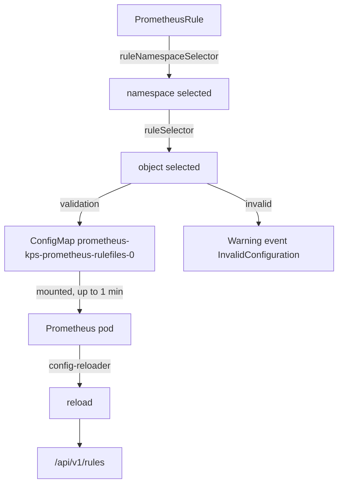

# Selecting And Loading PrometheusRules

A PrometheusRule can exist in Kubernetes and never reach Prometheus. `kubectl apply` only proves that the API server stored the object. Between that object and a rule Prometheus evaluates sit two selectors, a validation step, a generated ConfigMap and a reload, and a rule can drop out at each of them without any error in Prometheus. This part follows that path step by step, breaks it on purpose with a wrong label, and shows which command proves each step.

## The path from object to loaded rule

The Prometheus Operator is the component that turns PrometheusRule objects into files Prometheus reads. For the Prometheus resource `kps-prometheus` it does the following, in this order:

1. It lists the namespaces whose labels match `ruleNamespaceSelector`.
2. In those namespaces it lists the PrometheusRule objects whose `metadata.labels` match `ruleSelector`.
3. It validates each selected object: every rule group must parse, and every `expr` must be valid PromQL. A rejected object is skipped.
4. It writes each accepted object as one file, named `<namespace>-<name>-<uid>.yaml`, into the ConfigMap `prometheus-kps-prometheus-rulefiles-0` in `monitoring`, labelled `prometheus-name=kps-prometheus`.
5. The Prometheus pod mounts that ConfigMap under `/etc/prometheus/rules/prometheus-kps-prometheus-rulefiles-0/`. The kubelet refreshes a mounted ConfigMap on its own schedule, which is why a change takes up to about a minute to appear in the pod.
6. The `config-reloader` sidecar container watches that directory and asks Prometheus to reload. Prometheus re-reads its `rule_files` and starts evaluating the new groups.



The diagram shows the six steps a PrometheusRule passes before it appears in the rules API, and the only step that leaves a visible error.

Step 1 and step 2 are silent. An object that no selector matches is simply not part of the list, so there is no event, no log line and no error. Only step 3 complains. That is why the running rules API is the final proof, and why "the object exists" is never enough.

## Two selectors with different defaults

The two selectors read labels on different objects. `ruleNamespaceSelector` matches labels on **Namespace** objects. `ruleSelector` matches `metadata.labels` on **PrometheusRule** objects in the namespaces that passed the first test. Neither reads the `labels` inside a rule; those become alert labels and play no part in selection.

Both fields are optional, and an empty selector and a missing selector mean different things:

| Field on the Prometheus resource | Empty object `{}` | Omitted (null) |
| --- | --- | --- |
| `ruleNamespaceSelector` | Every namespace | Only the namespace of the Prometheus resource |
| `ruleSelector` | Every PrometheusRule in the selected namespaces | No PrometheusRule at all |

The Helm chart adds one more layer. kube-prometheus-stack has the value `ruleSelectorNilUsesHelmValues: true` by default, so an empty `ruleSelector` in its values is rendered as a selector on the chart's release label, `release: kps` here. That is why the live Prometheus resource shows `ruleNamespaceSelector: {}` (every namespace) next to a `ruleSelector` on `release: kps`, and why the chart values alone do not tell you what the server selects. Every PrometheusRule in this module must carry that label.

## A rule with the wrong label

<!-- astrona:playground:renew -->

Save this as `prometheusrule-scout-selector.yaml`:

```yaml
apiVersion: monitoring.coreos.com/v1
kind: PrometheusRule
metadata:
  name: scout-selector
  namespace: starfleet
  labels:
    release: outpost
spec:
  groups:
    - name: scout-selector
      rules:
        - alert: ScoutSelectorCheck
          expr: up{namespace="starfleet",job="scout"} == 0
          for: 1m
          labels:
            severity: warning
```

The label `release: outpost` is wrong on purpose. The expression alerts when a scrape of `scout` fails, so with healthy targets the rule stays inactive once it is loaded. The object itself is valid.

Apply it:

```sh
kubectl apply -f prometheusrule-scout-selector.yaml
```

Then check each step of the path. The object exists, its label is visible, and Prometheus has nothing:

```sh
kubectl -n starfleet get prometheusrule scout-selector --show-labels
kubectl -n starfleet describe prometheusrule scout-selector | tail -n 3
curl -s http://127.0.0.1:9090/api/v1/rules | jq '[.data.groups[].rules[] | select(.name == "ScoutSelectorCheck")]'
```

`get` prints the object with `release=outpost` in its labels. `describe` ends with `Events: <none>`: the operator was never asked to load this object, so it has nothing to report. The rules query prints `[]`, an empty list, even after a minute. The object is a valid Kubernetes object that no selector matches, and that is all the cluster can tell you.

Fix the object, not the selector:

```sh
kubectl -n starfleet label prometheusrule scout-selector release=kps --overwrite
```

Widening `ruleSelector` would also work, but it would make every PrometheusRule in the cluster part of this Prometheus, including ones other teams wrote for another server. Wait about a minute and read the group from the rules API, with the file it was loaded from:

```sh
curl -s http://127.0.0.1:9090/api/v1/rules | jq '.data.groups[] | select(.name == "scout-selector") | {file, lastEvaluation, rules: [.rules[] | {name, health, state}]}'
```

The group now exists. Its `file` is a path under `/etc/prometheus/rules/prometheus-kps-prometheus-rulefiles-0/` that ends in `starfleet-scout-selector-<uid>.yaml`, `lastEvaluation` is a recent time, and the rule shows `health: ok` and `state: inactive`. Inactive is the correct state here: the rule is loaded and evaluated, and its condition is false. The list of generated ConfigMaps confirms where the file lives:

```sh
kubectl -n monitoring get configmaps -l prometheus-name=kps-prometheus
```

One ConfigMap, `prometheus-kps-prometheus-rulefiles-0`, holds every selected PrometheusRule as one key each. A second one appears only when the files outgrow the size limit of a ConfigMap.

## A selected rule that is rejected

Selection is not the last gate. The operator also validates each selected object, and in this playground the chart installs the operator's validating admission webhook, `prometheusrulevalidate.monitoring.coreos.com`, which runs that same validation before the API server stores the object. Test it: edit `prometheusrule-scout-selector.yaml`, change the label to `release: kps` and cut the expression short so it reads `up{namespace="starfleet",job="scout"} ==`, then apply the file again.

`kubectl apply` fails. The error names the webhook and says the expression could not be parsed, and the object in the cluster stays as it was. If a cluster runs the operator without that webhook, the object is stored and the operator rejects it when it selects it: `kubectl -n starfleet describe prometheusrule scout-selector` then shows a `Warning` event with the reason `InvalidConfiguration` and a message that starts with `PrometheusRule scout-selector was rejected due to invalid configuration`, the operator log (`kubectl -n monitoring logs deploy/kps-operator`) has a line `skipping prometheusrule`, and the whole object disappears from the rules API, not only the broken rule. Put the full expression back and apply the file again.

A third kind of failure happens after loading. A rule that parses but fails at evaluation time, for example because a function gets the wrong argument type, is loaded and shows `health: err` in the rules API, with the message in `lastError`. The three failure modes leave their evidence in three different places: no evidence at all for a selector mismatch, an event or a refused `apply` for invalid configuration, and `health` and `lastError` for an evaluation error.

You can now follow a PrometheusRule from `kubectl apply` through both selectors, validation, the generated ConfigMap and the reload, and you know which command proves each step. The scout rules are loaded and healthy, and the alert has never fired. The open question is what happens between "the condition is true" and "someone is told".

## Common pitfalls

> [!WARNING]
> - **Labelling the rule instead of the object.** `spec.groups[].rules[].labels` become alert labels; selection reads `metadata.labels` on the PrometheusRule.
> - **Treating `{}` and a missing selector as the same.** An empty `ruleSelector` selects everything; a missing one selects nothing. The chart renders a release-label selector for both.
> - **Reading `Events: <none>` as "fine".** A selector mismatch produces no event. Only the rules API proves loading.
> - **Widening the Prometheus selector to fix one object.** Correct the object's label and keep the server's boundary.
