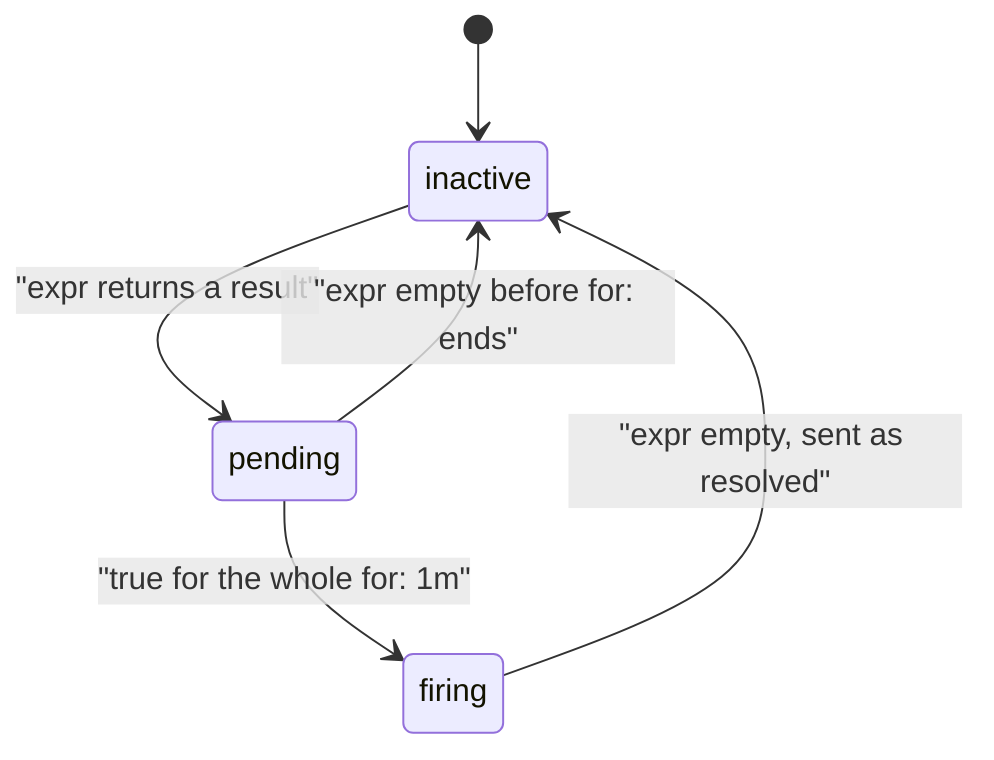

# The Alert Lifecycle

An alert does not jump from "fine" to "paging". It moves through states, and each state answers a different question: is the condition true right now, has it been true long enough, and is it over? Reading those states is how you tell a slow alert from a broken one. This part causes real errors in `scout` and follows `ScoutHighErrorRatio` through every state.

## The states

Prometheus evaluates the alerting rule on every group interval, here every 15 seconds, and keeps one state per alert:

- **inactive**: the expression returns nothing. Nothing is sent.
- **pending**: the expression returns a result, but for less time than `for`. Prometheus records when it started (`activeAt`) and waits.
- **firing**: the expression has returned a result for at least `for`. Prometheus sends the alert to Alertmanager, again on every evaluation while it stays true.
- **resolved**: the expression stopped returning a result after the alert fired. Prometheus tells Alertmanager the alert ended, and the alert drops back to inactive.



The diagram shows the three states Prometheus keeps and the condition that moves an alert from one to the next; the move from firing back to inactive is what Alertmanager reports as resolved.

## Cause errors

You need a steady stream of `500` answers. In a new terminal, start a loop in the `shuttle` pod that requests `/status/500` once per second for ten minutes. It keeps running in that terminal; leave it open:

<!-- astrona:playground:renew -->

```sh
kubectl -n starfleet exec deploy/shuttle -- sh -c 'for i in $(seq 1 600); do curl -s -o /dev/null http://scout.starfleet:9898/status/500; sleep 1; done'
```

Together with the normal traffic of one request per second, roughly every other request now fails. The loop stops on its own after ten minutes. In your first terminal, with the port-forward to Prometheus on `9090` still running, paste a helper that prints the alerts Prometheus currently holds, with their state, the time they became active and the value of the expression:

```sh
show_alerts() {
  curl -s http://127.0.0.1:9090/api/v1/alerts |
    jq -r '.data.alerts[] | "\(.labels.alertname)\t\(.state)\t\(.activeAt)\t\(.value)"'
}
```

Run `show_alerts` and `promql 'namespace:http_requests_error_ratio:rate1m'` every 20 seconds or so for two minutes.

## Watch the alert move

Here are five readings taken 20 seconds apart in the playground, starting when the error loop began (each reading shows `show_alerts`, then the recorded ratio):

```text
== +20s
== +40s
ScoutHighErrorRatio	pending	2026-10-10T16:17:10.604180701Z	2.568030391801051e-01
starfleet	0.2568030391801051
== +60s
ScoutHighErrorRatio	pending	2026-10-10T16:17:10.604180701Z	3.6225944879974215e-01
starfleet	0.36225944879974215
== +80s
ScoutHighErrorRatio	pending	2026-10-10T16:17:10.604180701Z	4.326923076923077e-01
starfleet	0.4326923076923077
== +100s
ScoutHighErrorRatio	firing	2026-10-10T16:17:10.604180701Z	4.2452830188679247e-01
starfleet	0.42452830188679247
```

At 20 seconds nothing has changed yet: the next scrape and the next rule evaluation have not both happened. By 40 seconds the recorded ratio exists, at about 26%, and the alert is `pending` with an `activeAt` time. It stays `pending` while the ratio climbs, because `for: 1m` has not passed. About one minute after `activeAt`, the alert is `firing`. The ratio settles a little above 40%, because the one-minute rate is now filled with the new mix of traffic.

Add the delays up and the alert fired about 100 seconds after the errors started: up to 15 seconds for the next scrape, up to 15 seconds for the next rule evaluation, then one full minute of `for`. That is the normal delay, not a fault. When an alert seems "late", add the scrape interval, the evaluation interval and `for` before you look for a bug.

## Firing is not notifying

A firing alert in Prometheus has not reached a person yet. Prometheus sends it to Alertmanager, and Alertmanager decides what to do. Look at the alert from Alertmanager's side. Start a second port-forward, to Alertmanager, in another terminal and leave it running:

```sh
kubectl -n monitoring port-forward svc/kps-alertmanager 9093:9093
```

Then ask Alertmanager's API which alerts it holds and which receivers they go to:

```sh
curl -s http://127.0.0.1:9093/api/v2/alerts |
  jq -r '.[] | "\(.labels.alertname)\t\(.status.state)\t\(.receivers | map(.name) | join(","))\t\(.labels | to_entries | map("\(.key)=\(.value)") | join(","))"'
```

You should see something like:

```text
ScoutHighErrorRatio	active	null	alertname=ScoutHighErrorRatio,namespace=starfleet,prometheus=monitoring/kps-prometheus,severity=warning,team=starfleet
```

Alertmanager has the alert, in its own state `active`, with every label from the rule plus `prometheus`, which names the Prometheus that sent it. The receiver is `null`, the one that does nothing, so no notification went anywhere. The page `http://127.0.0.1:9093` shows the same alert in a browser.

You can now read an alert's state in Prometheus, explain the delay between the first error and `firing`, and check whether Alertmanager received it and where it would send it. The alert is firing and reaching nobody. The open question is how to route it to a receiver that someone actually reads.

## Common pitfalls

> [!WARNING]
> - **Treating `pending` as broken.** It means the condition is true and `for` has not passed yet.
> - **Checking only Prometheus.** A `firing` alert can still go to a receiver that does nothing; check Alertmanager's view too.
> - **Expecting an alert seconds after the problem starts.** Scrape interval, evaluation interval and `for` add up.
> - **Mixing the two state names.** Prometheus says `firing`; Alertmanager says `active` (or `suppressed` when silenced).
