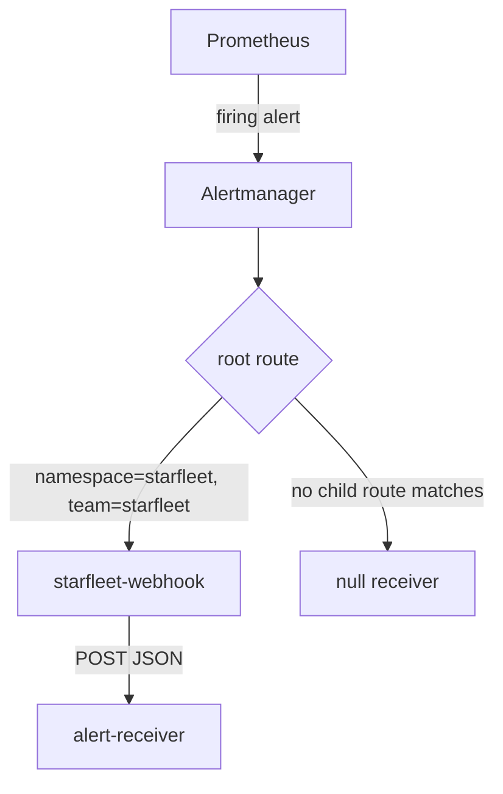

# Routing Alerts With Alertmanager

An alert that reaches no one is the same as no alert. Alertmanager decides where each alert goes by matching its labels against a tree of routes, and it groups alerts so that one incident sends one message instead of fifty. This part sends `ScoutHighErrorRatio` to the webhook receiver with an AlertmanagerConfig, and reads the configuration the operator generates from it, including one matcher you did not write.

## How Alertmanager routes

**Alertmanager** is the component that receives alerts from Prometheus, groups them, silences them and sends notifications. Its configuration is a **routing tree**. The root route catches every alert and names a default receiver. Child routes have **matchers** on alert labels; an alert walks down the tree and goes to the first child route whose matchers all match, unless that route sets `continue: true`, in which case later siblings are checked too. A **receiver** is a named place a notification goes: a webhook, an email address, a chat channel.

Each route also controls timing:

- `group_by` lists the labels that put alerts into the same notification. Alerts with the same values for those labels are sent together.
- `group_wait` is how long Alertmanager waits after the first alert of a new group, so related alerts can join before the first message goes out.
- `group_interval` is how long it waits before sending an update about a group that changed.
- `repeat_interval` is how long it waits before sending the same, unchanged group again.



The diagram shows a firing alert entering Alertmanager, matching the child route for `starfleet` on its labels, and being posted to the webhook, while unmatched alerts fall through to the root's `null` receiver.

## Write an AlertmanagerConfig

An **AlertmanagerConfig** is the Prometheus Operator's resource for a piece of Alertmanager routing that a team owns: a route and the receivers it uses, kept in the team's own namespace. The operator merges every selected AlertmanagerConfig into the running Alertmanager configuration as a child of the root route. In this playground, the Alertmanager resource selects every AlertmanagerConfig in every namespace (both its `alertmanagerConfigSelector` and `alertmanagerConfigNamespaceSelector` are empty), so no label is needed.

<!-- astrona:playground:renew -->

Save this as `alertmanagerconfig-starfleet.yaml`:

```yaml
apiVersion: monitoring.coreos.com/v1alpha1
kind: AlertmanagerConfig
metadata:
  name: starfleet
  namespace: starfleet
spec:
  route:
    receiver: starfleet-webhook
    matchers:
      - name: team
        value: starfleet
        matchType: "="
    groupBy: ["alertname"]
    groupWait: 10s
    groupInterval: 1m
    repeatInterval: 5m
  receivers:
    - name: starfleet-webhook
      webhookConfigs:
        - url: http://alert-receiver.monitoring:8080/
          sendResolved: true
```

The route sends alerts with `team="starfleet"` to the receiver `starfleet-webhook`, grouped by alert name. The timings are short so you can watch them in the playground; real values are usually longer. The receiver posts each notification as JSON to the `alert-receiver` Service, and `sendResolved: true` also posts when the alert ends.

Apply it:

```sh
kubectl apply -f alertmanagerconfig-starfleet.yaml
```

## Read what the operator generated

Like every operator change, this one reaches the running Alertmanager through a mounted Secret, so wait about a minute. Then print the routing part of the running configuration, with the Alertmanager port-forward on `9093` still running:

```sh
curl -s http://127.0.0.1:9093/api/v2/status | jq -r .config.original | sed -n '/^route:/,/^inhibit_rules:/p'
```

You should see:

```text
route:
  receiver: "null"
  group_by:
  - namespace
  continue: false
  routes:
  - receiver: starfleet/starfleet/starfleet-webhook
    group_by:
    - alertname
    matchers:
    - namespace="starfleet"
    - team="starfleet"
    continue: true
    group_wait: 10s
    group_interval: 1m
    repeat_interval: 5m
  - receiver: "null"
    matchers:
    - alertname="Watchdog"
    continue: false
  group_wait: 30s
  group_interval: 5m
  repeat_interval: 12h
inhibit_rules:
```

Your route is now the first child of the root, and the operator changed it in three ways:

- **It added the matcher `namespace="starfleet"`.** An AlertmanagerConfig in a namespace only receives alerts whose `namespace` label equals that namespace. This keeps one team's configuration from catching another team's alerts. An alerting rule whose expression drops the `namespace` label produces alerts this route can never match.
- **It renamed the receiver** to `<namespace>/<AlertmanagerConfig name>/<receiver name>`, so receivers from different teams cannot collide.
- **It set `continue: true`**, so alerts also keep walking the rest of the tree.

## See the notification arrive

Check where Alertmanager now sends the firing alert, and what the webhook received. The error loop must still be running, so the alert is still firing:

```sh
curl -s http://127.0.0.1:9093/api/v2/alerts | jq -r '.[] | "\(.labels.alertname)\t\(.status.state)\t\(.receivers | map(.name) | join(","))"'
kubectl -n monitoring logs deploy/alert-receiver
```

You should see something like:

```text
ScoutHighErrorRatio	active	starfleet/starfleet/starfleet-webhook
starfleet/starfleet/starfleet-webhook firing ScoutHighErrorRatio namespace=starfleet severity=warning startsAt=2026-10-10T16:18:10.604Z
```

The alert now goes to `starfleet/starfleet/starfleet-webhook`, and the receiver printed one notification: the receiver name, the status `firing`, the alert name, its labels and the time it started. Alertmanager also counts what it sends: `curl -s http://127.0.0.1:9093/metrics | grep -E '^alertmanager_notifications_total\{.*webhook'` prints `alertmanager_notifications_total{integration="webhook"} 1`.

You can now route alerts by label to a receiver with an AlertmanagerConfig, read the merged routing tree, and prove delivery from the receiver's side. You also know the namespace matcher the operator adds. The open question is the opposite need: keeping a known alert quiet while someone works on it.

## Common pitfalls

> [!WARNING]
> - **Forgetting the injected namespace matcher.** An AlertmanagerConfig in `monitoring` will not route alerts from `starfleet`, whatever its own matchers say.
> - **Matching on a label the rule does not set.** Routes can only match labels the alert carries; check them in `/api/v2/alerts`.
> - **Expecting the change at once.** The new route reaches Alertmanager through a mounted Secret; give it about a minute.
> - **Using `groupWait`, `groupInterval` and `repeatInterval` from a demo in production.** Very short values send many messages for one incident.
