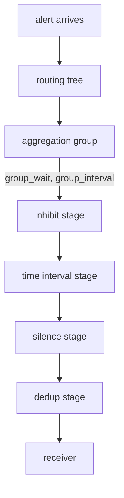

# Silences

Some alerts are true and still unwanted. During planned maintenance, or while someone already works on the problem, every new notification only adds noise. Deleting or editing the alerting rule would hide the problem for everyone and is easy to forget to undo. Alertmanager has a cleaner tool: a **silence** mutes matching alerts for a fixed time and leaves Prometheus untouched. This part silences `ScoutHighErrorRatio`, proves from the receiver that no notification goes out, and lets the silence end.

## Where a silence acts

A silence is a set of label matchers plus a start time, an end time, an author and a comment. While it is active, Alertmanager still receives and tracks matching alerts, but sends no notifications for them. It does not touch Prometheus: the alert keeps `firing` there, and Prometheus keeps re-sending it.

To see what "sends no notifications" means, follow one alert through Alertmanager. Every alert that arrives is matched against the routing tree, which picks a receiver. Alerts for the same receiver with the same `group_by` values form an aggregation group, and the group waits `group_wait` before its first flush. At each flush the group's alerts run through a pipeline of stages for that receiver, and only the alerts that survive every stage reach the webhook.



The diagram shows the order of the stages one flush passes through; an alert a silence matches is removed at the silence stage, after inhibition and before deduplication.

Two consequences follow from that order. A silence never cancels a notification that already left, so a silence added five seconds after a flush arrives too late for that flush. And the stages run per receiver, so silencing one alert mutes it for every receiver at once; there is no silence "for one route".

## Add a silence

`amtool` is Alertmanager's command-line tool, and it is part of the Alertmanager container image, so you can run it inside the Alertmanager pod. The error loop from earlier must still be running, so the alert is still firing. Add a silence for 30 minutes:

<!-- astrona:playground:renew -->

```sh
kubectl -n monitoring exec alertmanager-kps-alertmanager-0 -c alertmanager -- \
  amtool silence add alertname=ScoutHighErrorRatio namespace=starfleet \
  --duration=30m --author=platform --comment="known issue, fix in progress" \
  --alertmanager.url=http://localhost:9093
```

`amtool` prints the ID of the new silence:

```text
f82ebb4a-42a4-4e4b-896b-168680df659d
```

Your ID will differ; keep it, you need it to end the silence. List the active silences to check the matchers and the end time:

```sh
kubectl -n monitoring exec alertmanager-kps-alertmanager-0 -c alertmanager -- \
  amtool silence query --alertmanager.url=http://localhost:9093
```

You should see something like:

```text
ID                                    Matchers                                               Ends At                  Created By  Comment
f82ebb4a-42a4-4e4b-896b-168680df659d  alertname="ScoutHighErrorRatio" namespace="starfleet"  2026-10-10 16:50:05 UTC  platform    known issue, fix in progress
```

Every matcher of a silence must match for the silence to apply, so a second matcher narrows it. Match on more than the alert name: `namespace=starfleet` keeps the silence from muting the same alert for other teams. The browser page at `http://127.0.0.1:9093` has a form for the same thing.

`amtool` sent an HTTP `POST` to `/api/v2/silences`. Alertmanager stores the silence in its data directory, not in a Kubernetes object, and the same API lists it with its state:

```sh
curl -s http://127.0.0.1:9093/api/v2/silences | jq '.[] | {id, matchers, startsAt, endsAt, createdBy, comment, status}'
```

The silence shows `status.state: active`. A silence has three states: `pending` before its `startsAt`, `active` between `startsAt` and `endsAt`, and `expired` after `endsAt` or after someone expires it by hand. `amtool silence query` lists only active ones unless you pass `--expired`. In this playground the data directory is an `emptyDir` volume, so silences survive a container restart but not a replacement of the pod; a production Alertmanager uses a persistent volume for the same reason.

## Prove the silence works

First, check the alert's state in Alertmanager, with the Alertmanager port-forward on `9093` still running:

```sh
curl -s http://127.0.0.1:9093/api/v2/alerts | jq -r '.[] | "\(.labels.alertname)\t\(.status.state)\t\(.status.silencedBy | join(","))"'
```

You should see something like:

```text
ScoutHighErrorRatio	suppressed	f82ebb4a-42a4-4e4b-896b-168680df659d
```

The state changed from `active` to `suppressed`, and `silencedBy` names the silence. `amtool alert query` hides suppressed alerts by default; add `--silenced` to list them.

A state is not the proof, though. The proof is that no notification goes out. The route's `repeatInterval` is five minutes, so without the silence the receiver would get the same firing alert again about five minutes after the first notification. Wait a little longer than that, then read the receiver's log and the notification counter:

```sh
kubectl -n monitoring logs deploy/alert-receiver
curl -s http://127.0.0.1:9093/metrics | grep -E '^alertmanager_notifications_total\{.*webhook'
```

You should see something like:

```text
starfleet/starfleet/starfleet-webhook firing ScoutHighErrorRatio namespace=starfleet severity=warning startsAt=2026-10-10T16:18:10.604Z
alertmanager_notifications_total{integration="webhook"} 1
```

Still one notification after more than five minutes, while the alert kept firing in Prometheus the whole time. The silence held.

## End the silence

A silence ends on its own at its end time. To end it earlier, expire it by ID:

```sh
kubectl -n monitoring exec alertmanager-kps-alertmanager-0 -c alertmanager -- \
  amtool silence expire <SILENCE-ID> --alertmanager.url=http://localhost:9093
```

Replace `<SILENCE-ID>` with the ID `amtool silence add` printed. Expiring sets `endsAt` to now; the silence stays in the list as `expired` and cannot be made active again, so a new maintenance window needs a new silence. Then let the error loop finish; it stops on its own after ten minutes. Pressing `Ctrl+C` in its terminal stops your local `kubectl`, but not always the loop inside the pod, so waiting is the reliable way. Wait until a few minutes after the loop has ended, and read the receiver's log again:

```sh
kubectl -n monitoring logs deploy/alert-receiver
```

You should see something like:

```text
starfleet/starfleet/starfleet-webhook firing ScoutHighErrorRatio namespace=starfleet severity=warning startsAt=2026-10-10T16:18:10.604Z
starfleet/starfleet/starfleet-webhook firing ScoutHighErrorRatio namespace=starfleet severity=warning startsAt=2026-10-10T16:18:10.604Z
starfleet/starfleet/starfleet-webhook resolved ScoutHighErrorRatio namespace=starfleet severity=warning startsAt=2026-10-10T16:18:10.604Z
```

Two new lines arrived. As soon as the silence expired, the alert was still firing and its repeat interval had long passed, so Alertmanager sent it again at the next flush. When the loop ended, the one-minute error ratio dropped below 5%, the alert left `firing` in Prometheus, and Alertmanager sent `resolved`, because the receiver has `sendResolved: true`. Expiring a silence while the problem still exists brings the notifications straight back.

You can now mute an alert for a planned window with a silence, read its state from the API, prove from the receiver and the counter that nothing was sent, and end the silence early. A silence is a decision a person makes and dates. The open question is how Alertmanager mutes an alert on its own, when another alert already says the same thing.

## Common pitfalls

> [!WARNING]
> - **Silencing with only `alertname`.** The silence then mutes the alert for every namespace and team.
> - **Deleting or editing the rule instead of silencing.** The problem disappears for everyone, with no end time and no comment.
> - **Expecting a silence to change Prometheus.** The alert keeps `firing` there; only Alertmanager stops notifying.
> - **Expiring a silence while the problem still exists.** The next notification goes out right away.
> - **Expecting a silence to recall a notification.** It acts at the silence stage of the next flush; what already left stays sent.
