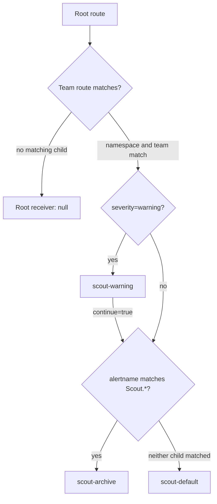

# Route Precedence And Configuration Merging

An alert can match the right team and still reach an unexpected receiver. Alertmanager checks routes in order, inherits settings from parent routes and can select several receivers. The Prometheus Operator also changes team routes while merging them. Inspect the generated configuration before assuming that the resource you applied is the configuration Alertmanager runs.

<!-- astrona:playground:renew -->

Save this as `alertmanagerconfig-scout-decisions.yaml`:

```yaml
apiVersion: monitoring.coreos.com/v1alpha1
kind: AlertmanagerConfig
metadata:
  name: scout-decisions
  namespace: starfleet
spec:
  route:
    receiver: scout-default
    matchers:
      - name: team
        value: scout
        matchType: "="
    groupBy: [namespace, alertname]
    groupWait: 10s
    groupInterval: 1m
    repeatInterval: 5m
    routes:
      - receiver: scout-warning
        matchers:
          - name: severity
            value: warning
            matchType: "="
        continue: true
      - receiver: scout-archive
        matchers:
          - name: alertname
            value: Scout.*
            matchType: "=~"
  receivers:
    - name: scout-default
      webhookConfigs:
        - url: http://alert-receiver.monitoring:8080/
    - name: scout-warning
      webhookConfigs:
        - url: http://alert-receiver.monitoring:8080/
    - name: scout-archive
      webhookConfigs:
        - url: http://alert-receiver.monitoring:8080/
```

A **route** is a node that matches alert labels and chooses receivers or child routes. A **receiver** is a named notification destination. These three receivers use the same webhook, a server that accepts an HTTP (Hypertext Transfer Protocol) request, so its logs let you compare the selected receiver names. The diagnostic alert `ScoutEvaluationCheck` has `namespace=starfleet`, `team=scout` and `severity=warning`; keep its rule applied while trying this route.

Apply it:

```sh
kubectl apply -f alertmanagerconfig-scout-decisions.yaml
```

Then check the result through the Alertmanager application programming interface (API):

```sh
kubectl get --raw '/api/v1/namespaces/monitoring/services/kps-alertmanager:9093/proxy/api/v2/status' | jq -r '.config.original'
kubectl get --raw '/api/v1/namespaces/monitoring/services/kps-alertmanager:9093/proxy/api/v2/alerts' | jq '.[] | select(.labels.team == "scout") | {labels, receivers, status}'
kubectl -n monitoring logs deploy/alert-receiver
```

Look for receivers named `starfleet/scout-decisions/scout-warning` and `starfleet/scout-decisions/scout-archive`. The API shows assignments; the receiver log proves that requests arrived. Give configuration propagation, rule evaluation and the first group wait time to complete.

## Follow the route tree

An alert enters the root route, which must accept every alert. Each child requires all its matchers to match. If none of a node's children match, that node handles the alert with its receiver. If a child matches, Alertmanager descends into it; the parent receiver is not an extra destination.



The diagram shows the example's matching decisions. If the warning child matched but the archive child did not, only the warning receiver handles the alert; the parent fallback applies only when no child matched.

`continue: true` on the warning route lets Alertmanager test its later sibling after handling the matching warning route. With `continue: false`, matching stops at that sibling level. It does not mean that Alertmanager returns to the root and starts over. A broad child placed before a specific child can hide that specific route unless the broad child continues.

## Grouping and timing

A **notification group** combines alerts with the same values for `group_by` labels on the selected route. Here two alert instances for different Pods can share a group because the route groups by namespace and alert name. Labels that are not in `group_by` still exist on the alerts; grouping does not remove them.

The custom resource uses camel case fields. The operator renders their native Alertmanager equivalents:

| AlertmanagerConfig field | Generated field | Effect |
| --- | --- | --- |
| `groupBy` | `group_by` | Labels that identify a notification group |
| `groupWait` | `group_wait` | Initial wait for a new group |
| `groupInterval` | `group_interval` | Interval for checking group changes after the initial wait |
| `repeatInterval` | `repeat_interval` | Time before resending an unchanged notification |

Child routes inherit omitted timing and grouping settings from their parent. The initial `group_wait` can collect related alerts and allow inhibition to take effect before a message. If an alert resolves before that wait ends, it need not notify. Afterward, group changes are sent on the `group_interval` schedule. Alertmanager checks whether a repeat is due on that schedule too, so use a `repeat_interval` that is a multiple of `group_interval`.

## What the operator adds

The Alertmanager resource's `alertmanagerConfigNamespaceSelector` selects namespaces and `alertmanagerConfigSelector` selects the objects. Inspect both selectors and the namespace matcher strategy:

```sh
kubectl -n monitoring get alertmanager kps-alertmanager -o json | jq '.spec | {alertmanagerConfigNamespaceSelector, alertmanagerConfigSelector, alertmanagerConfigMatcherStrategy}'
```

In this playground, empty selectors select every AlertmanagerConfig in every namespace. The default namespace strategy adds `namespace="starfleet"` to the top route of this resource and forces that top route to continue to later routes. Nested routes retain their own continuation behavior. Receiver names gain the namespace and object name to keep different teams' names distinct.

The operator merges these routes into the generated configuration and adds the receivers and inhibition rules. Alertmanager then loads that configuration. Namespace scoping is a default behavior of selected team resources, not an unconditional property of all Alertmanager configurations: an administrator can change `alertmanagerConfigMatcherStrategy`, and a global configuration has different scope. Keep the playground's strategy unchanged and preserve `namespace` in alert expressions.

You can now predict which receivers a route tree selects, why a parent fallback stays unused and when notifications are sent. Reading the loaded configuration also exposes the operator's namespace matcher and renamed receivers, which the original custom resource does not show.

## Common pitfalls

> [!WARNING]
> - **Treating matchers as alternatives.** All matchers on one route must match; use sibling routes for separate cases.
> - **Expecting the parent receiver as well.** A matching child takes responsibility unless other matching siblings also handle the alert.
> - **Confusing team scope with discovery scope.** Selecting objects from all namespaces does not remove their injected namespace matchers.
