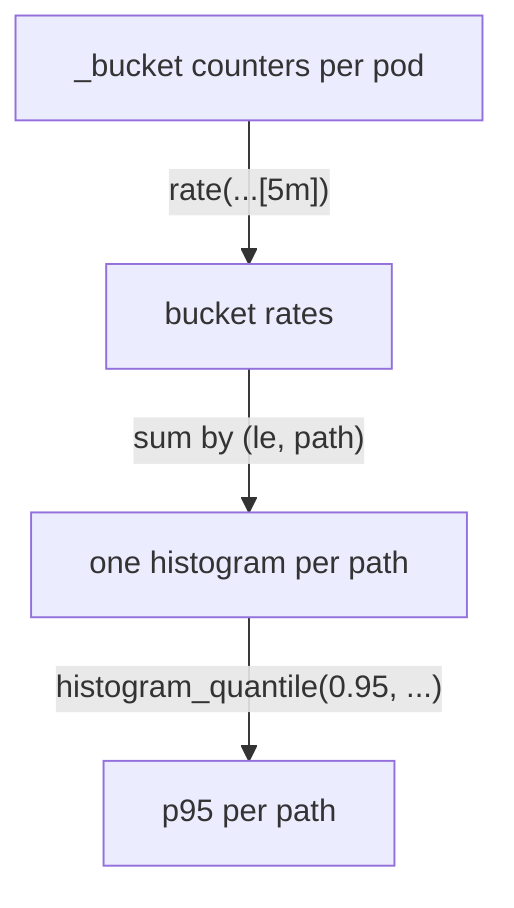

# Calculate A Latency Percentile

The `scout` histogram counts requests in cumulative duration buckets. To estimate the 95th percentile, convert each bucket counter to a rate, keep the `le` bucket boundary while aggregating, and pass the result to `histogram_quantile()`.

## Read the histogram


An average latency hides the slow requests that users notice. A **percentile** answers the better question: "95% of requests were faster than how long?" Prometheus computes it from a histogram with `histogram_quantile()`. It needs the rate of the `_bucket` counters, summed with the `le` label kept, because `le` holds each bucket's upper bound:

Forward Prometheus in another terminal, then define the query helper in your working terminal.

<!-- astrona:playground:renew -->

```sh
kubectl -n monitoring port-forward svc/kps-prometheus 9090:9090
```

```sh
promql() {
  curl -fsSG http://127.0.0.1:9090/api/v1/query --data-urlencode "query=$1" |
    jq -r '.data.result[] | "\(.metric | del(.__name__) | to_entries | map("\(.key)=\(.value)") | join(","))\t\(.value[1])"'
}
```

```sh
promql 'histogram_quantile(0.95, sum by (le) (rate(http_request_duration_seconds_bucket{namespace="starfleet"}[5m])))'
```

You should see something like:

```text
	1.2653846153846122
```

Across all `starfleet` requests, 95% finished in about 1.27 seconds or less. Most requests take a few milliseconds, but `/delay/1` requests arrive at 0.1 per second out of about 1.5 per second, which is more than 5% of all requests. So the slowest 5% reach into the slow requests, and the 95th percentile lands above one second. Split it by path to see where the time goes; the `path` label comes from `scout` itself:

```sh
promql 'histogram_quantile(0.95, sum by (le, path) (rate(http_request_duration_seconds_bucket{namespace="starfleet"}[5m])))'
```

You should see something like:

```text
path=delay	2.425
path=metrics	0.004749999999999999
path=readyz	0.00475
path=root	0.00475
path=status	0.00475
```

The slow path is `delay`. Look at its value, though: `2.425` seconds, for requests that take one second. That is not a bug in `scout`. A histogram only knows how many observations fell into each bucket, and `scout`'s buckets jump from `1` to `2.5` seconds. Every `/delay/1` request takes a little over one second, so all of them land in the `1` to `2.5` bucket, and `histogram_quantile()` assumes they are spread evenly across it. The result is an estimate whose precision is set by the bucket bounds. The fast paths show the same effect at the other end: every fast request falls in the first bucket, which ends at `0.005` seconds, and `0.00475` is simply 95% of the way through it.



The diagram shows the order every percentile query follows: rate of the buckets, sum while keeping `le`, then the quantile.


A recording rule for the percentile must retain the bucket boundaries until `histogram_quantile()` runs. The result is a duration in the unit used by the histogram; this metric uses seconds. Compare the recorded series with the direct expression after the rule reloads.


To persist the percentile, add a recording rule named `scout:request_duration_seconds:p95_5m` with the histogram expression. In the lab, inspect `monitoring/scout-queries` and edit only that rule's `expr`:

```sh
kubectl -n monitoring get prometheusrule scout-queries -o yaml
kubectl -n monitoring edit prometheusrule scout-queries
```

Wait for the rule to reload, then query the recorded series and the direct expression. Keep the error-ratio rule unchanged.

## Common pitfalls

> [!WARNING]
> - Do not remove `le` before calculating the percentile.
> - Do not apply `rate()` to the result of `histogram_quantile()`.
> - A percentile estimate depends on bucket boundaries; it is not an exact sorted request duration.

## Your mission: Repair A Latency Percentile Recording Rule

The recording rule `scout:request_duration_seconds:p95_5m` in `monitoring/scout-queries` returns the wrong result. The other recording rule is already correct.

This independent lab has 4 tasks. Allow 10–15 minutes for task work, plus environment startup and telemetry collection.

Pause the playground and start the lab:

```sh
astrona stop ats-020-playground-010-02
astrona run --git ssh://git@github.com/astrona-io/ATS020.git -c sections/section-010/module-20/labs/lab-03
```

Submit after verifying the result:

```sh
astrona submit -c sections/section-010/module-20/labs/lab-03
```

Remove the lab and resume the playground:

```sh
astrona destroy ats-020-lab-010-02-03
astrona start ats-020-playground-010-02
```
