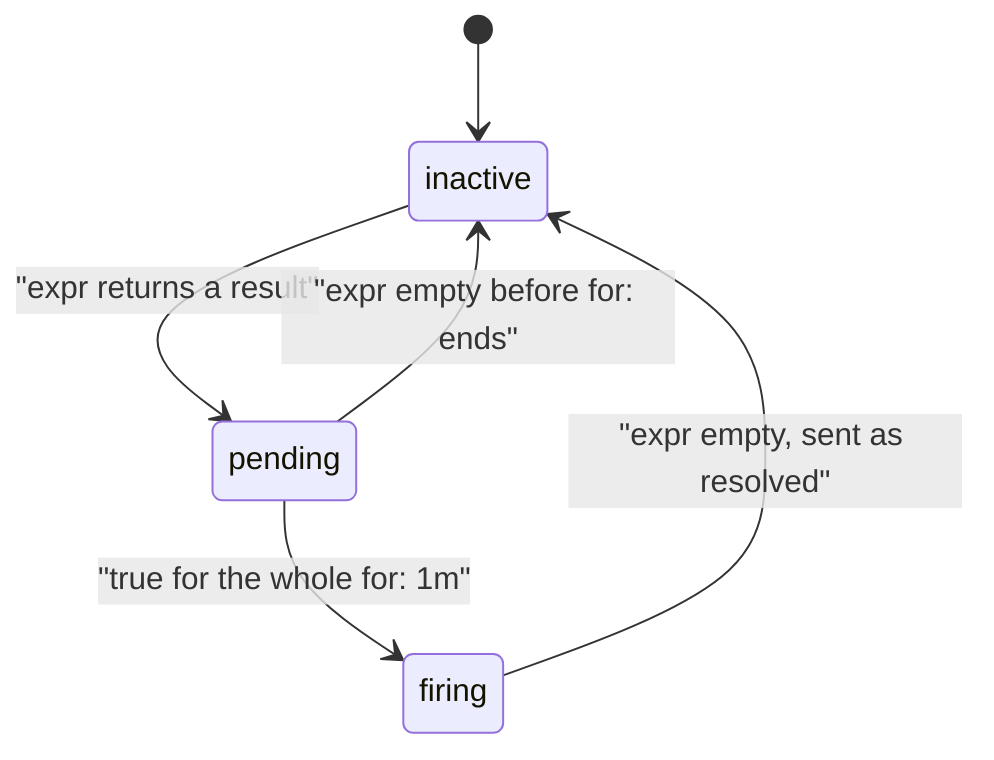

# The Alert Lifecycle

Follow one alert from an inactive condition through pending and firing, then back to inactive. The expression determines whether the condition is true; `for` determines how long it must remain true before firing. Verify these states in Prometheus before investigating notification routing.

## The states

Prometheus evaluates the alerting rule on every group interval, here every 15 seconds. It keeps one **alert instance** per label set the expression returns, and one state per instance:

- **inactive**: the expression returns nothing. Nothing is sent.
- **pending**: the expression returns a result, but for less time than `for`. Prometheus records when it started (`activeAt`) and waits.
- **firing**: the expression has returned a result for at least `for`. Prometheus sends the alert to Alertmanager and keeps re-sending it while it stays true.
- **resolved**: the expression stopped returning a result after the alert fired. Prometheus tells Alertmanager the alert ended, and the alert drops back to inactive.



The diagram shows the three states Prometheus keeps and the condition that moves an alert from one to the next; the move from firing back to inactive is what Alertmanager reports as resolved.

Each evaluation is a fresh query, not a continuous watch. On every run Prometheus compares the label sets the expression returned with the instances it already holds. A label set it has seen keeps its `activeAt`; a new label set starts a new instance with a new timer. An instance whose label set is missing from the result is deleted at once while pending, so a condition that flickers on and off never fires. The move from pending to firing happens on the first evaluation where `now - activeAt >= for`, which is why `for: 1m` means "at least one minute, plus up to one evaluation interval".

Two details follow from "one instance per label set". A changing value in a label, such as a pod name after a restart, is a different label set, so it starts over as a new pending instance. Put values that change in `annotations`, which carry text for people and play no part in identity. And a comparison with `bool`, such as `> bool 0.1`, returns a series for every input with the value `0` or `1`; an alerting rule treats both as present, so both become alert instances. A fault alert uses the plain comparison `> 0.1`, which drops the series below the threshold.

## Cause errors

You need a steady stream of `500` answers. In a new terminal, start a loop in the `shuttle` pod that requests `/status/500` once per second for ten minutes. It keeps running in that terminal; leave it open:

<!-- astrona:playground:renew -->

```sh
kubectl -n starfleet exec deploy/shuttle -- sh -c 'for i in $(seq 1 600); do curl -s -o /dev/null http://scout.starfleet:9898/status/500; sleep 1; done'
```

Together with the normal traffic of one request per second, roughly every other request now fails. The loop stops on its own after ten minutes. In your first terminal, with the port-forward to Prometheus on `9090` still running, paste a helper that prints the alerts Prometheus currently holds, with their state, the time they became active and the value of the expression:

```sh
show_alerts() {
  curl -s http://127.0.0.1:9090/api/v1/alerts |
    jq -r '.data.alerts[] | "\(.labels.alertname)\t\(.state)\t\(.activeAt)\t\(.value)"'
}
```

Run `show_alerts` and `promql 'namespace:http_requests_error_ratio:rate1m'` every 20 seconds or so for two minutes.

## Watch the alert move

Here are five readings taken 20 seconds apart in the playground, starting when the error loop began (each reading shows `show_alerts`, then the recorded ratio):

```text
== +20s
== +40s
ScoutHighErrorRatio	pending	2026-10-10T16:17:10.604180701Z	2.568030391801051e-01
starfleet	0.2568030391801051
== +60s
ScoutHighErrorRatio	pending	2026-10-10T16:17:10.604180701Z	3.6225944879974215e-01
starfleet	0.36225944879974215
== +80s
ScoutHighErrorRatio	pending	2026-10-10T16:17:10.604180701Z	4.326923076923077e-01
starfleet	0.4326923076923077
== +100s
ScoutHighErrorRatio	firing	2026-10-10T16:17:10.604180701Z	4.2452830188679247e-01
starfleet	0.42452830188679247
```

At 20 seconds nothing has changed yet: the next scrape and the next rule evaluation have not both happened. By 40 seconds the recorded ratio exists, at about 26%, and the alert is `pending` with an `activeAt` time. It stays `pending` while the ratio climbs, because `for: 1m` has not passed. About one minute after `activeAt`, the alert is `firing`. The ratio settles a little above 40%, because the one-minute rate is now filled with the new mix of traffic.

Add the delays up and the alert fired about 100 seconds after the errors started: up to 15 seconds for the next scrape, up to 15 seconds for the next rule evaluation, then one full minute of `for`. That is the normal delay, not a fault. When an alert seems "late", add the scrape interval, the evaluation interval and `for` before you look for a bug.

The alerts endpoint lists only instances that are pending or firing. An inactive rule is absent from it, so its absence proves nothing about whether the rule is loaded. The rules endpoint lists every rule with `state: inactive` and its `health`, and that is the place to check loading. Prometheus also writes the states as time series, which lets you query the history:

```sh
promql 'ALERTS{alertname="ScoutHighErrorRatio"}'
```

`ALERTS` has the alert's labels plus `alertstate`, which is `pending` or `firing`, with the value `1`. A companion series, `ALERTS_FOR_STATE`, holds the `activeAt` time as a Unix timestamp; Prometheus reads it back after a restart so a pending alert does not lose its timer. Both are useful for a query such as "how often did this alert fire last week".

## Firing is not notifying

A firing alert in Prometheus has not reached a person yet. Prometheus has a notifier that queues firing alerts and sends them in batches with HTTP `POST` requests to every Alertmanager it has discovered. It does not re-send on every evaluation: an unchanged firing alert goes out again only after the resend delay, the flag `--rules.alert.resend-delay`, which is one minute by default. Each send carries `startsAt`, the `activeAt` time, and `endsAt`, set four times the larger of the evaluation interval and the resend delay into the future, here about four minutes. Alertmanager treats an alert whose `endsAt` has passed as resolved, so a Prometheus that stops sending makes its alerts resolve on their own. When the expression goes empty, Prometheus sets `endsAt` to that evaluation time, sends the alert once more, and keeps the resolved instance for 15 minutes so later sends repeat the resolution.

Check which Alertmanagers the notifier found, and whether sends succeed:

```sh
curl -s http://127.0.0.1:9090/api/v1/alertmanagers | jq '.data'
promql 'prometheus_notifications_sent_total'
```

The first command lists one entry under `activeAlertmanagers`, the pod IP of `alertmanager-kps-alertmanager-0` on port `9093`, and an empty `droppedAlertmanagers`. The second returns a counter that has grown since the alert fired; `prometheus_notifications_errors_total` stays at zero when sends succeed. A rule that evaluates correctly but has no active Alertmanager fires forever and tells nobody.

Now look at the alert from Alertmanager's side. Start a second port-forward, to Alertmanager, in another terminal and leave it running:

```sh
kubectl -n monitoring port-forward svc/kps-alertmanager 9093:9093
```

Then ask Alertmanager's API which alerts it holds and which receivers they go to:

```sh
curl -s http://127.0.0.1:9093/api/v2/alerts |
  jq -r '.[] | "\(.labels.alertname)\t\(.status.state)\t\(.receivers | map(.name) | join(","))\t\(.labels | to_entries | map("\(.key)=\(.value)") | join(","))"'
```

You should see something like:

```text
ScoutHighErrorRatio	active	null	alertname=ScoutHighErrorRatio,namespace=starfleet,prometheus=monitoring/kps-prometheus,severity=warning,team=starfleet
```

Alertmanager has the alert, in its own state `active`, with every label from the rule plus `prometheus`, which names the Prometheus that sent it. The receiver is `null`, the one that does nothing, so no notification went anywhere. The page `http://127.0.0.1:9093` shows the same alert in a browser.

Alertmanager has three states of its own, and none of them is "firing". `unprocessed` means the alert arrived and has not passed through the routing tree yet, a state that lasts a moment. `active` means it is routed and eligible for notification. `suppressed` means a silence or an inhibition holds it back. Prometheus and Alertmanager keep separate state, so a delay or a loss has to be located in one of three places: evaluation in Prometheus (the rules and alerts endpoints), transport (`prometheus_notifications_sent_total` and the Alertmanager alerts endpoint), or notification (the receiver). A receiver assignment alone does not prove that a notification left Alertmanager; only the receiver's own log proves that.

## Common pitfalls

> [!WARNING]
> - **Treating `pending` as broken.** It means the condition is true and `for` has not passed yet.
> - **Checking only Prometheus.** A `firing` alert can still go to a receiver that does nothing; check Alertmanager's view too.
> - **Expecting an alert seconds after the problem starts.** Scrape interval, evaluation interval and `for` add up.
> - **Mixing the two state names.** Prometheus says `firing`; Alertmanager says `active` (or `suppressed` when silenced or inhibited).
> - **Looking only at the alerts endpoint.** An inactive loaded rule is visible only in the rules endpoint.
> - **Changing a label during `for`.** A different label set starts a new instance and waiting period.
> - **Using a `bool` comparison for a fault alert.** A returned zero still creates an alert instance.

## Your mission: Create And Verify An Alerting Rule

Traffic to `scout` includes status `500` responses. Its alerting rule is missing; the receiver route already works.

This independent lab has 4 tasks. Allow 10–15 minutes for task work, plus environment startup and telemetry collection.

Pause the playground and start the lab:

```sh
astrona stop ats-020-playground-010-03
astrona run --git ssh://git@github.com/astrona-io/ATS020.git -c sections/section-010/module-30/labs/lab-01
```

Submit after verifying the result:

```sh
astrona submit -c sections/section-010/module-30/labs/lab-01
```

Remove the lab and resume the playground:

```sh
astrona destroy ats-020-lab-010-03
astrona start ats-020-playground-010-03
```
