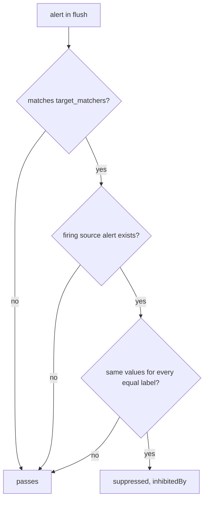

# Inhibition

An inhibition rule suppresses a target alert while a related source alert fires. Match the source and target labels separately, then use equal labels to limit the relationship to the same affected service. Both alerts must continue to exist.

## How an inhibition rule decides

An inhibition rule has three parts. `source_matchers` describe the alert that does the muting, `target_matchers` describe the alerts that get muted, and `equal` lists the labels that must have the same value on both. Alertmanager keeps an index of the alerts that match a source. At the inhibit stage of every flush, for each alert in the group it checks whether that alert matches a target and whether a firing source alert exists with the same values for every `equal` label. If both hold, the alert is marked `suppressed` with `inhibitedBy` set to the fingerprint of the source alert, and it is dropped from the flush.



All three conditions must hold for inhibition; a label named in `equal` that is missing from both alerts counts as equal, since both sides have the empty value.

Two rules of the stage matter in practice. Alerts that match both the source and target sides of a rule cannot inhibit one another or themselves. Keep source and target matchers distinct so the intended relationship is clear. And the inhibit stage runs before the silence stage, so an alert that is both inhibited and silenced carries both `inhibitedBy` and `silencedBy`.

The Helm chart's default Alertmanager configuration already has such rules. The first one, in the running configuration, reads:

```text
inhibit_rules:
- source_matchers:
  - severity="critical"
  target_matchers:
  - severity=~"warning|info"
  equal:
  - namespace
  - alertname
```

While an alert with `severity="critical"` fires, alerts with the same `namespace` and `alertname` and a `severity` of `warning` or `info` are muted. If `ScoutHighErrorRatio` had a second rule with the same name and a higher threshold labelled `critical`, the `warning` version would go quiet as soon as the `critical` one fired.

## Build a source and a target

To watch inhibition happen you need two alerts that fire at once.

<!-- astrona:playground:renew -->

Save this as `prometheusrule-scout-inhibition.yaml`:

```yaml
apiVersion: monitoring.coreos.com/v1
kind: PrometheusRule
metadata:
  name: scout-inhibition
  namespace: starfleet
  labels:
    release: kps
spec:
  groups:
    - name: scout-inhibition
      rules:
        - alert: ScoutLatency
          expr: vector(1)
          labels:
            namespace: starfleet
            team: scout-inhibit
            severity: critical
        - alert: ScoutLatency
          expr: vector(1)
          labels:
            namespace: starfleet
            team: scout-inhibit
            severity: warning
```

`vector(1)` returns a single constant series with no labels, so the rule sets `namespace` itself; the alerts are diagnostic fixtures, not real latency measurements. The two rules share the alert name but differ in `severity`, so they are two alert instances. There is no `for`, so both fire on their first evaluation, within about a minute of the apply.

Apply it:

```sh
kubectl apply -f prometheusrule-scout-inhibition.yaml
```

Then give the pair a route and a rule of their own. Save this as `alertmanagerconfig-scout-inhibition.yaml`:

```yaml
apiVersion: monitoring.coreos.com/v1alpha1
kind: AlertmanagerConfig
metadata:
  name: scout-inhibition
  namespace: starfleet
spec:
  route:
    receiver: scout-webhook
    matchers:
      - name: team
        value: scout-inhibit
        matchType: "="
    groupBy: [namespace, alertname]
    groupWait: 10s
    groupInterval: 1m
    repeatInterval: 5m
  receivers:
    - name: scout-webhook
      webhookConfigs:
        - url: http://alert-receiver.monitoring:8080/
  inhibitRules:
    - sourceMatch:
        - name: team
          value: scout-inhibit
          matchType: "="
        - name: severity
          value: critical
          matchType: "="
      targetMatch:
        - name: team
          value: scout-inhibit
          matchType: "="
        - name: severity
          value: warning
          matchType: "="
      equal: [namespace, team, alertname]
```

`sourceMatch` identifies the critical source and `targetMatch` the warning targets, and `equal` requires the same `namespace`, `team` and `alertname` on both. In the generated configuration these fields become `source_matchers`, `target_matchers` and `equal`, and the operator adds a `namespace="starfleet"` matcher to both sides, so a team's inhibition rule can never mute another namespace's alerts.

Apply it:

```sh
kubectl apply -f alertmanagerconfig-scout-inhibition.yaml
```

Then check the result, with the Alertmanager port-forward on `9093` still running:

```sh
curl -s http://127.0.0.1:9093/api/v2/status | jq -r '.config.original' | grep -A 40 '^inhibit_rules:'
curl -s http://127.0.0.1:9093/api/v2/alerts | jq '.[] | select(.labels.alertname == "ScoutLatency") | {labels, status}'
```

The first command prints the inhibition rules in the running configuration; the chart's three rules are followed by yours, with the added namespace matchers. Once both alert instances have arrived, the second command shows the `critical` instance `active` and the `warning` instance `suppressed` with a non-empty `inhibitedBy`. Two rules mute it at the same time here: yours, and the chart's rule on `severity`, because the pair also shares `namespace` and `alertname`. When you explain a suppression, read every rule in the loaded configuration, not only the one you wrote. The receiver log shows one line for the critical alert and none for the warning alert.

## Tell inhibition from silencing

Both causes show the same `suppressed` state, and only the two fields tell them apart. Put a silence on top of the inhibited alert to see both at once. Create a ten-minute silence for only the warning instance, with an author and a comment:

```sh
kubectl -n monitoring exec alertmanager-kps-alertmanager-0 -c alertmanager -- amtool silence add alertname=ScoutLatency namespace=starfleet severity=warning --duration=10m --author=platform --comment='scout latency maintenance' --alertmanager.url=http://localhost:9093
kubectl -n monitoring exec alertmanager-kps-alertmanager-0 -c alertmanager -- amtool silence query --alertmanager.url=http://localhost:9093
```

The add command prints the silence ID; keep it. All three matchers must match, and `severity=warning` keeps the critical source out of the silence. Now read both sides:

```sh
curl -s http://127.0.0.1:9093/api/v2/silences | jq '.[] | {id, matchers, startsAt, endsAt, createdBy, comment, status}'
curl -s http://127.0.0.1:9093/api/v2/alerts | jq '.[] | select(.labels.alertname == "ScoutLatency") | {labels, status}'
curl -s http://127.0.0.1:9090/api/v1/alerts | jq '.data.alerts[] | select(.labels.alertname == "ScoutLatency") | {labels, state}'
```

The silence has `status.state: active`. The warning alert now has its ID in `silencedBy` and still has the source fingerprint in `inhibitedBy`. Both alerts stay `firing` in Prometheus: suppression changes notification handling, not rule evaluation. Replace `<SILENCE-ID>` with the ID you kept, expire the silence early, and read the alert again:

```sh
kubectl -n monitoring exec alertmanager-kps-alertmanager-0 -c alertmanager -- amtool silence expire <SILENCE-ID> --alertmanager.url=http://localhost:9093
curl -s http://127.0.0.1:9093/api/v2/silences | jq '.[] | {id, status}'
curl -s http://127.0.0.1:9093/api/v2/alerts | jq '.[] | select(.labels.alertname == "ScoutLatency") | {labels, status}'
```

The silence shows `expired`, `silencedBy` is empty again, and the warning alert is still `suppressed`, because the critical source still fires. Expiring a silence removes only that silence; it does not switch off inhibition. The reverse also holds: deleting the inhibition rule would leave a silence in place. A suppressed alert with an empty `silencedBy` and an empty `inhibitedBy` is the third case, an alert muted by a time interval on its route, and that is reported in `mutedBy`.

Choose the `equal` labels with care. Since a label missing from both alerts counts as equal, an `equal` list of labels the alerts do not carry lets one critical alert mute every warning in the namespace. Use labels both alerts carry, and source and target matchers that name the intended severities.

## Common pitfalls

> [!WARNING]
> - **Reading only `suppressed`.** Inspect `silencedBy` and `inhibitedBy` to find every reason notifications stopped.
> - **Using absent labels in `equal`.** Two missing values compare equal and can broaden inhibition.
> - **Deleting a firing rule for maintenance.** Use a silence with a duration and comment so evaluation continues and the suppression ends.
> - **Forgetting the chart's own rules.** A `critical` alert already mutes `warning` and `info` alerts with the same `namespace` and `alertname`.

## Your mission: Inhibit A Related Warning Alert

Two diagnostic alerts fire: `ScoutUnavailable` is critical and `ScoutLatency` is warning. The team wants the critical alert to suppress the related warning automatically. Their different names keep the chart's default same-alertname rule from hiding a mistake in your custom inhibition rule.

This independent lab has 4 tasks. Allow 10–15 minutes for task work, plus environment startup and telemetry collection.

Pause the playground and start the lab:

```sh
astrona stop ats-020-playground-010-03
astrona run --git ssh://git@github.com/astrona-io/ATS020.git -c sections/section-010/module-30/labs/lab-04
```

Submit after verifying the result:

```sh
astrona submit -c sections/section-010/module-30/labs/lab-04
```

Remove the lab and resume the playground:

```sh
astrona destroy ats-020-lab-010-03-04
astrona start ats-020-playground-010-03
```
