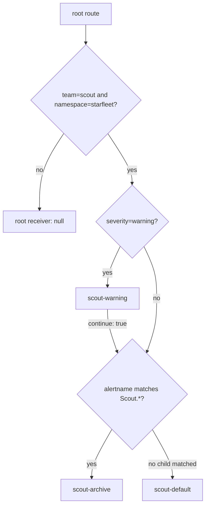
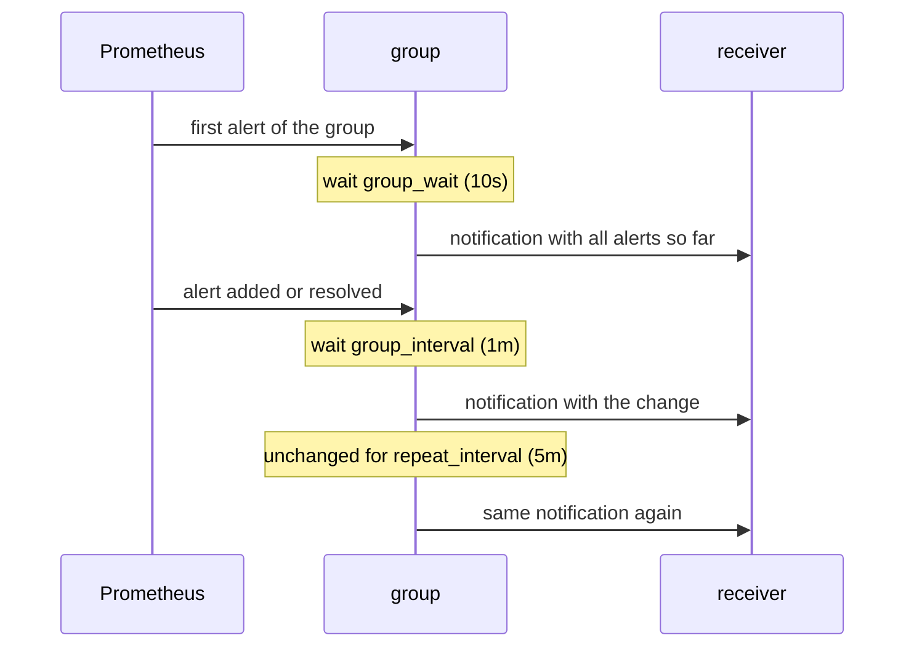

# Route Precedence And Grouping

An alert can match the right team and still reach an unexpected receiver. Alertmanager walks the routing tree in a fixed order, a child route inherits what it does not set from its parent, and `continue` decides whether one match ends the search. The Prometheus Operator adds its own changes while it merges every team's AlertmanagerConfig into one tree. This part builds a route tree with three receivers, sends a diagnostic alert through it, and reads the loaded configuration to predict and then prove which receivers handle it.

## A diagnostic alert that is always firing

The alert for this part must fire without an outage, so it alerts on a healthy target.

<!-- astrona:playground:renew -->

Save this as `prometheusrule-scout-route-check.yaml`:

```yaml
apiVersion: monitoring.coreos.com/v1
kind: PrometheusRule
metadata:
  name: scout-route-check
  namespace: starfleet
  labels:
    release: kps
spec:
  groups:
    - name: scout-route-check
      interval: 15s
      rules:
        - alert: ScoutRouteCheck
          expr: up{namespace="starfleet",job="scout"} == 1
          for: 1m
          labels:
            team: scout
            severity: warning
```

`up` is the scrape result: `1` means the last scrape succeeded. The comparison keeps each healthy target's series, so the two `scout` pods produce two alert instances, each with `team=scout` and `severity=warning` added by the rule and `namespace=starfleet` from the target.

Apply it:

```sh
kubectl apply -f prometheusrule-scout-route-check.yaml
```

Then check that the rule is loaded, with the Prometheus port-forward on `9090` still running:

```sh
curl -s http://127.0.0.1:9090/api/v1/rules | jq '.data.groups[] | select(.name == "scout-route-check") | {interval, lastEvaluation, rules: [.rules[] | {name, health, state}]}'
curl -s http://127.0.0.1:9090/api/v1/alerts | jq '.data.alerts[] | select(.labels.alertname == "ScoutRouteCheck") | {labels, state, activeAt}'
```

About a minute after the apply the group is loaded with `health: ok`; a minute later the two instances are `firing`. Until then, the route you write next has nothing to route. The page `http://127.0.0.1:9090/alerts` shows the same states in the browser.

## A route tree with three receivers

Save this as `alertmanagerconfig-scout-decisions.yaml`:

```yaml
apiVersion: monitoring.coreos.com/v1alpha1
kind: AlertmanagerConfig
metadata:
  name: scout-decisions
  namespace: starfleet
spec:
  route:
    receiver: scout-default
    matchers:
      - name: team
        value: scout
        matchType: "="
    groupBy: [namespace, alertname]
    groupWait: 10s
    groupInterval: 1m
    repeatInterval: 5m
    routes:
      - receiver: scout-warning
        matchers:
          - name: severity
            value: warning
            matchType: "="
        continue: true
      - receiver: scout-archive
        matchers:
          - name: alertname
            value: Scout.*
            matchType: "=~"
  receivers:
    - name: scout-default
      webhookConfigs:
        - url: http://alert-receiver.monitoring:8080/
    - name: scout-warning
      webhookConfigs:
        - url: http://alert-receiver.monitoring:8080/
    - name: scout-archive
      webhookConfigs:
        - url: http://alert-receiver.monitoring:8080/
```

The three receivers use the same webhook, so the receiver log lets you compare the receiver names Alertmanager chose. Before you apply it, predict the result from the matching rules below.

## How Alertmanager walks the tree

Routing is one function applied to the root route. For a node, Alertmanager first tests the node's own matchers; every matcher must match, or the node is skipped. If the node matches, it tries the node's child routes in the order they are written. The first child that matches handles the alert, and the search in that list stops there, unless that child has `continue: true`, in which case the next sibling is tried as well. If no child matches, the node itself handles the alert with its own receiver. The root route has no matchers and always matches, so every alert ends at some receiver, and the set of receivers an alert gets is the set of nodes where the walk ended.



The diagram shows the walk for the team route; `ScoutRouteCheck` matches the warning child, continues to the archive child and matches it too, so it reaches two receivers and never the default.

Three tie-breaks follow from that walk. The parent receiver is not an extra destination; `scout-default` handles only alerts that match no child. `continue` only affects the siblings after the matching route; it never sends the alert back to the root. And a broad child placed before a specific one hides the specific one for every alert that matches both, unless the broad child continues. Order and `continue` are the whole precedence rule; there is no "most specific wins".

A child also inherits what it does not set. `receiver`, `group_by`, `group_wait`, `group_interval` and `repeat_interval` come from the parent unless the child sets them, so both child routes here group by `namespace` and `alertname` and use the team's timings. A child that sets `group_by` replaces the parent's list; it does not add to it.

## Grouping and timing

A **notification group** is the set of alerts on one route with the same values for its `group_by` labels. The two `ScoutRouteCheck` instances differ only in `pod` and `instance`, which are not in `group_by`, so they form one group and one notification carries both. The other labels stay on the alerts; grouping decides what is bundled, not what is kept.



The diagram shows the three timers of one group; after the first flush, a group is checked only every `group_interval`, and that check is also where a repeat is due or not.

`group_wait` gives related alerts time to arrive and gives an inhibiting source time to fire before the first message. An alert that resolves inside that wait is never sent. After the first flush, a notification goes out at a `group_interval` tick only when the group changed, or when the last notification of the same content is older than `repeat_interval`. Alertmanager records what it sent per receiver in its notification log, and that record is what the dedup stage compares against. Because repeats are checked only at those ticks, use a `repeat_interval` that is a multiple of `group_interval`.

Now apply the route:

```sh
kubectl apply -f alertmanagerconfig-scout-decisions.yaml
```

Then check the result, with the Alertmanager port-forward on `9093` still running:

```sh
curl -s http://127.0.0.1:9093/api/v2/status | jq -r '.config.original' | grep -B 2 -A 14 'scout-decisions/scout-default'
curl -s http://127.0.0.1:9093/api/v2/alerts | jq '.[] | select(.labels.team == "scout") | {labels, receivers, status}'
kubectl -n monitoring logs deploy/alert-receiver
```

Give the operator about a minute to merge the configuration and Alertmanager the `group_wait` after that. The route block in the loaded configuration carries the namespace matcher and renamed receivers described next. The alerts response lists two instances of `ScoutRouteCheck`, each with two entries under `receivers`: `starfleet/scout-decisions/scout-warning` and `starfleet/scout-decisions/scout-archive`, and no default. The receiver log has one line per alert and receiver, so four new lines, two for each receiver. The API shows the assignment; the log proves the delivery.

## What the operator adds while merging

The Alertmanager resource selects AlertmanagerConfigs the same way the Prometheus resource selects rules, with `alertmanagerConfigNamespaceSelector` for namespaces and `alertmanagerConfigSelector` for objects, and both are empty here. Read them together with the matcher strategy:

```sh
kubectl -n monitoring get alertmanager kps-alertmanager -o json | jq '.spec | {alertmanagerConfigNamespaceSelector, alertmanagerConfigSelector, alertmanagerConfigMatcherStrategy}'
```

Both selectors are `{}`, so every AlertmanagerConfig in every namespace is merged, and `alertmanagerConfigMatcherStrategy` is absent, which means the default type, `OnNamespace`. The operator then builds one configuration in this order:

1. It starts from the chart's own configuration: the root route with receiver `null`, its `Watchdog` child, and the chart's inhibition rules.
2. It sorts the selected objects by `<namespace>/<name>` and renames every receiver and time interval to `<namespace>/<name>/<receiver>` so two teams can both have a receiver called `webhook`.
3. For each object's top route it adds a matcher `namespace="<its namespace>"` and sets `continue: true`; nested routes keep their own `continue`. Under `OnNamespace` it adds the same namespace matcher to both sides of each inhibition rule.
4. It inserts the team routes, in that sorted order, before the chart's own child routes, and appends the receivers and inhibition rules.

The `continue: true` on every team top route is forced for every strategy, so a top route never hides a later team's route. The namespace matcher is what keeps one team's route from taking another team's alerts, and it is the part an administrator can change: `OnNamespaceExceptForAlertmanagerNamespace` skips the matcher for objects in `monitoring`, and `None` skips it everywhere. Keep the playground's default and keep `namespace` in your alert expressions, because a team route only ever sees alerts from its own namespace. In the loaded configuration the three team routes appear as `starfleet/scout-decisions`, `starfleet/scout-inhibition` and `starfleet/starfleet`, in that order, before the `Watchdog` route.

You can now predict which receivers a route tree selects, why a parent fallback stays unused, when a notification is sent and when it is repeated, and which matchers and names the operator added that your AlertmanagerConfig does not show. Together with rules, the lifecycle, silences and inhibition, that is the whole path from a PromQL condition to a message a person reads.

## Common pitfalls

> [!WARNING]
> - **Treating matchers as alternatives.** All matchers on one route must match; use sibling routes for separate cases.
> - **Expecting the parent receiver as well.** A matching child takes responsibility unless other matching siblings also handle the alert.
> - **Expecting "most specific wins".** Order and `continue` decide; a broad child first hides a specific child after it.
> - **Confusing team scope with discovery scope.** Selecting objects from all namespaces does not remove their injected namespace matchers.
> - **A `repeat_interval` that is not a multiple of `group_interval`.** Repeats are only checked at `group_interval` ticks, so the real repeat time rounds up.

## Your mission: Route A Team Alert And Silence Maintenance

You can now prove loading, routing and suppression at each component. Repair a team's alert path and create a scoped maintenance silence in a separate graded lab.

Pause the playground, then start the lab:

```sh
astrona stop ats-020-playground-010-03
astrona run --git ssh://git@github.com/astrona-io/ATS020.git -c sections/section-010/module-30/labs/lab-01
```

Use the walkthrough's watch command while working. When ready, finish the attempt:

```sh
astrona submit --git ssh://git@github.com/astrona-io/ATS020.git -c sections/section-010/module-30/labs/lab-01
```

If you abandoned the attempt before submitting, remove the lab. Then resume the playground:

```sh
astrona destroy ats-020-lab-010-03
astrona start ats-020-playground-010-03
```
