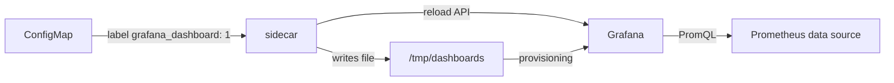

# Grafana's Parts And A Provisioned Data Source

Grafana draws nothing until it knows where the data is. Before the first panel, it needs a data source, and that data source should come from a file, not from a form in the web interface. This part shows how the Grafana pod in the playground is built and adds Prometheus as a data source from a labelled ConfigMap.

A ConfigMap is a Kubernetes object that stores configuration text. A label is a key-value pair attached to an object so a selector can find it.

## The words Grafana uses

Grafana has a small set of objects, and every task in this module uses them:

- A **data source** is a connection Grafana uses to read data. It has a type (`prometheus`), a Uniform Resource Locator (URL), the server address, and a **UID** (unique identifier), a short fixed string that dashboards use to point at it.
- A **dashboard** is a page with a title, a UID, a time range and a list of panels. Grafana stores it as a JSON (JavaScript Object Notation) document.
- A **panel** is one box on a dashboard. It names a data source, holds one or more **queries** (here expressions in Prometheus Query Language, or PromQL), and has a **visualisation**, the way the result is drawn: a time series graph, a stat (one big number) or a table.
- A **variable** is a value the viewer picks from a drop-down list at the top of a dashboard. Queries use it as `$name`.

**Provisioning** means that Grafana loads data sources and dashboards from files when it starts, and again when told to reload. The data source in this playground is read-only after provisioning. Dashboard providers separately control whether Grafana may save dashboard edits; this playground disables those saves.

## The sidecar containers in the Grafana pod

The playground runs Grafana with two extra containers. A pod is the Kubernetes unit that runs containers together; a Deployment manages and replaces its pod replicas. Each one is a **sidecar**, a second container in the same pod that does a helper job. Check the pod:

<!-- astrona:playground:renew -->

```sh
kubectl -n monitoring get pods -l app.kubernetes.io/name=grafana -o jsonpath='{.items[0].spec.containers[*].name}'; echo
```

You should see:

```text
grafana-sc-dashboard grafana-sc-datasources grafana
```

`grafana` is Grafana itself. `grafana-sc-datasources` and `grafana-sc-dashboard` watch the Kubernetes application programming interface (API) for ConfigMaps with a certain label, write their content as files into Grafana's provisioning folders, and then call Grafana's reload API. Print their settings:

```sh
kubectl -n monitoring get deploy kps-grafana -o jsonpath='{range .spec.template.spec.containers[*]}{.name}{"\n"}{range .env[*]}  {.name}={.value}{"\n"}{end}{end}' | grep -E "^[a-z]|LABEL|FOLDER|NAMESPACE"
```

You should see:

```text
grafana-sc-dashboard
  LABEL=grafana_dashboard
  LABEL_VALUE=1
  FOLDER=/tmp/dashboards
  NAMESPACE=ALL
grafana-sc-datasources
  LABEL=grafana_datasource
  LABEL_VALUE=1
  FOLDER=/etc/grafana/provisioning/datasources
  NAMESPACE=ALL
grafana
```

The output is shortened by `grep`. It tells you the contract: a ConfigMap labelled `grafana_datasource: "1"`, in any namespace, becomes a data source file, and a ConfigMap labelled `grafana_dashboard: "1"` becomes a dashboard file. The label names and the value `1` come from the chart's values in this playground; another installation can use other values, so always read them from the pod first.



The diagram shows a labelled ConfigMap read by the sidecar, written as a file, loaded by Grafana, and the panels then querying Prometheus through the data source.

## Connect to Grafana

Start each port-forward in its own terminal and leave it running. The local Grafana port is `3300` to avoid a common conflict on `3000`; the Service forwards it to Grafana's container port `3000`:

```sh
kubectl -n monitoring port-forward svc/kps-grafana 3300:80
```

```sh
kubectl -n monitoring port-forward svc/kps-prometheus 9090:9090
```

Grafana is now at `http://127.0.0.1:3300` (user `admin`, password `starfleet`). The commands in this module use Grafana's Hypertext Transfer Protocol (HTTP) API with `curl`, so you can check every step from the terminal. Check that Grafana answers and that it has no data source yet:

```sh
curl -s -u admin:starfleet http://127.0.0.1:3300/api/health
curl -s -u admin:starfleet http://127.0.0.1:3300/api/datasources; echo
```

You should see:

```text
{
  "database": "ok",
  "version": "13.2.3",
  "commit": "90ffed056f0884267356c12a0eeb72a022af53f1"
}[]
```

The empty list `[]` means there is no data source. Panels cannot query Prometheus until a data source exists.

## Provision the Prometheus data source

A data source provisioning file is YAML with `apiVersion: 1` and a `datasources` list. Wrap it in a ConfigMap with the label the sidecar watches.

Save this as `configmap-datasource-prometheus.yaml`:

```yaml
apiVersion: v1
kind: ConfigMap
metadata:
  name: datasource-prometheus
  namespace: monitoring
  labels:
    grafana_datasource: "1"
data:
  prometheus.yaml: |
    apiVersion: 1
    datasources:
      - name: Prometheus
        type: prometheus
        uid: prometheus
        access: proxy
        url: http://kps-prometheus.monitoring:9090
        isDefault: true
        jsonData:
          timeInterval: 15s
```

The fields that matter:

- `uid: prometheus` fixes the data source's identifier. Dashboards point at it by this UID, so a fixed value keeps every dashboard file working on any cluster.
- `url` is the address **Grafana** uses, from inside the cluster, so it is the Service Domain Name System (DNS) name, not your port-forward.
- `access: proxy` means the Grafana server sends the queries, not your browser.
- `jsonData.timeInterval: 15s` tells Grafana the scrape interval, as the minimum interval used to calculate query steps. It matches the playground's 15-second scrapes; it does not change Prometheus's scrape schedule.

Apply it:

```sh
kubectl apply -f configmap-datasource-prometheus.yaml
```

Then check the result. First, the sidecar's log shows that it saw the ConfigMap:

```sh
kubectl -n monitoring logs deploy/kps-grafana -c grafana-sc-datasources --tail=2
```

You should see:

```text
{"time": "2026-10-12T16:22:20.955839+00:00", "level": "INFO", "msg": "Writing /etc/grafana/provisioning/datasources/prometheus.yaml (ascii)"}
{"time": "2026-10-12T16:22:20.978381+00:00", "level": "INFO", "msg": "None sent to http://localhost:3000/api/admin/provisioning/datasources/reload. Response: 200 OK {\"message\":\"Datasources config reloaded\"}"}
```

The sidecar wrote the file under the ConfigMap's key name and Grafana answered the reload with `200 OK`. Now ask Grafana for its data sources, and ask it to test the connection:

```sh
curl -s -u admin:starfleet http://127.0.0.1:3300/api/datasources | jq '.[] | {name, uid, type, url}'
curl -s -u admin:starfleet http://127.0.0.1:3300/api/datasources/uid/prometheus/health | jq
```

You should see:

```text
{
  "name": "Prometheus",
  "uid": "prometheus",
  "type": "prometheus",
  "url": "http://kps-prometheus.monitoring:9090"
}
{
  "details": {
    "application": "Prometheus",
    "features": {
      "rulerApiEnabled": false
    }
  },
  "message": "Successfully queried the Prometheus API.",
  "status": "OK"
}
```

The health check is the proof: Grafana reached Prometheus through the Service address. In the web interface, the same test is the **Save & test** button under **Connections**, **Data sources**. If the URL were wrong, the health check would return an error with the connection message, and every panel would stay empty.

Grafana now has a data source that comes from a file and returns after any restart. The next question is what to put on a dashboard, and how to choose a visualisation for each query.

## Common pitfalls

> [!WARNING]
> - **Using the wrong label or label value.** The sidecar only reads ConfigMaps whose label matches `LABEL` and `LABEL_VALUE` exactly. Read them from the Deployment before you write the ConfigMap.
> - **Putting `127.0.0.1:9090` in the data source URL.** That is your port-forward, not an address Grafana can reach. Use the Service DNS name.
> - **Using different data source UIDs.** A panel points at the UID, rather than the display name. Keep that UID the same in the data source file and dashboard.
> - **Editing a provisioned data source in the web interface.** Grafana treats the file as the source of truth; change the ConfigMap instead.
