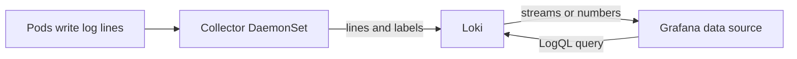

# Connect Grafana To Loki

A dashboard panel that points at a missing data source shows nothing, however good its query is. Grafana does not hold logs. It sends each query to a data source and draws the answer, so the connection comes first.

Loki stores log lines in compressed chunks and indexes only their labels. Lines with exactly the same set of labels form one **stream**. In this environment each stream has the labels `namespace`, `pod` and `container`, so each container has its own stream. Loki runs in **single-binary mode**, where one process does all the work of writing and reading. That is enough for a small environment.



<!-- astrona:playground:renew -->

Open a port-forward to each Service in its own terminal and leave them running:

```sh
kubectl -n monitoring port-forward svc/kps-grafana 3300:80
```

```sh
kubectl -n logging port-forward svc/loki 3100:3100
```

Ask Loki which labels it holds, and which values one of them has:

```sh
curl -fsS http://127.0.0.1:3100/loki/api/v1/labels | jq
curl -fsS http://127.0.0.1:3100/loki/api/v1/label/namespace/values | jq
```

Look for `namespace`, `pod` and `container` in the first list, and `outpost` and `starfleet` in the second. If a list is empty, wait a minute for the first lines to arrive.

## Add the data source through the API

Each data source has a **unique identifier (UID)**, and panels refer to the data source by that value. The saved dashboard expects the UID `loki`. Only the API lets you choose it, because the web interface generates its own.

Save this as `loki-data-source.json`:

```json
{
  "name": "Loki",
  "uid": "loki",
  "type": "loki",
  "access": "proxy",
  "url": "http://loki.logging:3100",
  "jsonData": {
    "maxLines": 1000
  }
}
```

The address is the one Grafana reaches from inside the cluster. `access: proxy` makes the Grafana server send the queries, not your browser.

Apply it:

```sh
curl -fsS -u admin:starfleet -H 'Content-Type: application/json' \
  -X POST http://127.0.0.1:3300/api/datasources/ -d @loki-data-source.json | jq
```

Then check the result by asking Grafana to test the connection:

```sh
curl -fsS -u admin:starfleet http://127.0.0.1:3300/api/datasources/uid/loki/health | jq
```

Look for a `status` of `OK`.

## Add and inspect one in the web interface

Open `http://127.0.0.1:3300` and sign in. Open **Connections**, then **Data sources**, and select **Add new data source**. Choose **Loki**, name it `Loki Web`, set the address to `http://loki.logging:3100`, and select **Save & test**.

List what Grafana now holds:

```sh
curl -fsS -u admin:starfleet http://127.0.0.1:3300/api/datasources/ |
  jq '.[] | {name, uid, type, url, readOnly}'
```

Look for two entries. `Loki` has the UID you chose and `Loki Web` has a generated one. Delete the second, using its UID in place of `<uid>`:

```sh
curl -fsS -u admin:starfleet -X DELETE http://127.0.0.1:3300/api/datasources/uid/<uid>
```

## Change Maximum lines

**Maximum lines** is the number of log lines Grafana asks Loki for when a query does not set its own limit. Its default is `1000`. A lower value keeps a busy log view light, and a higher value shows more lines per query.

In the web interface, open **Connections**, then **Data sources**, then **Loki**. Type `500` in **Maximum lines** and select **Save & test**. The field is stored as `jsonData.maxLines`. Read it back:

```sh
curl -fsS -u admin:starfleet http://127.0.0.1:3300/api/datasources/uid/loki | jq '.jsonData'
```

Look for `maxLines` with the value `"500"`. The web interface stores it as a string, and the Loki plugin parses it into a number.

Through the API, a `PUT` replaces the whole data source, so read it first, change one field and send it all back:

```sh
curl -fsS -u admin:starfleet http://127.0.0.1:3300/api/datasources/uid/loki |
  jq '.jsonData.maxLines = 250' |
  curl -fsS -u admin:starfleet -H 'Content-Type: application/json' \
    -X PUT http://127.0.0.1:3300/api/datasources/uid/loki -d @- | jq '.datasource.jsonData'
```

Look for `maxLines` with the number `250`. Grafana now has a working, tunable connection to the logs, and you can make the same change by hand or from a script.

## Common pitfalls

> [!WARNING]
> **`localhost` as the Loki address.** The address is used from inside the Grafana Pod. `http://localhost:3100` fails the health check even while your port-forward works. Use the Service name.

> [!WARNING]
> **A `PUT` with only the changed field.** A `PUT` replaces the data source, so a body with only `jsonData` loses the rest. Send the whole object you read.

> [!WARNING]
> **Editing a provisioned data source.** A data source loaded from a provisioning file has `readOnly` set to `true`, and Grafana refuses to change it through the API. Change its file instead.

> [!WARNING]
> **Comparing `maxLines` as one type.** The value is a string after a save in the web interface and a number after an API call that sends a number. A script that reads it must accept both.
