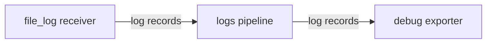

# A DaemonSet Collector Reads The Log Files

The Collector must read the container log files on each node before it can enrich or count records. Follow the host-path mount, file pattern and container parser, then verify that newly written lines enter the pipeline.

## Where the container logs live

The container runtime on a node writes the stdout and stderr of every container to a file. The kubelet puts these files under `/var/log/pods`, in one directory per pod and one directory per container:

```text
/var/log/pods/<namespace>_<pod name>_<pod uid>/<container name>/<restart count>.log
```

A restarted container writes a new file, with the restart count as its name. The files belong to `root`, so a normal pod cannot read them. To look at them, run a pod as user 0 (root) that mounts the node directory `/var/log/pods` with a `hostPath` volume. A `hostPath` volume mounts a directory of the node into the pod. Mount it read-only.

<!-- astrona:playground:renew -->

Save this as `pod-nodelogs.yaml`:

```yaml
apiVersion: v1
kind: Pod
metadata:
  name: nodelogs
  namespace: monitoring
spec:
  restartPolicy: Never
  securityContext:
    runAsUser: 0
  containers:
    - name: nodelogs
      image: curlimages/curl:8.22.0
      command: ["sleep", "3600"]
      volumeMounts:
        - name: varlogpods
          mountPath: /var/log/pods
          readOnly: true
  volumes:
    - name: varlogpods
      hostPath:
        path: /var/log/pods
```

Apply it:

```sh
kubectl apply -f pod-nodelogs.yaml
```

Then check the result. Wait until the pod is ready, list the directories of the example pods and read the last two lines of one file:

```sh
kubectl -n monitoring wait pod/nodelogs --for=condition=Ready --timeout=60s
kubectl -n monitoring exec nodelogs -- ls /var/log/pods | grep -E 'outpost|starfleet'
kubectl -n monitoring exec nodelogs -- sh -c 'tail -n 2 /var/log/pods/outpost_probe-*/probe/0.log'
```

You should see output like this. The pod names and unique identifiers (UIDs) will differ:

```text
pod/nodelogs condition met
outpost_probe-7749f6b9bc-gkdm6_a6581488-0aa5-4bf8-9ccd-e3fa002ed3cc
starfleet_scout-674cfb4855-bvgwr_f049259a-f468-4800-ba1c-3949bf4187ce
starfleet_shuttle-65f695c8c6-974tv_b5774096-5f91-4602-a0f1-524479501dce
2026-11-02T19:36:35.682493244Z stderr F time=2026-11-02T19:36:35.682Z level=INFO msg="200 GET /get 0.0ms" status=200 method=GET uri=/get route="GET /get" size_bytes=254 duration_ms=0.038666 user_agent=curl/8.22.0 client_ip=10.244.0.14 request_size_bytes=0
2026-11-02T19:36:35.886120084Z stderr F time=2026-11-02T19:36:35.885Z level=INFO msg="200 GET /status/200 0.0ms" status=200 method=GET uri=/status/200 route=/status/{code} size_bytes=0 duration_ms=0.019 user_agent=kube-probe/1.35 client_ip=10.244.0.1 request_size_bytes=0
```

The file does not hold the bare line. Each line starts with a timestamp, the stream name (`stderr`) and a letter `F`, which means "full line". This is the Container Runtime Interface (CRI) log format. The text after `F` is the line the program wrote. Remove the helper pod when you have seen enough:

```sh
kubectl -n monitoring delete pod nodelogs
```

## Why a DaemonSet

Every node has its own `/var/log/pods`. A reader of these files must therefore run on every node. A **DaemonSet** is the Kubernetes workload that runs exactly one pod on every node, and it adds a pod when a node joins the cluster. This is why a log Collector uses the mode `daemonset`.

The OpenTelemetry Operator, installed in the playground, turns a custom resource named `OpenTelemetryCollector` into the running Collector. The field `spec.mode` selects the workload kind (`deployment`, `daemonset`, `statefulset` or `sidecar`). The field `spec.config` holds the Collector configuration. The operator also creates the service account and the Services for it.

The Collector configuration has four parts. A **receiver** brings data in. A **processor** changes it. An **exporter** sends it out. A **pipeline** connects them for one signal type, here `logs`:



The `file_log` receiver reads the files, and the `debug` exporter prints what comes out. The next steps put both in an `OpenTelemetryCollector`.

## Deploy the Collector

The receiver is named `file_log`. In older releases it was named `filelog`; version 0.165.0 still accepts the old name but prints a deprecation warning, so this module uses the new name. Its fields:

- `include` lists the files to read. The pattern `/var/log/pods/*/*/*.log` matches every container log.
- `exclude` skips files. The Collector must not read its own log, or each line it prints would create a new line to read.
- `start_at: end` reads only lines written after the Collector starts. The default, `beginning`, would read every old file.
- `include_file_path: true` adds the path of the file to each record.
- `operators` is a list of steps that parse each line. The `container` operator understands the CRI format from the previous section. It reads the timestamp and stream, and it takes the namespace, pod name, pod UID and container name from the file path.

Save this as `collector-logs.yaml`:

```yaml
apiVersion: opentelemetry.io/v1beta1
kind: OpenTelemetryCollector
metadata:
  name: logs
  namespace: monitoring
spec:
  mode: daemonset
  image: otel/opentelemetry-collector-contrib:0.165.0
  volumes:
    - name: varlogpods
      hostPath:
        path: /var/log/pods
  volumeMounts:
    - name: varlogpods
      mountPath: /var/log/pods
      readOnly: true
  config:
    receivers:
      file_log:
        include:
          - /var/log/pods/*/*/*.log
        exclude:
          - /var/log/pods/monitoring_logs-collector-*/*/*.log
        start_at: end
        include_file_path: true
        operators:
          - type: container
    exporters:
      debug:
        verbosity: detailed
    service:
      pipelines:
        logs:
          receivers: [file_log]
          exporters: [debug]
```

The Collector pod needs the same `hostPath` volume as the helper pod. The image `otel/opentelemetry-collector-contrib` is the Collector build that includes the `file_log` receiver. Apply it:

```sh
kubectl apply -f collector-logs.yaml
```

Then check the result. The operator names the DaemonSet after the resource, with the suffix `-collector`:

```sh
kubectl -n monitoring rollout status ds/logs-collector
kubectl -n monitoring get ds,pod -l app.kubernetes.io/instance=monitoring.logs
```

You should see one pod, because the playground has one node:

```text
daemon set "logs-collector" successfully rolled out
NAME                            DESIRED   CURRENT   READY   UP-TO-DATE   AVAILABLE   NODE SELECTOR   AGE
daemonset.apps/logs-collector   1         1         1       1            1           <none>          2s

NAME                       READY   STATUS    RESTARTS   AGE
pod/logs-collector-jwnzg   1/1     Running   0          2s
```

## Read what the Collector reads

The Collector writes its own startup messages to its log, and the debug exporter writes every log record there too. First check that the Collector started and found the files:

```sh
kubectl -n monitoring logs ds/logs-collector | grep -E "Starting otelcol|Everything is ready|Started watching" | cut -c1-120 | head -4
```

You should see lines like these. The command shortens each line to its first 120 characters, so the JSON that follows on the real line is not shown:

```text
2026-11-02T19:36:42.398Z	info	service@v0.165.0/service.go:233	Starting otelcol-contrib...	{"resource": {"service.instanc
2026-11-02T19:36:42.398Z	info	service@v0.165.0/service.go:256	Everything is ready. Begin running and processing data.	{"resource": {"service.
2026-11-02T19:36:42.603Z	info	fileconsumer/file.go:470	Started watching file	{"resource": {"service.instance.id": "4749654a-d9
2026-11-02T19:36:42.603Z	info	fileconsumer/file.go:470	Started watching file	{"resource": {"service.instance.id": "4749654a-d9
```

Now look at one log record of `probe`:

```sh
kubectl -n monitoring logs ds/logs-collector --tail=400 | grep -B7 -A14 "Body: Str(time=.*level=INFO" | head -26
```

The output has the structure below. The command output is shortened here: the `Body` line is cut after the first fields, and the exact attribute order can differ.

```text
Resource attributes:
     -> k8s.namespace.name: Str(outpost)
     -> k8s.pod.name: Str(probe-7749f6b9bc-gkdm6)
     -> k8s.container.restart_count: Str(0)
     -> k8s.pod.uid: Str(a6581488-0aa5-4bf8-9ccd-e3fa002ed3cc)
     -> k8s.container.name: Str(probe)
ScopeLogs #0
LogRecord #0
Timestamp: 2026-11-02 19:36:43.755076654 +0000 UTC
SeverityText: 
Body: Str(time=2026-11-02T19:36:43.754Z level=INFO msg="200 GET /get 0.0ms" status=200 ...)
Attributes:
     -> log.file.name: Str(0.log)
     -> log.file.path: Str(/var/log/pods/outpost_probe-7749f6b9bc-gkdm6_a6581488-0aa5-4bf8-9ccd-e3fa002ed3cc/probe/0.log)
     -> log.iostream: Str(stderr)
     -> logtag: Str(F)
```

A **log record** is the Collector's form of one log line. It has a `Body`, a timestamp, a severity and two sets of key-value data. **Resource attributes** describe where the record came from. **Attributes** describe the record itself. The `container` operator filled the resource attributes `k8s.namespace.name`, `k8s.pod.name`, `k8s.pod.uid` and `k8s.container.name` from the file path. It removed the CRI prefix, so the `Body` is the line the program wrote. The `SeverityText` is still empty, because the Collector did not read `level=INFO` as a severity.

The `file_log` receiver now delivers every line of every container on the node, with the pod and container names. The record has the pod name but not the deployment, and every `INFO` line is still there. The next part adds the missing data and removes the noise.

## Common pitfalls

> [!WARNING]
> - **Reading old files by mistake.** With `start_at: beginning` the Collector reads all existing data on the first start. Use `end` unless you want the history.
> - **No `exclude` for the Collector's own log.** With the `debug` exporter, the Collector writes a line for every record it reads, including those lines. Exclude `monitoring_logs-collector-*`.
> - **Missing `hostPath` mount.** Without the `volumes` and `volumeMounts` fields, the Collector starts and finds no files. Check for `Started watching file` lines.
> - **Using `filelog` or `k8sattributes` from older examples.** Version 0.165.0 accepts these names but logs a deprecation warning. The new names are `file_log` and `k8s_attributes`.

## Your mission: Repair Container Log File Collection

The `logs` Collector has working permissions and a scrape target, but its file receiver watches the wrong directory.

This independent lab has 4 tasks. Allow 10–15 minutes for task work, plus environment startup and telemetry collection.

Pause the playground and start the lab:

```sh
astrona stop ats-020-playground-020-02
astrona run --git ssh://git@github.com/astrona-io/ATS020.git -c sections/section-020/module-20/labs/lab-03
```

Submit after verifying the result:

```sh
astrona submit -c sections/section-020/module-20/labs/lab-03
```

Remove the lab and resume the playground:

```sh
astrona destroy ats-020-lab-020-02-03
astrona start ats-020-playground-020-02
```
