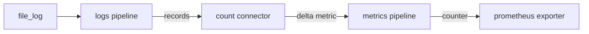

# Count Error Lines Into A Prometheus Metric

The count connector turns matching error records into a metric. Follow that metric through the metrics pipeline and exporter to Prometheus. A healthy scrape target proves connectivity; an increasing error counter proves the logs are being processed.

## From log records to a counter

A **connector** is a Collector component that is an exporter in one pipeline and a receiver in another. It is the bridge between two pipelines of different signal types. The **count connector** receives log records in a `logs` pipeline and emits a metric in a `metrics` pipeline. A condition in the Transformation Language decides which records it counts.

Three more parts finish the chain:

- The `delta_to_cumulative` processor. The count connector emits a delta, the number of matching records since the last export. Prometheus expects a counter that only grows. Without this processor, the value in Prometheus stays at 1.
- The `prometheus` exporter. It opens a port (here `8889`) and serves the metrics in the Prometheus text format on `/metrics`. Prometheus scrapes it like any other target.
- The setting `resource_to_telemetry_conversion`. It copies the resource attributes of the record into labels, so `k8s.deployment.name` becomes the label `k8s_deployment_name`. Version 0.162.0 prints a deprecation warning for this setting, but it works and it is the setting that adds the labels in this configuration.

The flow has two pipelines:



The `file_log` receiver feeds the logs pipeline, the count connector ends that pipeline and starts the metrics pipeline, and the `prometheus` exporter serves the result.

## Deploy the counting Collector

The connector is named `count`. It is listed under `connectors`, and it appears in the `exporters` of the logs pipeline and in the `receivers` of the metrics pipeline. The metric is named `log_error_lines`. The Prometheus exporter adds the suffix `_total` to a counter, so Prometheus sees `log_error_lines_total`.

<!-- astrona:playground:renew -->

Save this as `collector-logs-count.yaml`:

```yaml
apiVersion: opentelemetry.io/v1beta1
kind: OpenTelemetryCollector
metadata:
  name: logs
  namespace: monitoring
spec:
  mode: daemonset
  image: otel/opentelemetry-collector-contrib:0.162.0
  env:
    - name: K8S_NODE_NAME
      valueFrom:
        fieldRef:
          fieldPath: spec.nodeName
  volumes:
    - name: varlogpods
      hostPath:
        path: /var/log/pods
  volumeMounts:
    - name: varlogpods
      mountPath: /var/log/pods
      readOnly: true
  config:
    receivers:
      file_log:
        include:
          - /var/log/pods/*/*/*.log
        exclude:
          - /var/log/pods/monitoring_logs-collector-*/*/*.log
        start_at: end
        include_file_path: true
        operators:
          - type: container
    processors:
      k8s_attributes:
        filter:
          node_from_env_var: K8S_NODE_NAME
        pod_association:
          - sources:
              - from: resource_attribute
                name: k8s.pod.uid
        extract:
          metadata:
            - k8s.deployment.name
            - k8s.node.name
      filter/drop-info:
        error_mode: ignore
        logs:
          log_record:
            - 'IsMatch(body, "level=INFO")'
      delta_to_cumulative: {}
    connectors:
      count:
        logs:
          log_error_lines:
            description: Log lines with level=ERROR
            conditions:
              - 'IsMatch(body, "level=ERROR")'
    exporters:
      debug:
        verbosity: basic
      prometheus:
        endpoint: 0.0.0.0:8889
        resource_to_telemetry_conversion:
          enabled: true
    service:
      pipelines:
        logs:
          receivers: [file_log]
          processors: [k8s_attributes, filter/drop-info]
          exporters: [debug, count]
        metrics:
          receivers: [count]
          processors: [delta_to_cumulative]
          exporters: [prometheus]
```

The debug exporter stays, with the lower verbosity `basic`, so the Collector's log shows only how many records pass. Apply it:

```sh
kubectl apply -f collector-logs-count.yaml
```

The operator creates a Service named `logs-collector` for the exporter port. It carries the labels `app.kubernetes.io/instance: monitoring.logs` and `operator.opentelemetry.io/collector-service-type: base`, and it names the port `prometheus`. Then check the result. After a minute, read the metric straight from the Collector with a request from the `shuttle` pod:

```sh
kubectl -n starfleet exec deploy/shuttle -- curl -s logs-collector.monitoring:8889/metrics | grep log_error
```

You should see a line with the metric name, the labels from the record, and the value. The output is shortened to the metric name and the labels that matter; the real line has more labels and the count:

```text
# HELP log_error_lines_total Log lines with level=ERROR
# TYPE log_error_lines_total counter
log_error_lines_total{k8s_container_name="probe",...,k8s_deployment_name="probe",k8s_namespace_name="outpost",...}
```

## Make Prometheus scrape it

A **ServiceMonitor** is a Prometheus Operator resource that tells Prometheus to scrape the endpoints behind matching Services. Its `selector` matches the labels of the Service. Its `endpoints` entry names the port, here `prometheus`. In this playground, the Prometheus resource selects only ServiceMonitors that carry the label `release: kps`. A ServiceMonitor without this label is ignored, and its target never appears.

Save this as `servicemonitor-logs-collector.yaml`:

```yaml
apiVersion: monitoring.coreos.com/v1
kind: ServiceMonitor
metadata:
  name: logs-collector
  namespace: monitoring
  labels:
    release: kps
spec:
  selector:
    matchLabels:
      app.kubernetes.io/instance: monitoring.logs
      operator.opentelemetry.io/collector-service-type: base
  endpoints:
    - port: prometheus
      interval: 15s
```

Apply it:

```sh
kubectl apply -f servicemonitor-logs-collector.yaml
```

Prometheus reads a new ServiceMonitor after about a minute. In a second terminal, start a port-forward to Prometheus and leave it running:

```sh
kubectl -n monitoring port-forward svc/kps-prometheus 9090:9090
```

Then check the result. This helper sends a PromQL query and prints the result series:

```sh
query_prometheus() {
  curl -fsS http://127.0.0.1:9090/api/v1/query \
    --data-urlencode "query=$1" | jq -c '.data.result[]'
}
query_prometheus 'up{job="logs-collector"}'
```

You should see one series with the value `"1"`. The output is shortened here by removing the timestamp:

```text
{"metric":{"__name__":"up","container":"otc-container","endpoint":"prometheus","instance":"10.244.0.20:8889","job":"logs-collector","namespace":"monitoring","pod":"logs-collector-8n9k4","service":"logs-collector"},"value":[...,"1"]}
```

The target is up. Wait until a minute has passed after the first scrape, so that `rate()` has data, and ask for the counter and the per-second rate. `probe` writes one error line every 4 seconds, so the rate is close to 0.25:

```sh
query_prometheus 'sum by (k8s_deployment_name) (rate(log_error_lines_total[1m]))'
query_prometheus 'sum by (k8s_namespace_name, k8s_deployment_name) (increase(log_error_lines_total[2m]))'
```

You should see something like this. Your numbers will differ a little:

```text
{"metric":{"k8s_deployment_name":"probe"},"value":[...,"0.19393888888888888"]}
{"metric":{"k8s_deployment_name":"probe","k8s_namespace_name":"outpost"},"value":[...,"11.6536"]}
```

The first query says that `probe` logs about 0.19 error lines per second. The second says that it logged about 11.7 error lines in the last two minutes. The values are lower than 0.25 and 15 because the metric did not exist for the full range when the query ran. The labels `k8s_deployment_name` and `k8s_namespace_name` come from the Kubernetes data that `k8s_attributes` added. This is why that processor sits before the connector.

The chain is now complete. Container log files on each node become log records, the Collector adds Kubernetes data, the count connector turns the `ERROR` records into a counter, and Prometheus stores it. From here an alerting rule or a Grafana panel can use `log_error_lines_total` like any other metric. When this chain breaks, find the first component that does not do its job: the Collector's log shows permission errors, the target page shows a missing target, and a query shows a missing label.

## Common pitfalls

> [!WARNING]
> - **No `delta_to_cumulative` processor.** The counter stays at 1 in Prometheus. The connector emits a delta, and the exporter needs a cumulative value.
> - **A ServiceMonitor without `release: kps`.** Prometheus does not select it and the target never appears. Check the labels first.
> - **Selecting the wrong Service.** The operator also creates `logs-collector-headless` and `logs-collector-monitoring`. The selector with the `base` service type label picks only the metric Service.
> - **Querying the dotted name.** The Prometheus names use underscores. Ask for `k8s_deployment_name`, not `k8s.deployment.name`.
> - **Querying too early.** Prometheus scrapes every 15 seconds here, and `rate()` over one minute needs at least two samples. Wait a minute after a change.

## Your mission: Scrape Collector Error Metrics

The `logs` Collector runs as a DaemonSet in `monitoring`. It reads `probe` error logs and exposes `log_error_lines_total` for Prometheus.

This independent lab has 4 tasks. Allow 10–15 minutes for task work, plus environment startup and telemetry collection.

Pause the playground and start the lab:

```sh
astrona stop ats-020-playground-020-02
astrona run --git ssh://git@github.com/astrona-io/ATS020.git -c sections/section-020/module-20/labs/lab-02
```

Submit after verifying the result:

```sh
astrona submit -c sections/section-020/module-20/labs/lab-02
```

Remove the lab and resume the playground:

```sh
astrona destroy ats-020-lab-020-02-02
astrona start ats-020-playground-020-02
```
