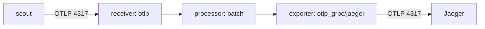

# A Collector With An OTLP Receiver And A Jaeger Exporter

Applications should not know where traces are stored. They send spans to a Collector, and the Collector decides what happens next: batching, filtering and the choice of backend. This part writes the OpenTelemetryCollector resource that sits between `scout` and Jaeger, and shows what the Operator builds from it.

## The problem: spans with nowhere to go

The `scout` pod in `starfleet` already creates spans. The OpenTelemetry software development kit (SDK) inside the application records each request as a span and sends the spans over the OpenTelemetry Protocol (OTLP). OTLP is the wire format for telemetry. It uses port `4317` for gRPC and port `4318` for HTTP. `scout` sends them to `http://otel-collector.observability:4317`, but no Service with that name exists yet. Its logs show it:

<!-- astrona:playground:renew -->

```sh
kubectl -n starfleet logs deploy/scout --tail=2
```

```text
{"level":"info","ts":"2026-11-02T18:58:52.904Z","caller":"errorhandler/errorhandler.go:36","msg":"exporter export timeout: rpc error: code = Unavailable desc = name resolver error: produced zero addresses"}
{"level":"info","ts":"2026-11-02T18:59:01.933Z","caller":"errorhandler/errorhandler.go:36","msg":"traces export: exporter export timeout: rpc error: code = Unavailable desc = name resolver error: produced zero addresses"}
```

"Produced zero addresses" means the Service name did not resolve. The spans are lost.

## The parts of a Collector

A Collector is built from four kinds of part. A **receiver** is where data comes in. A **processor** changes data on its way through, for example by grouping spans into batches. An **exporter** sends data out. A **pipeline** connects them for one signal: it lists the receivers, the processors in order, and the exporters.

Defining a part is not enough. The Collector only starts a part that a pipeline lists. This rule explains most broken Collector configurations, and the last part of this module returns to it.



The diagram shows one `traces` pipeline: spans enter at the receiver, pass through the processor and leave through the exporter to Jaeger.

The names have the form `type` or `type/name`. `otlp` is a receiver of type `otlp`. `otlp_grpc/jaeger` is an exporter of type `otlp_grpc` that this configuration calls `jaeger`. The second form lets you define two parts of the same type.

## Write the OpenTelemetryCollector

Save this as `opentelemetrycollector-otel.yaml`:

```yaml
apiVersion: opentelemetry.io/v1beta1
kind: OpenTelemetryCollector
metadata:
  name: otel
  namespace: observability
spec:
  mode: deployment
  image: otel/opentelemetry-collector-contrib:0.162.0
  config:
    receivers:
      otlp:
        protocols:
          grpc:
            endpoint: 0.0.0.0:4317
          http:
            endpoint: 0.0.0.0:4318
    processors:
      batch: {}
    exporters:
      otlp_grpc/jaeger:
        endpoint: jaeger.observability:4317
        tls:
          insecure: true
    service:
      pipelines:
        traces:
          receivers: [otlp]
          processors: [batch]
          exporters: [otlp_grpc/jaeger]
```

The fields under `spec` have these jobs:

- `mode` chooses what the Operator creates to run the Collector. `deployment` creates a Deployment.
- `image` is the Collector image. The `contrib` image holds many receivers and exporters. Without this field the Operator uses its own default image.
- `config` is the Collector configuration itself. In the `v1beta1` version of the resource it is written as YAML, not as a string.
- The `otlp` receiver listens on both OTLP ports on all addresses.
- The `batch` processor groups spans and sends them together.
- The exporter sends spans over gRPC to the Service `jaeger` on port `4317`. `tls.insecure: true` switches off TLS, because Jaeger in the playground has none.
- The `traces` pipeline connects the three parts.

Apply it:

```sh
kubectl apply -f opentelemetrycollector-otel.yaml
```

## What the Operator creates

The Collector name is `otel`, so the Operator names everything it creates `otel-collector`. That is the Service name `scout` already uses. Wait a few seconds, then list the objects:

```sh
kubectl -n observability get opentelemetrycollector,deployment,service
```

```text
NAME                                           MODE         VERSION   READY   AGE   IMAGE                                          MANAGEMENT
opentelemetrycollector.opentelemetry.io/otel   deployment   0.160.0   1/1     27s   otel/opentelemetry-collector-contrib:0.162.0   managed

NAME                             READY   UP-TO-DATE   AVAILABLE   AGE
deployment.apps/jaeger           1/1     1            1           2m26s
deployment.apps/otel-collector   1/1     1            1           27s

NAME                                TYPE        CLUSTER-IP      EXTERNAL-IP   PORT(S)                       AGE
service/jaeger                      ClusterIP   10.96.10.202    <none>        4317/TCP,4318/TCP,16686/TCP   2m26s
service/otel-collector              ClusterIP   10.96.220.64    <none>        4317/TCP,4318/TCP             27s
service/otel-collector-headless     ClusterIP   None            <none>        4317/TCP,4318/TCP             27s
service/otel-collector-monitoring   ClusterIP   10.96.137.118   <none>        8888/TCP                      27s
```

In the `VERSION` column, `0.160.0` is the version of the Operator, not of the Collector. The image column shows the Collector, `0.162.0`.

The Service `otel-collector` has the ports `4317` and `4318`. The Operator took these ports from the receivers in the pipeline. The Service `otel-collector-monitoring` exposes port `8888`, where the Collector reports metrics about itself. The Operator also stored your configuration, with a metrics setting added, in a ConfigMap, and the Deployment mounts it:

```sh
kubectl -n observability get cm $(kubectl -n observability get deploy otel-collector -o jsonpath='{.spec.template.spec.volumes[0].configMap.name}') -o jsonpath='{.data.collector\.yaml}'
```

```text
receivers:
  otlp:
    protocols:
      grpc:
        endpoint: 0.0.0.0:4317
      http:
        endpoint: 0.0.0.0:4318
exporters:
  otlp_grpc/jaeger:
    endpoint: jaeger.observability:4317
    tls:
      insecure: true
processors:
  batch: {}
service:
  telemetry:
    metrics:
      readers:
        - pull:
            exporter:
              prometheus:
                host: 0.0.0.0
                port: 8888
  pipelines:
    traces:
      exporters:
        - otlp_grpc/jaeger
      processors:
        - batch
      receivers:
        - otlp
```

The ConfigMap name ends in a hash of the content, so it changes when you change the configuration. Your hash differs from the one in this book. The Operator keeps the older ConfigMaps for a while.

## Check that spans flow

Read the Collector log. Each part that starts writes a line. The command below keeps three fields of each log line: the level, the source file and the message:

```sh
kubectl -n observability logs deploy/otel-collector | awk -F'\t' '/Starting|Everything/{print $2, $3, $4}'
```

```text
info service@v0.162.0/service.go:233 Starting otelcol-contrib...
info extensions/extensions.go:43 Starting extensions...
info otlpreceiver@v0.162.0/otlp.go:120 Starting GRPC server
info otlpreceiver@v0.162.0/otlp.go:175 Starting HTTP server
info service@v0.162.0/service.go:256 Everything is ready. Begin running and processing data.
```

The receiver started a gRPC server and an HTTP server, one for each protocol you listed. Now read the Collector's own metrics from `shuttle`, through the `otel-collector-monitoring` Service. Two counters show the flow. `otelcol_receiver_accepted_spans` counts spans the receiver took in, and `otelcol_exporter_sent_spans` counts spans the exporter delivered. The counters grow over time, so your numbers differ:

```sh
kubectl exec -n starfleet deploy/shuttle -- curl -s otel-collector-monitoring.observability:8888/metrics | grep -E "^otelcol_(receiver_accepted_spans|exporter_sent_spans)"
```

```text
otelcol_exporter_sent_spans{exporter="otlp_grpc/jaeger",server_address="jaeger.observability",server_port="4317"} 232
otelcol_receiver_accepted_spans{receiver="otlp",transport="grpc"} 232
```

Both counters are equal and rising, so every span that `scout` sends passes through the Collector to Jaeger. You now have a working pipeline and know which Kubernetes objects the Operator made for it. The open question is how to find one of these traces in Jaeger and read it.

## Common pitfalls

> [!WARNING]
> - **Defining a part without listing it in a pipeline.** The Collector ignores it. A receiver that no pipeline lists never opens its port, and the Operator leaves its port out of the Service.
> - **Mixing up the two ports.** `4317` is OTLP over gRPC and `4318` is OTLP over HTTP. An exporter that expects one and talks to the other fails to connect or to decode.
> - **Forgetting `tls.insecure: true` for a backend without TLS.** The exporter then tries a TLS handshake and fails.
> - **Reading the `VERSION` column as the Collector version.** It shows the Operator version. The `IMAGE` column shows the Collector.
