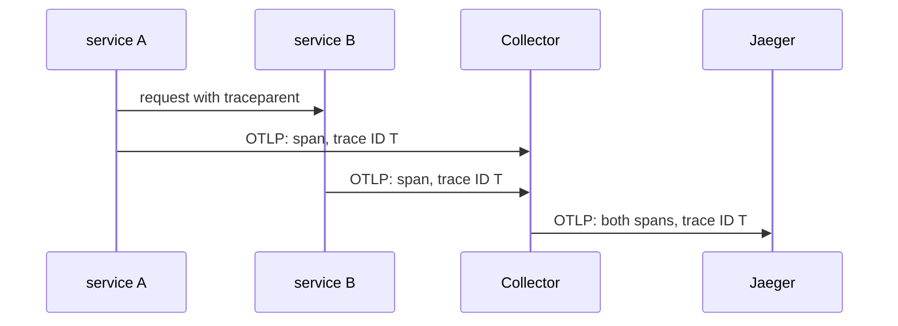

# Reading A Trace In Jaeger

Spans that reach Jaeger are only useful if you can find the right trace and read it. A trace answers a question that metrics cannot: when one request crossed several steps, where did the time go? This part defines the words, then finds traces in Jaeger two ways: with the API from the command line, and in the web interface.

## Traces, spans and the trace ID

A **span** is one timed step of a request, such as "handle `GET /` in `scout`". It has a name, a start time, a duration and attributes. A **trace** is the set of all spans that belong to one request. All spans of a trace share one **trace ID**. Every span also has its own **span ID**, and a span has a **parent span ID** that points at the span that caused it. A span with no parent is the **root span**.

When a request moves from one service to the next, the first service passes the trace ID on in an HTTP header named `traceparent`. Its format is `00-<trace ID>-<parent span ID>-<flags>`. The second service reads the header and creates its spans with that trace ID. This is **context propagation**. Without it, each service would start a new trace, and Jaeger could not join the steps.



The diagram shows a request that crosses two services. Both services send their spans to the Collector, not to Jaeger, and the spans carry the same trace ID. In this part `scout` is the only service with spans, so its trace has the spans of one service. The ideas are the same.

## Find traces with the Jaeger API

Jaeger 2.22 serves its web interface and its API on port `16686` of the Service `jaeger`. Start a port-forward in a second terminal and leave it running:

<!-- astrona:playground:renew -->

```sh
kubectl -n observability port-forward svc/jaeger 16686:16686
```

In your first terminal, ask which services have sent spans. The version 3 API (`/api/v3`) is the one this Jaeger version serves; the older path `/api/services` answers `404`:

```sh
curl -fsS http://127.0.0.1:16686/api/v3/services | jq -c .services
```

```text
["jaeger","scout"]
```

`jaeger` is Jaeger tracing its own work. `scout` is your application, which proves that its spans passed through the Collector. The trace search needs a start and an end time. This helper uses a wide window, so you do not compute dates. It prints the name, trace ID, span ID and parent span ID of every span the search finds. The second argument is the number of traces to return:

```sh
list_spans() {
  curl -fsS "http://127.0.0.1:16686/api/v3/traces?query.service_name=$1&query.start_time_min=2020-01-01T00:00:00Z&query.start_time_max=2100-01-01T00:00:00Z&query.search_depth=${2:-1}" |
    jq -c '.result.resourceSpans[].scopeSpans[].spans[] | {name, traceId, spanId, parentSpanId}'
}
list_spans scout
```

The trace IDs differ on every system, so your values differ from these:

```text
{"name":"infoHandler","traceId":"d62d920cc3f3566a2b5c756a2bc34571","spanId":"f2fa4afc2d30506e","parentSpanId":"a3c3217014ed2b22"}
{"name":"GET /","traceId":"d62d920cc3f3566a2b5c756a2bc34571","spanId":"a3c3217014ed2b22","parentSpanId":null}
```

Both spans have the same `traceId`. The span `GET /` is the root span, because its `parentSpanId` is `null`. The span `infoHandler` is its child: its `parentSpanId` equals the `spanId` of `GET /`. That is a trace with two spans in one service.

## Send a test trace

When a real application sends nothing, you need to know whether the fault is in the application or in the pipeline. `telemetrygen` is a tool from the Collector project that sends generated spans over OTLP. Run it once as a pod. It sends one trace to the Collector Service and exits. It prints many log lines of its own, and the last one is `stopping the exporter`:

```sh
kubectl -n observability run telemetrygen --restart=Never --rm -i --image=ghcr.io/open-telemetry/opentelemetry-collector-contrib/telemetrygen:v0.162.0 -- traces --otlp-insecure --otlp-endpoint otel-collector.observability:4317 --service telemetrygen-test --traces 1
```

Jaeger shows the trace a few seconds later, because the batch processor waits before it exports. Search for the new service name:

```sh
list_spans telemetrygen-test
```

```text
{"name":"okey-dokey-0","traceId":"289d1864033b8462e09ae1b59bcb45e6","spanId":"7ded96de08929b2a","parentSpanId":"9af267753a020c1d"}
{"name":"lets-go","traceId":"289d1864033b8462e09ae1b59bcb45e6","spanId":"9af267753a020c1d","parentSpanId":null}
```

The generated trace has a root span `lets-go` and a child span `okey-dokey-0`. If this appears and the `scout` trace does not, the fault is in `scout` or its endpoint. If neither appears, the fault is in the Collector or in Jaeger.

## Find the slow step

The search can filter by duration. `shuttle` sends a request to `/delay/1` of `scout` every tenth round, and that request takes about one second. Add `query.duration_min=500ms` to find only traces at least that long:

```sh
curl -fsS "http://127.0.0.1:16686/api/v3/traces?query.service_name=scout&query.start_time_min=2020-01-01T00:00:00Z&query.start_time_max=2100-01-01T00:00:00Z&query.search_depth=1&query.duration_min=500ms" |
  jq -c '[.result.resourceSpans[].scopeSpans[].spans[] | {name, traceId}]'
```

```text
[{"name":"delayHandler","traceId":"1f5f53f2ec58cf5e8469da8446760589"},{"name":"GET /delay/{wait:[0-9]+}","traceId":"1f5f53f2ec58cf5e8469da8446760589"}]
```

The two spans of the slow request share one trace ID. The root span `GET /delay/{wait:[0-9]+}` is the whole request, and `delayHandler` is the step inside it.

## The web interface

Open `http://127.0.0.1:16686` in a browser. Choose the service `scout` on the Search page and select **Find Traces**. Each row is a trace. Open one to see its spans as bars on a timeline: the root span on top, its children below, and the length of each bar showing its duration. The same data that the API returned appears there, with the span attributes, such as `http.route` and `http.response.status_code`, in each span's detail.

Jaeger in the playground stores traces in memory. If the `jaeger` pod restarts, every trace is gone, and the Collector does not store them again.

You can now find a trace by service name, read its parent and child spans, send a test trace, and filter by duration. The remaining question is how to choose where the Collector runs: one shared Deployment is not the only option.

## Common pitfalls

> [!WARNING]
> - **Searching without a time range.** The version 3 API answers `400` with `min and max start time are required`.
> - **Looking for a trace seconds after the request.** The batch processor and Jaeger need a few seconds. Search again before you decide that spans are missing.
> - **Reading `null` as a missing value.** A `parentSpanId` of `null` marks the root span. It is not an error.
> - **Expecting traces after a Jaeger restart.** In-memory storage loses them.
