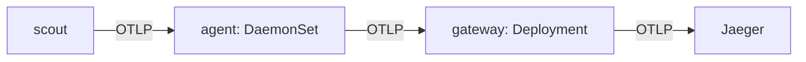

# Choosing A Collector Mode

One Collector configuration can run in more than one way. Where the Collector runs decides how many copies exist, how far the data travels to reach it, and which failures it shares with the application. This part creates a Collector in each of the modes the Operator supports and shows what each one builds.

## Four modes, four shapes

The `mode` field of an OpenTelemetryCollector tells the Operator which Kubernetes object runs the Collector.

- `deployment` creates a Deployment with a Service. One shared Collector, or a few copies behind the Service, receives data from many applications. Call this a **gateway**.
- `daemonset` creates a DaemonSet, which runs one pod on every node. Applications and other tools on a node send data to the Collector on the same node. Call this an **agent**.
- `sidecar` creates no workload. The Operator adds a Collector container to every pod that asks for it with an annotation. Each application gets its own Collector.
- `statefulset` creates a StatefulSet. It gives each pod a stable name, and the Operator uses it with the Target Allocator for Prometheus scraping. This module does not use it.

The usual choice is a gateway for shared processing, an agent where something must run on every node (reading files from the node, for example), and a sidecar where one application needs its own settings.



The diagram shows a common layout: an agent on the node forwards to a gateway, and only the gateway talks to the backend.

## The mode cannot change in place

The `otel` Collector runs in `deployment` mode. Try to turn it into a DaemonSet by patching its `mode` field:

<!-- astrona:playground:renew -->

```sh
kubectl -n observability patch opentelemetrycollector otel --type merge -p '{"spec":{"mode":"daemonset"}}'
```

The Operator's validating webhook refuses the change:

```text
Error from server (Forbidden): admission webhook "vopentelemetrycollectorcreateupdatebeta.kb.io" denied the request: the OpenTelemetry Collector mode is set to deployment, which does not support modification
```

To change the mode of an existing Collector you must delete it and create it again. Leave `otel` as it is and create two more Collectors with other names.

## Create an agent

Save this as `opentelemetrycollector-agent.yaml`. It receives OTLP on port `4317` and forwards to the gateway `otel-collector`:

```yaml
apiVersion: opentelemetry.io/v1beta1
kind: OpenTelemetryCollector
metadata:
  name: agent
  namespace: observability
spec:
  mode: daemonset
  image: otel/opentelemetry-collector-contrib:0.162.0
  config:
    receivers:
      otlp:
        protocols:
          grpc:
            endpoint: 0.0.0.0:4317
    processors:
      batch: {}
    exporters:
      otlp_grpc/gateway:
        endpoint: otel-collector.observability:4317
        tls:
          insecure: true
    service:
      pipelines:
        traces:
          receivers: [otlp]
          processors: [batch]
          exporters: [otlp_grpc/gateway]
```

Apply it:

```sh
kubectl apply -f opentelemetrycollector-agent.yaml
```

Then list what the Operator created. The label selects the objects that belong to the `agent` Collector:

```sh
kubectl -n observability get daemonset,pod -l app.kubernetes.io/instance=observability.agent
```

```text
NAME                             DESIRED   CURRENT   READY   UP-TO-DATE   AVAILABLE   NODE SELECTOR   AGE
daemonset.apps/agent-collector   1         1         1       1            1           <none>          20s

NAME                        READY   STATUS    RESTARTS   AGE
pod/agent-collector-4n8mc   1/1     Running   0          20s
```

The playground has one node, so the DaemonSet has one pod. A cluster with five nodes would run five. The Operator named the objects `agent-collector`, after the resource name `agent`, and it also created the Services `agent-collector`, `agent-collector-headless` and `agent-collector-monitoring`.

## Inject a sidecar

A sidecar Collector is created in two steps. First, create an OpenTelemetryCollector with `mode: sidecar`. It runs nothing by itself. Save this as `opentelemetrycollector-edge.yaml`:

```yaml
apiVersion: opentelemetry.io/v1beta1
kind: OpenTelemetryCollector
metadata:
  name: edge
  namespace: starfleet
spec:
  mode: sidecar
  image: otel/opentelemetry-collector-contrib:0.162.0
  config:
    receivers:
      otlp:
        protocols:
          grpc:
            endpoint: 0.0.0.0:4317
    processors:
      batch: {}
    exporters:
      otlp_grpc/gateway:
        endpoint: otel-collector.observability:4317
        tls:
          insecure: true
    service:
      pipelines:
        traces:
          receivers: [otlp]
          processors: [batch]
          exporters: [otlp_grpc/gateway]
```

```sh
kubectl apply -f opentelemetrycollector-edge.yaml
```

Second, add the annotation `sidecar.opentelemetry.io/inject` to the pod template of the workload. Its value is the name of the Collector. The Operator's mutating webhook reads the annotation when a pod is created, so the change only reaches new pods. Patching the pod template makes the Deployment roll out a new pod:

```sh
kubectl -n starfleet patch deployment scout --type merge -p '{"spec":{"template":{"metadata":{"annotations":{"sidecar.opentelemetry.io/inject":"edge"}}}}}'
kubectl -n starfleet rollout status deploy/scout
kubectl -n starfleet get pods
```

```text
deployment.apps/scout patched
deployment "scout" successfully rolled out
NAME                       READY   STATUS        RESTARTS   AGE
scout-6b57d6d96f-pfkhg     2/2     Running       0          12s
scout-787bdfdc65-q9z8p     1/1     Terminating   0          3m9s
shuttle-65f695c8c6-jr5xb   1/1     Running       0          12m
```

The new `scout` pod shows `2/2`: the application and the Collector. The Collector is not in the container list. Kubernetes 1.35 runs it as a native sidecar, an init container with `restartPolicy: Always`. Check:

```sh
kubectl -n starfleet get pod -l app=scout -o jsonpath='{.items[0].spec.initContainers[0].name}{" "}{.items[0].spec.initContainers[0].restartPolicy}{"\n"}'
```

```text
otc-container Always
```

Because the Collector shares the pod, the application would reach it at `localhost:4317`. This module leaves the `scout` endpoint as it is, so `scout` still sends to the gateway. You can now name the four modes and create an agent and a sidecar. The question left is what to do when the Collector runs but no trace arrives.

## Common pitfalls

> [!WARNING]
> - **Changing `mode` on an existing Collector.** The webhook denies it. Delete the resource and create it again.
> - **Expecting a `sidecar` Collector to run on its own.** It runs nothing until a pod carries the `sidecar.opentelemetry.io/inject` annotation.
> - **Annotating a running pod.** The webhook only acts when a pod is created. Annotate the pod template of the Deployment, so that new pods get the sidecar.
> - **Putting the annotation on the Deployment's own metadata.** It must be on the pod template, under `spec.template.metadata`.
