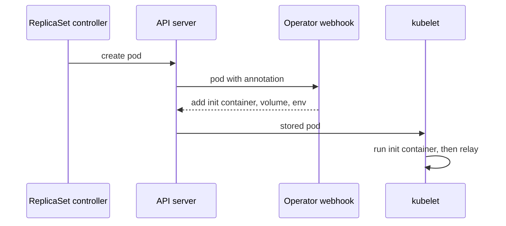

# What The Operator Injects Into A Pod

A trace is only as complete as the services that create spans. `scout` creates its own spans, but `relay`, the service in front of it, has no tracing code at all. Adding a tracing library to every service means changing code, rebuilding images and rolling out each one. The OpenTelemetry Operator can instead add a tracing agent to a pod at the moment the pod is created. This part shows what the Operator adds, which resource and annotation tell it to do so, and why only new pods change.

## A trace that starts too late

A **span** is one timed step of a request. A **trace** is the set of all spans of one request, and all of them share one **trace ID**. In the playground, `shuttle` sends a request to `relay` every 2 seconds, and `relay` sends one request to `scout`. So every request crosses two services. Start a port-forward to Jaeger in a second terminal and leave it running:

<!-- astrona:playground:renew -->

```sh
kubectl -n observability port-forward svc/jaeger 16686:16686
```

Ask the Jaeger API which services have sent spans. Then define a small helper that prints the spans of the newest traces of one service. It leaves out the `GET /readyz` spans that the readiness probe of `scout` creates:

```sh
curl -fsS http://127.0.0.1:16686/api/v3/services | jq -c .services

list_spans() {
  curl -fsS "http://127.0.0.1:16686/api/v3/traces?query.service_name=$1&query.start_time_min=2020-01-01T00:00:00Z&query.start_time_max=2100-01-01T00:00:00Z&query.search_depth=${2:-1}" |
    jq -c '.result.resourceSpans[] | (.resource.attributes[] | select(.key=="service.name") | .value.stringValue) as $service | .scopeSpans[].spans[] | select(.name != "GET /readyz") | {service: $service, name, traceId, spanId, parentSpanId}'
}
list_spans scout 3 | head -2
```

Only `scout` and `jaeger` itself appear. The first two spans of `scout` show a trace that starts at `scout`. Your trace IDs differ:

```text
["jaeger","scout"]
{"service":"scout","name":"infoHandler","traceId":"a3772cb5867739d7d3e3839dd3ac6b62","spanId":"83e2d5a8703144b0","parentSpanId":"1d5802525a98f026"}
{"service":"scout","name":"GET /","traceId":"a3772cb5867739d7d3e3839dd3ac6b62","spanId":"1d5802525a98f026","parentSpanId":null}
```

The span `GET /` is the root span, because its `parentSpanId` is `null`. The request really began one step earlier, in `relay`. `relay` creates no spans and sends no trace context to `scout`, so `scout` starts a new trace for every request. Jaeger cannot show the step in `relay`, and it cannot show how much of the time went there.

## How the injection works

The OpenTelemetry Operator watches for a pod that asks to be instrumented. The pod asks with an **annotation**, a key-value pair in its metadata. For Node.js the key is `instrumentation.opentelemetry.io/inject-nodejs`. The settings for the agent come from an **Instrumentation**, a custom resource of the Operator that holds the exporter endpoint, the propagators and the sampler.

The work happens in a **mutating admission webhook**. This is an HTTP service that the Kubernetes API server calls when it receives a request to create an object. The service can change the object before the API server stores it. The webhook of the Operator reads the annotation, finds the Instrumentation in the namespace of the pod, and adds an init container, a volume and environment variables to the pod.



The diagram shows that the change happens while the pod is created, before the kubelet starts any container. The init container copies the Node.js agent into a shared volume and exits. The `relay` container then starts with the environment variable `NODE_OPTIONS`, which makes Node.js load the agent before the application code. The application itself does not change.

This has one consequence that the exam likes to test. The webhook only sees create requests. A pod that already runs is never changed, so a pod must be created again after the Instrumentation and the annotation both exist.

## Create the Instrumentation

Start with the Instrumentation. Save this as `instrumentation-nodejs.yaml`:

```yaml
apiVersion: opentelemetry.io/v1alpha1
kind: Instrumentation
metadata:
  name: nodejs
  namespace: starfleet
spec:
  exporter:
    endpoint: http://otel-collector.observability:4318
  propagators:
    - tracecontext
    - baggage
  sampler:
    type: parentbased_traceidratio
    argument: "1"
```

The field `exporter.endpoint` is where the agent sends its spans. Here it is the Service `otel-collector` on port `4318`, the OTLP (OpenTelemetry Protocol) HTTP port of the Collector. The field `propagators` lists the formats in which the agent passes trace context to the next service. The field `sampler` decides which traces the agent keeps, and `parentbased_traceidratio` with the argument `1` keeps every trace.

Apply it:

```sh
kubectl apply -f instrumentation-nodejs.yaml
```

Then check the result. The Instrumentation exists, and the running `relay` pod has no init container yet:

```sh
kubectl -n starfleet get instrumentation
kubectl -n starfleet get pods -l app=relay -o 'custom-columns=NAME:.metadata.name,INIT:.spec.initContainers[*].name'
```

```text
NAME     AGE   ENDPOINT                                   SAMPLER                    SAMPLER ARG
nodejs   0s    http://otel-collector.observability:4318   parentbased_traceidratio   1
NAME                     INIT
relay-58cd79c99d-qdvxc   <none>
```

The Instrumentation alone changes nothing. No pod has asked for it, and the running pod was created before it existed.

## Annotate the pod template

The annotation must be on the **pod template** of the Deployment, because the pods are created from the template. Save this as `relay-patch.yaml`:

```yaml
spec:
  template:
    metadata:
      annotations:
        instrumentation.opentelemetry.io/inject-nodejs: "true"
```

The value `"true"` means "use the Instrumentation in the namespace of this pod". Apply the patch. A change to the pod template makes the Deployment create a new pod, so the webhook sees a create request. Wait for the rollout and list the pods:

```sh
kubectl -n starfleet patch deployment relay --patch-file relay-patch.yaml
kubectl -n starfleet rollout status deployment/relay
kubectl -n starfleet get pods -l app=relay
```

```text
deployment.apps/relay patched
Waiting for deployment "relay" rollout to finish: 0 out of 1 new replicas have been updated...
Waiting for deployment "relay" rollout to finish: 1 old replicas are pending termination...
Waiting for deployment "relay" rollout to finish: 1 old replicas are pending termination...
deployment "relay" successfully rolled out
NAME                     READY   STATUS        RESTARTS   AGE
relay-58cd79c99d-qdvxc   1/1     Terminating   0          2m25s
relay-78b85c779-jvqnj    1/1     Running       0          6s
```

The old pod is still shutting down, and the new pod is `Running`. Wait a few seconds until only the new pod is listed. Then read what the webhook added to it. The first command shows the init container and its image. The second prints the environment variables that matter. Your pod name differs:

```sh
kubectl -n starfleet get pod -l app=relay -o jsonpath='{.items[0].spec.initContainers[0].name}{"\n"}{.items[0].spec.initContainers[0].image}{"\n"}'
kubectl -n starfleet get pod -l app=relay -o json | jq -r '.items[0].spec.containers[0].env[] | select(.name|test("^(NODE_OPTIONS|OTEL_(SERVICE_NAME|EXPORTER_OTLP_ENDPOINT|PROPAGATORS|TRACES_SAMPLER|TRACES_SAMPLER_ARG))$")) | "\(.name)=\(.value)"'
```

```text
opentelemetry-auto-instrumentation-nodejs
ghcr.io/open-telemetry/opentelemetry-operator/autoinstrumentation-nodejs:0.78.0
NODE_OPTIONS= --require /otel-auto-instrumentation-nodejs/autoinstrumentation.js
OTEL_SERVICE_NAME=relay
OTEL_EXPORTER_OTLP_ENDPOINT=http://otel-collector.observability:4318
OTEL_PROPAGATORS=tracecontext,baggage
OTEL_TRACES_SAMPLER=parentbased_traceidratio
OTEL_TRACES_SAMPLER_ARG=1
```

The init container `opentelemetry-auto-instrumentation-nodejs` is the proof that the webhook ran. The values of the variables come from the Instrumentation: the endpoint, the propagators and the sampler. The Operator also sets `OTEL_SERVICE_NAME` to `relay`, the name of the workload, and `NODE_OPTIONS` loads the agent. The pod has more `OTEL_` variables than these, and the command shows only the ones that matter here.

You now know what the Operator adds to a pod, which two resources trigger it, and why only a new pod changes. The open question is whether the spans of `relay` really reach Jaeger and join the spans of `scout` in one trace.

## Common pitfalls

> [!WARNING]
> - **Expecting the Instrumentation alone to change a pod.** The webhook only changes pods that carry the annotation and are created afterwards.
> - **Looking at the old pod.** During a rollout two pods exist for a short time. Check the pod in `Running` state, not the one in `Terminating`.
> - **Reading the init container as a failure.** The init container runs once, copies the agent and exits. Its status `Completed` is the normal end.
