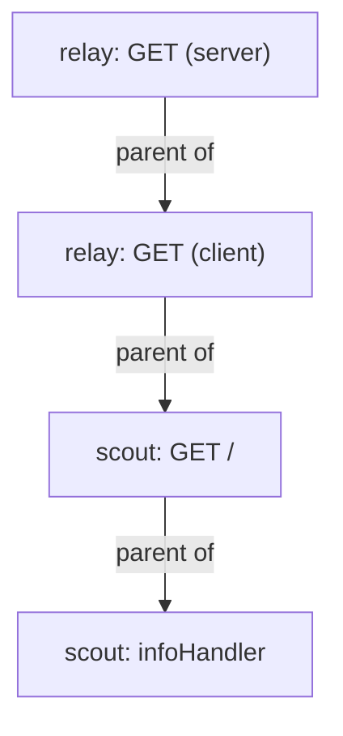

# Reading One Trace Across Two Services

An injected agent is only useful if its spans end up in the same trace as the spans of the next service. A trace that shows `relay` and `scout` in one tree answers the question that metrics cannot: when one request was slow, which step took the time? This part reads such a trace span by span, finds the slowest step of a slow request, and then removes the setting that joins the two services to see what breaks.

The commands need `relay` to carry the annotation `instrumentation.opentelemetry.io/inject-nodejs` on its pod template, and an Instrumentation named `nodejs` in `starfleet`. The `relay` pod must have been created after both.

## Find the joined trace

Keep a port-forward to Jaeger running in a second terminal. If it is not running, start it with `kubectl -n observability port-forward svc/jaeger 16686:16686`. Then define the helper that prints the spans of the newest traces of one service, and search for `relay`:

<!-- astrona:playground:renew -->

```sh
list_spans() {
  curl -fsS "http://127.0.0.1:16686/api/v3/traces?query.service_name=$1&query.start_time_min=2020-01-01T00:00:00Z&query.start_time_max=2100-01-01T00:00:00Z&query.search_depth=${2:-1}" |
    jq -c '.result.resourceSpans[] | (.resource.attributes[] | select(.key=="service.name") | .value.stringValue) as $service | .scopeSpans[].spans[] | select(.name != "GET /readyz") | {service: $service, name, traceId, spanId, parentSpanId}'
}
list_spans relay 1
```

Spans arrive a few seconds after the request, because the agent and the Collector both batch them. If the command prints nothing, run it again. The trace IDs differ on every system, so your values differ from these:

```text
{"service":"relay","name":"GET","traceId":"e1b605f2f564e70188dd9b387f651805","spanId":"66604d233db6d049","parentSpanId":"8cff97019427b3e1"}
{"service":"relay","name":"GET","traceId":"e1b605f2f564e70188dd9b387f651805","spanId":"8cff97019427b3e1","parentSpanId":null}
{"service":"scout","name":"GET /","traceId":"e1b605f2f564e70188dd9b387f651805","spanId":"bfa6a49a27e5ecc7","parentSpanId":"66604d233db6d049"}
{"service":"scout","name":"infoHandler","traceId":"e1b605f2f564e70188dd9b387f651805","spanId":"121c76f32f79a525","parentSpanId":"bfa6a49a27e5ecc7"}
```

All four spans have the same `traceId`, and two services appear in it. The chain of parents shows how the request moved. The span with `parentSpanId` `null` is the root span, the request that `shuttle` sent to `relay`. The other span of `relay` is a child of it: the request that `relay` sent on to `scout`. The span `GET /` of `scout` has that client span as its parent, and `infoHandler` is the last step inside `scout`.



The diagram shows the four spans as a tree. The link between `relay` and `scout` is the one that crosses a network call. It exists because the agent in `relay` added an HTTP header named `traceparent` to its request. The format of the header is `00-<trace ID>-<parent span ID>-<flags>`. `scout` read the header and created its spans with that trace ID and that parent. Passing the trace ID like this from one service to the next is **context propagation**.

## Name the slowest step

`shuttle` sends a request to `/slow` of `relay` every fifth round. `relay` asks `scout` for `/delay/1`, and `scout` waits one second. Add `query.duration_min=500ms` to the search to find only traces at least that long. The helper below also prints the duration of every span in milliseconds, and the span `kind`. The kind `1` is an internal step, `2` is a server span that handled a request, and `3` is a client span that sent a request:

```sh
slow_trace() {
  curl -fsS "http://127.0.0.1:16686/api/v3/traces?query.service_name=relay&query.start_time_min=2020-01-01T00:00:00Z&query.start_time_max=2100-01-01T00:00:00Z&query.search_depth=1&query.duration_min=500ms" |
    jq -c '.result.resourceSpans[] | (.resource.attributes[] | select(.key=="service.name") | .value.stringValue) as $service | .scopeSpans[].spans[] | {service: $service, name, kind, ms: (((.endTimeUnixNano|tonumber) - (.startTimeUnixNano|tonumber)) / 1000000 | round)}'
}
slow_trace
```

```text
{"service":"scout","name":"delayHandler","kind":1,"ms":1000}
{"service":"scout","name":"GET /delay/{wait:[0-9]+}","kind":2,"ms":1000}
{"service":"relay","name":"GET","kind":3,"ms":1001}
{"service":"relay","name":"GET","kind":2,"ms":1002}
```

Every span lasts about one second, because each span contains the spans below it. The slowest **step** is the span that holds the time itself. The root span in `relay` lasts 1002 ms and its child 1001 ms, so `relay` itself spends about 1 ms. The client span lasts 1001 ms and the server span of `scout` 1000 ms, so the network call adds about 1 ms. The span `delayHandler` in `scout` lasts 1000 ms and has no child, so the wait happens inside it. The answer to "where did the time go?" is `delayHandler` in `scout`.

## What joins the two services

The `propagators` field of the Instrumentation decides which headers the agent sends and reads. The value `tracecontext` is the standard W3C `traceparent` header. The value `baggage` passes key-value pairs and carries no trace ID. Remove `tracecontext` to see the effect. Save this as `instrumentation-nodejs-baggage.yaml`:

```yaml
apiVersion: opentelemetry.io/v1alpha1
kind: Instrumentation
metadata:
  name: nodejs
  namespace: starfleet
spec:
  exporter:
    endpoint: http://otel-collector.observability:4318
  propagators:
    - baggage
  sampler:
    type: parentbased_traceidratio
    argument: "1"
```

Apply it. Then read the variable `OTEL_PROPAGATORS` of the running pod:

```sh
kubectl apply -f instrumentation-nodejs-baggage.yaml
kubectl -n starfleet get pod -l app=relay -o jsonpath='{.items[0].spec.containers[0].env[?(@.name=="OTEL_PROPAGATORS")].value}{"\n"}'
```

```text
instrumentation.opentelemetry.io/nodejs configured
tracecontext,baggage
```

The pod still has the old value. The webhook wrote the environment variables when it created the pod, and a change to the Instrumentation does not reach a running pod. Restart the Deployment so the Operator injects the pod again. Wait a few seconds until only the new pod is listed, then read the variable again:

```sh
kubectl -n starfleet rollout restart deployment/relay
kubectl -n starfleet rollout status deployment/relay
kubectl -n starfleet get pod -l app=relay -o jsonpath='{.items[0].spec.containers[0].env[?(@.name=="OTEL_PROPAGATORS")].value}{"\n"}'
```

```text
deployment.apps/relay restarted
Waiting for deployment "relay" rollout to finish: 1 old replicas are pending termination...
deployment "relay" successfully rolled out
baggage
```

Wait about 20 seconds for new traffic and new spans, then search both services. The first command shows the newest trace of `relay`. The second shows the first two spans of the newest `scout` requests:

```sh
list_spans relay 1
list_spans scout 5 | head -2
```

```text
{"service":"relay","name":"GET","traceId":"610828339b90aa4b72148b11b179eeb1","spanId":"e9f03855758c5c5a","parentSpanId":"a7ce6cc4df43a211"}
{"service":"relay","name":"GET","traceId":"610828339b90aa4b72148b11b179eeb1","spanId":"a7ce6cc4df43a211","parentSpanId":null}
{"service":"scout","name":"GET /","traceId":"0d38bfeb69da128d2553c7bd112f4f2e","spanId":"284203252f92f8ab","parentSpanId":null}
{"service":"scout","name":"infoHandler","traceId":"0d38bfeb69da128d2553c7bd112f4f2e","spanId":"63f2c059c580fbec","parentSpanId":"284203252f92f8ab"}
```

Both services still send spans, and the Collector still accepts them. But the trace of `relay` has two spans and ends there. The root span of `scout` has `parentSpanId` `null`, and its trace ID is a different one. `relay` sent no `traceparent` header, so `scout` started its own trace. This is the usual sign of broken context propagation: every service shows up in Jaeger, but no trace crosses a service border.

Put the setting back. Save this as `instrumentation-nodejs.yaml`:

```yaml
apiVersion: opentelemetry.io/v1alpha1
kind: Instrumentation
metadata:
  name: nodejs
  namespace: starfleet
spec:
  exporter:
    endpoint: http://otel-collector.observability:4318
  propagators:
    - tracecontext
    - baggage
  sampler:
    type: parentbased_traceidratio
    argument: "1"
```

Apply it and restart `relay`, so that the new pod gets the old value:

```sh
kubectl apply -f instrumentation-nodejs.yaml
kubectl -n starfleet rollout restart deployment/relay
```

You can now read one trace across two services, find the slowest step from the span durations, and tell a joined trace from two separate ones. The remaining question is what to do when a pod gets no agent at all, and the Operator gives no obvious sign of why.

## Common pitfalls

> [!WARNING]
> - **Reading the longest span as the slow step.** A parent span always lasts at least as long as its children. Look for the deepest span that holds the time.
> - **Editing the Instrumentation and expecting a running pod to change.** Restart the Deployment so the Operator injects a new pod.
> - **Treating two services in Jaeger as proof of propagation.** Check that a span of the second service has a span of the first as its parent.
> - **Searching right after a change.** The agent and the Collector batch spans. Wait about 20 seconds and search again.
