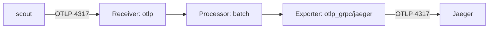

# A Collector with an OTLP Receiver and a Jaeger Exporter

The `scout` application already records requests as spans, but it cannot send them anywhere yet. A **span** records the timing and details of one operation. `scout` sends its spans to `otel-collector.observability:4317`, and that Service does not exist until you create a Collector.

The **OpenTelemetry Collector** receives telemetry, processes it, and exports it to a backend. Here it will receive spans from `scout`, group them into batches, and forward them to Jaeger for storage and searching.

## Check the application error

The application's OpenTelemetry software development kit (SDK) creates and exports spans. It uses the **OpenTelemetry Protocol (OTLP)**, which supports gRPC, a remote procedure call transport, and Hypertext Transfer Protocol (HTTP). Their default ports are `4317` and `4318` respectively.

<!-- astrona:playground:renew -->

Read the last two log lines from `scout`:

```sh
kubectl -n starfleet logs deploy/scout --tail=2
```

Before the Collector exists, the logs can show this error:

```text
{"level":"info","ts":"2026-11-02T18:58:52.904Z","caller":"errorhandler/errorhandler.go:36","msg":"exporter export timeout: rpc error: code = Unavailable desc = name resolver error: produced zero addresses"}
{"level":"info","ts":"2026-11-02T18:59:01.933Z","caller":"errorhandler/errorhandler.go:36","msg":"traces export: exporter export timeout: rpc error: code = Unavailable desc = name resolver error: produced zero addresses"}
```

`name resolver error: produced zero addresses` means that the exporter could not resolve its destination to a usable address. Spans can be lost when the SDK exhausts its buffering or retry limits. Creating the Collector gives new spans a destination; it does not recover spans already dropped.

## Define the trace pipeline

A **pipeline** connects the Collector components used for one type of telemetry. A **receiver** accepts incoming data, a **processor** changes or batches it, and an **exporter** sends it to a destination. The `traces` pipeline below connects one of each:



`scout` sends spans to the OTLP receiver, the batch processor groups them, and the exporter sends them to Jaeger.

The component name `otlp_grpc/jaeger` has two parts: `otlp_grpc` is the exporter type, and `jaeger` names this instance. It sends OTLP to Jaeger; the suffix does not select a separate Jaeger-specific protocol. Named instances let you configure several exporters of the same type.

An **OpenTelemetryCollector** is the custom resource that tells the OpenTelemetry Operator how to deploy and configure a Collector. Save this as `opentelemetrycollector-otel.yaml`:

```yaml
apiVersion: opentelemetry.io/v1beta1
kind: OpenTelemetryCollector
metadata:
  name: otel
  namespace: observability
spec:
  mode: deployment
  image: otel/opentelemetry-collector-contrib:0.165.0
  config:
    receivers:
      otlp:
        protocols:
          grpc:
            endpoint: 0.0.0.0:4317
          http:
            endpoint: 0.0.0.0:4318
    processors:
      batch: {}
    exporters:
      otlp_grpc/jaeger:
        endpoint: jaeger.observability:4317
        tls:
          insecure: true
    service:
      pipelines:
        traces:
          receivers: [otlp]
          processors: [batch]
          exporters: [otlp_grpc/jaeger]
```

Apply it:

```sh
kubectl apply -f opentelemetrycollector-otel.yaml
```

`mode: deployment` asks the Operator to create a Kubernetes Deployment. The `image` field pins the Collector to the contrib distribution at version `0.162.0`. The contrib image contains the receiver, processor, and exporter used here.

The receiver binds to `0.0.0.0` so that other pods can connect through the Service. Its gRPC listener uses port `4317`, and its HTTP listener uses `4318`. The exporter sends to `jaeger.observability:4317` with Transport Layer Security (TLS) disabled because the playground's Jaeger receiver accepts an unencrypted connection.

The empty object in `batch: {}` selects the processor's defaults. Defining a receiver, processor, or exporter makes it available to the configuration; listing it under `service.pipelines.traces` activates it. Only traces have a pipeline in this configuration.

## Inspect the resources the Operator creates

The Operator reads the custom resource and creates the Collector's workload, configuration, and Services. Allow a few seconds for reconciliation, then check the result:

```sh
kubectl -n observability get opentelemetrycollector,deployment,service
```

The output should include these resources. Addresses and ages will differ:

```text
NAME                                           MODE         VERSION   READY   AGE   IMAGE                                          MANAGEMENT
opentelemetrycollector.opentelemetry.io/otel   deployment   0.162.0   1/1     27s   otel/opentelemetry-collector-contrib:0.165.0   managed

NAME                             READY   UP-TO-DATE   AVAILABLE   AGE
deployment.apps/jaeger           1/1     1            1           2m26s
deployment.apps/otel-collector   1/1     1            1           27s

NAME                                TYPE        CLUSTER-IP      EXTERNAL-IP   PORT(S)                       AGE
service/jaeger                      ClusterIP   10.96.10.202    <none>        4317/TCP,4318/TCP,16686/TCP   2m26s
service/otel-collector              ClusterIP   10.96.220.64    <none>        4317/TCP,4318/TCP             27s
service/otel-collector-headless     ClusterIP   None            <none>        4317/TCP,4318/TCP             27s
service/otel-collector-monitoring   ClusterIP   10.96.137.118   <none>        8888/TCP                      27s
```

The resource name `otel` produces the Service name `otel-collector`, which matches the destination configured in `scout`. The ready Deployment shows that a Collector pod is available. The `IMAGE` column identifies the Collector version; the `VERSION` column shown here reports the Operator version, so the two values need not match.

Each generated Service has a different purpose:

| Service | Ports | Purpose |
| --- | --- | --- |
| `otel-collector` | `4317`, `4318` | Accepts application telemetry over OTLP |
| `otel-collector-headless` | `4317`, `4318` | Provides discovery of individual Collector pod addresses |
| `otel-collector-monitoring` | `8888` | Exposes the Collector's own metrics |

The Operator derives the receiver ports from the configuration. You do not need to create these Services yourself.

The Collector reads its runtime configuration from a **ConfigMap**, a Kubernetes object that stores configuration data. Inspect the ConfigMap mounted by the Deployment:

```sh
kubectl -n observability get cm $(kubectl -n observability get deploy otel-collector -o jsonpath='{.spec.template.spec.volumes[0].configMap.name}') -o jsonpath='{.data.collector\.yaml}'
```

The inner command finds the ConfigMap name in the Deployment's volume. The outer command prints its `collector.yaml` key:

```yaml
receivers:
  otlp:
    protocols:
      grpc:
        endpoint: 0.0.0.0:4317
      http:
        endpoint: 0.0.0.0:4318

exporters:
  otlp_grpc/jaeger:
    endpoint: jaeger.observability:4317
    tls:
      insecure: true

processors:
  batch: {}

service:
  telemetry:
    metrics:
      readers:
        - pull:
            exporter:
              prometheus:
                host: 0.0.0.0
                port: 8888

  pipelines:
    traces:
      exporters:
        - otlp_grpc/jaeger
      processors:
        - batch
      receivers:
        - otlp
```

The generated configuration keeps the trace pipeline and adds `service.telemetry.metrics.readers`. That section exposes the Collector's internal metrics in Prometheus format on port `8888`. These metrics describe the Collector's work, including how many spans it receives and exports.

The ConfigMap name includes a hash of its contents. When the configuration changes, the Operator can generate a new ConfigMap and update the Deployment to use it. Edit the `OpenTelemetryCollector` resource to make lasting changes; the Operator manages the generated objects.

## Check reception and export

Startup logs show whether the configured receivers started. Filter the Collector log for its startup messages:

```sh
kubectl -n observability logs deploy/otel-collector | awk -F'\t' '/Starting|Everything/{print $2, $3, $4}'
```

The relevant lines are:

```text
info service@v0.165.0/service.go:233 Starting otelcol-contrib...
info extensions/extensions.go:43 Starting extensions...
info otlpreceiver@v0.165.0/otlp.go:120 Starting GRPC server
info otlpreceiver@v0.165.0/otlp.go:175 Starting HTTP server
info service@v0.165.0/service.go:256 Everything is ready. Begin running and processing data.
```

The gRPC and HTTP server messages confirm that both receiver protocols started. They do not show whether any spans have arrived. For that, read the Collector's counters through its monitoring Service:

```sh
kubectl exec -n starfleet deploy/shuttle -- curl -s otel-collector-monitoring.observability:8888/metrics | grep -E "^otelcol_(receiver_accepted_spans|exporter_sent_spans)"
```

This command runs `curl` inside the `shuttle` pod, which can reach the cluster Service. It selects the accepted-span and sent-span counters:

```text
otelcol_exporter_sent_spans{exporter="otlp_grpc/jaeger",server_address="jaeger.observability",server_port="4317"} 232
otelcol_receiver_accepted_spans{receiver="otlp",transport="grpc"} 232
```

In this sample, the receiver accepted 232 spans and the exporter successfully sent 232 spans. Repeat the command after a few seconds while `shuttle` continues making requests to `scout`. Both counters should increase.

The values need not match at every instant: the batch processor and exporter can hold spans briefly. The counters also reset when the Collector process restarts. Increasing sent-span counts show successful exports, while finding a recent trace in Jaeger confirms that the backend can return the data.

The Collector now has a receiving endpoint, an active trace pipeline, and counters that expose its work. To inspect what an application request did, use Jaeger to retrieve the spans that belong to that request.

## Common pitfalls

> [!WARNING]
> - **Defining an unused component.** A receiver, processor, or exporter must appear in a pipeline to run.
> - **Mixing OTLP transports.** Match the application's transport to the receiver: gRPC on `4317`, HTTP on `4318`.
> - **Using the wrong TLS setting.** This playground's Jaeger endpoint is unencrypted and needs `tls.insecure: true`.
> - **Editing generated resources.** Change the custom resource; the Operator can overwrite edits to its Deployment or ConfigMap.
> - **Treating startup as proof of delivery.** Check increasing counters and recent traces in Jaeger.
