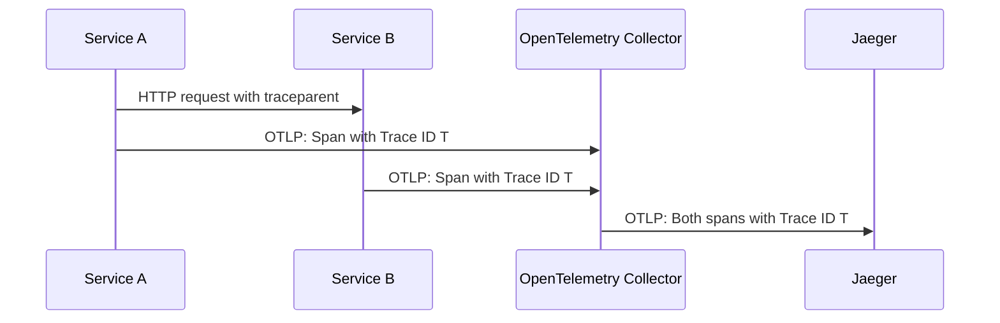

# Reading and Analyzing Traces in Jaeger

A slow request to `scout` can include several operations. Jaeger lets you inspect their timing and relationships. A **trace** groups the recorded operations for one request, and each **span** describes one operation within it.

The playground sends `scout` spans through `otel-collector` to Jaeger. You will retrieve a trace, identify its parent and child spans, and send a separate test trace to check the same delivery path.

## Find a trace from scout

Jaeger exposes its web interface and application programming interface (API) on port `16686`. The API returns JavaScript Object Notation (JSON), which `jq` can filter from the terminal.

<!-- astrona:playground:renew -->

Open a second terminal and forward the Jaeger Service to your machine. Leave this command running while you query Jaeger:

```sh
kubectl -n observability port-forward svc/jaeger 16686:16686
```

In your first terminal, list the services that Jaeger has received spans from:

```sh
curl -fsS http://127.0.0.1:16686/api/v3/services | jq -c '.services'
```

The response can include:

```text
["scout","jaeger","probe"]
```

The order can differ. `scout` exports through the Collector, `probe` sends directly to Jaeger, and `jaeger` records its own operations. Seeing `scout` tells you that Jaeger has received its spans, but a service name alone does not prove that new spans are still arriving.

The playground uses Jaeger 2.22 and its `/api/v3` query routes. A trace search needs a service name and a time range. Define this helper to request traces and print the identifiers of their spans:

```sh
list_spans() {
  curl -fsS -G "http://127.0.0.1:16686/api/v3/traces" \
    --data-urlencode "query.service_name=$1" \
    --data-urlencode "query.start_time_min=2020-01-01T00:00:00Z" \
    --data-urlencode "query.start_time_max=2100-01-01T00:00:00Z" \
    --data-urlencode "query.search_depth=${2:-1}" |
    jq -c '.result.resourceSpans[].scopeSpans[].spans[] | {name, traceId, spanId, parentSpanId}'
}
```

`curl -G` sends the values as query parameters, and `--data-urlencode` encodes each value for the request. The first argument supplies the service name. The second limits the number of traces requested and defaults to `1`. The broad time range is convenient in a short-lived playground; use the incident's time window when investigating a real service.

The `jq` filter walks through resource groups, instrumentation scopes, and spans in the response. It prints the operation name and three identifiers. Request a trace from `scout`:

```sh
list_spans scout
```

A request to `/` produces a result like this; your identifiers will differ:

```json
{"name":"infoHandler","traceId":"d62d920cc3f3566a2b5c756a2bc34571","spanId":"f2fa4afc2d30506e","parentSpanId":"a3c3217014ed2b22"}
{"name":"GET /","traceId":"d62d920cc3f3566a2b5c756a2bc34571","spanId":"a3c3217014ed2b22","parentSpanId":null}
```

Both spans have the same `traceId`, so they belong to one trace. The `parentSpanId` of `infoHandler` matches the `spanId` of `GET /`. That makes `infoHandler` a child of the request span. `GET /` has no parent and is the **root span**:

```text
Trace: d62d920cc3f3566a2b5c756a2bc34571
│
└── GET / (root span)
    │
    └── infoHandler (child span)
```

A span also records its start time, duration, and **attributes**, which are key-value details such as a request route or response status. The helper prints only the fields needed to read the parent-child relationship.

## How services share a trace

The two `scout` spans describe work inside one service. When an instrumented service calls another, **context propagation** carries the trace identity with the request. The World Wide Web Consortium (W3C) Trace Context standard defines a Hypertext Transfer Protocol (HTTP) header named `traceparent`:

```text
00-<trace-id>-<parent-id>-<trace-flags>
```

The fields hold the format version, trace identifier, calling span identifier, and trace flags, including the sampled flag. The receiving service extracts that context and uses it when creating a child span. Without propagation, the receiving service can start a separate trace.

Each application exports its spans using the OpenTelemetry Protocol (OTLP). Context travels with the application request; exported spans travel to the Collector:



The shared trace identifier lets Jaeger group spans even though the services export them separately.

The Collector does not create the parent-child relationship. Application instrumentation records it. Missing instrumentation, sampling, or failed delivery can leave a trace incomplete, so a missing span alone does not prove that an operation never ran.

## Test delivery with a generated trace

The `telemetrygen` tool creates test telemetry. Sending a known trace to the Collector checks delivery without depending on `scout` to generate spans. Run it as a temporary pod:

```sh
kubectl -n observability run telemetrygen \
  --restart=Never \
  --rm -i \
  --image=ghcr.io/open-telemetry/opentelemetry-collector-contrib/telemetrygen:v0.162.0 \
  -- traces \
  --otlp-insecure \
  --otlp-endpoint otel-collector.observability:4317 \
  --service telemetrygen-test \
  --traces 1
```

`--restart=Never` makes this a one-time pod. `--rm -i` attaches to it and removes it when it finishes. After the `--` separator, the arguments belong to `telemetrygen`: `traces` selects trace data, `--traces 1` creates one trace, and `--service` sets the reported service name.

The endpoint is the Collector's gRPC receiver on port `4317`. `--otlp-insecure` selects an unencrypted connection, matching the playground configuration. The generator's final log message is:

```text
stopping the exporter
```

That message marks completion of the generator. Allow a few seconds for batching and ingestion, then check what Jaeger stored:

```sh
list_spans telemetrygen-test
```

The response contains a root span and a child span:

```json
{"name":"okey-dokey-0","traceId":"289d1864033b8462e09ae1b59bcb45e6","spanId":"7ded96de08929b2a","parentSpanId":"9af267753a020c1d"}
{"name":"lets-go","traceId":"289d1864033b8462e09ae1b59bcb45e6","spanId":"9af267753a020c1d","parentSpanId":null}
```

`lets-go` has no parent. `okey-dokey-0` names it as its parent, and both share one trace identifier. Finding them in Jaeger confirms that this test trace passed through the Collector and reached searchable storage.

If the test trace arrives but recent `scout` traces do not, inspect `scout`'s instrumentation, exporter settings, and connectivity. If neither arrives, inspect the Collector's receiver and exporter, Jaeger ingestion, and the query's time range.

## Find the slow operation

The `shuttle` pod requests `/delay/1` from `scout` every tenth round. This request takes about one second. Filter for traces lasting at least 500 milliseconds:

```sh
curl -fsS "http://127.0.0.1:16686/api/v3/traces?query.service_name=scout&query.start_time_min=2020-01-01T00:00:00Z&query.start_time_max=2100-01-01T00:00:00Z&query.search_depth=1&query.duration_min=500ms" |
  jq -c '[.result.resourceSpans[].scopeSpans[].spans[] | {name, traceId}]'
```

A matching trace contains these operations:

```text
[{"name":"delayHandler","traceId":"1f5f53f2ec58cf5e8469da8446760589"},{"name":"GET /delay/{wait:[0-9]+}","traceId":"1f5f53f2ec58cf5e8469da8446760589"}]
```

The root span covers the whole request. Its child, `delayHandler`, records the operation inside the handler. The identifiers differ between requests, but the two spans of one request share a trace identifier.

Open `http://127.0.0.1:16686` in a browser, choose `scout` on the Search page, and select **Find Traces**. Open a slow trace to see its spans as bars on a timeline. Expand `delayHandler` to inspect its duration and attributes. Parent spans include time spent waiting for children, so adding every span's duration can count the same time twice.

Jaeger uses in-memory storage in this playground. A Jaeger pod restart removes the stored traces; new traffic creates new ones. The API and timeline now let you inspect both delivery and request timing, while the generated trace gives you a way to test the pipeline when application data is missing.

## Common pitfalls

> [!WARNING]
> - **Omitting the time range.** The version 3 search requires both start-time bounds.
> - **Searching before ingestion finishes.** Allow a few seconds for batching, then query again.
> - **Treating a missing parent identifier as an error.** A root span has no parent. A child whose parent was not collected can still have a parent identifier.
> - **Adding parent and child durations.** Their time intervals can overlap.
> - **Expecting stored traces after a restart.** This playground's Jaeger storage is in memory.
