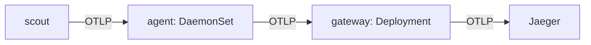

# Choosing a Collector Mode

The `otel` Collector receives spans from applications through one shared Service. This is a **gateway** deployment: applications send telemetry to a central Collector for processing and export. Other tasks, such as reading files on every node, need a different placement.

The `mode` field of an `OpenTelemetryCollector` custom resource selects the workload that the OpenTelemetry Operator creates. The pipeline configuration still controls what the Collector receives and where it sends the data.

## Match the mode to the task

The Operator supports four modes. Choose one based on where the Collector needs to run:

| Mode | What the Operator creates | Typical use |
| --- | --- | --- |
| `deployment` | A Deployment with one or more Collector replicas | Shared processing and export through a gateway |
| `daemonset` | A DaemonSet with a pod on each eligible node | Node-level collection, such as reading local log files |
| `sidecar` | A Collector container injected into annotated application pods | Collection with settings and resources dedicated to an application pod |
| `statefulset` | A StatefulSet with stable pod identities | Collection that needs stable identities or persistent storage configured for each replica |

A node-local Collector is often called an **agent**. An agent can forward data to a gateway using the OpenTelemetry Protocol (OTLP), as this layout shows:



The agent collects near the application, and the gateway handles shared processing before export to Jaeger. A DaemonSet alone does not make application traffic node-local: the application's endpoint and routing must direct it to the Collector on the same node.

## Check whether the mode can change

The `otel` resource uses `deployment` mode. Its validating webhook, which checks updates before Kubernetes accepts them, rejects changes to this field.

<!-- astrona:playground:renew -->

Try changing the existing Collector to a DaemonSet:

```sh
kubectl -n observability patch opentelemetrycollector otel --type merge -p '{"spec":{"mode":"daemonset"}}'
```

The webhook refuses the update:

```text
Error from server (Forbidden): admission webhook "vopentelemetrycollectorcreateupdatebeta.kb.io" denied the request: the OpenTelemetry Collector mode is set to deployment, which does not support modification
```

The failed patch leaves `otel` unchanged. Changing its mode would require replacing the resource. Keep the gateway running and use separate resource names to inspect the other modes.

## Create a node agent

The agent will accept OTLP over gRPC, a remote procedure call transport, on port `4317` and forward it to `otel-collector`. Save this as `opentelemetrycollector-agent.yaml`:

```yaml
apiVersion: opentelemetry.io/v1beta1
kind: OpenTelemetryCollector
metadata:
  name: agent
  namespace: observability
spec:
  mode: daemonset
  image: otel/opentelemetry-collector-contrib:0.162.0
  config:
    receivers:
      otlp:
        protocols:
          grpc:
            endpoint: 0.0.0.0:4317
    processors:
      batch: {}
    exporters:
      otlp_grpc/gateway:
        endpoint: otel-collector.observability:4317
        tls:
          insecure: true
    service:
      pipelines:
        traces:
          receivers: [otlp]
          processors: [batch]
          exporters: [otlp_grpc/gateway]
```

Apply it:

```sh
kubectl apply -f opentelemetrycollector-agent.yaml
```

Then check the result. The label selects the DaemonSet and pods belonging to the `agent` resource:

```sh
kubectl -n observability get daemonset,pod -l app.kubernetes.io/instance=observability.agent
```

The single-node playground produces one agent pod:

```text
NAME                             DESIRED   CURRENT   READY   UP-TO-DATE   AVAILABLE   NODE SELECTOR   AGE
daemonset.apps/agent-collector   1         1         1       1            1           <none>          20s

NAME                        READY   STATUS    RESTARTS   AGE
pod/agent-collector-4n8mc   1/1     Running   0          20s
```

Pod names and ages will differ. The DaemonSet creates a pod on each eligible node; node selectors, taints, and tolerations can affect placement. The Operator also creates receiver and monitoring Services for this Collector.

The agent is ready to receive spans, but creating it does not change `scout`'s exporter endpoint. `scout` continues sending directly to the gateway.

## Inject a Collector into an application pod

A **sidecar** is a supporting container that runs alongside an application in the same pod. First define the Collector configuration that the Operator will inject. Save this as `opentelemetrycollector-edge.yaml`:

```yaml
apiVersion: opentelemetry.io/v1beta1
kind: OpenTelemetryCollector
metadata:
  name: edge
  namespace: starfleet
spec:
  mode: sidecar
  image: otel/opentelemetry-collector-contrib:0.162.0
  config:
    receivers:
      otlp:
        protocols:
          grpc:
            endpoint: 0.0.0.0:4317
    processors:
      batch: {}
    exporters:
      otlp_grpc/gateway:
        endpoint: otel-collector.observability:4317
        tls:
          insecure: true
    service:
      pipelines:
        traces:
          receivers: [otlp]
          processors: [batch]
          exporters: [otlp_grpc/gateway]
```

Apply it:

```sh
kubectl apply -f opentelemetrycollector-edge.yaml
```

This resource creates no standalone Collector workload. The Operator injects it when a new pod requests it through the `sidecar.opentelemetry.io/inject` annotation. Add the annotation to `scout`'s pod template, using `edge` as the resource name:

```sh
kubectl -n starfleet patch deployment scout --type merge -p '{"spec":{"template":{"metadata":{"annotations":{"sidecar.opentelemetry.io/inject":"edge"}}}}}'
kubectl -n starfleet rollout status deploy/scout
kubectl -n starfleet get pods
```

Changing the pod template triggers a rollout. The output below omits the rollout's waiting messages:

```text
deployment.apps/scout patched
deployment "scout" successfully rolled out
NAME                       READY   STATUS        RESTARTS   AGE
probe-c74b7b9f9-jw5sn      1/1     Running       0          2m6s
scout-6b57d6d96f-6d7fl     2/2     Running       0          4s
scout-787bdfdc65-z2vhl     1/1     Terminating   0          15m
shuttle-65f695c8c6-c5857   1/1     Running       0          15m
```

The replacement `scout` pod reports `2/2` ready: the application and the Collector. In this playground, the Operator injects a Kubernetes native sidecar, which appears under `initContainers` with `restartPolicy: Always`. Inspect those fields:

```sh
kubectl -n starfleet get pod -l app=scout -o jsonpath='{.items[0].spec.initContainers[0].name}{" "}{.items[0].spec.initContainers[0].restartPolicy}{"\n"}'
```

The injected container reports:

```text
otc-container Always
```

Containers in a pod share its network, so an application can reach this Collector at `localhost:4317`. Injection does not change `scout`'s exporter setting; its spans still go to the gateway. The exercise demonstrates placement and injection without rerouting application traffic.

Collector placement determines which applications share a process and where collection happens. The pipeline determines whether that process can receive and export spans, so even a correctly placed Collector still needs delivery checks.

## Common pitfalls

> [!WARNING]
> - **Changing an existing Collector's mode.** The webhook rejects the update. Create a replacement resource with the required mode.
> - **Expecting sidecar mode to create a Deployment.** Injection happens only when an annotated pod is created.
> - **Annotating the Deployment's own metadata.** Put the annotation under `spec.template.metadata.annotations`.
> - **Expecting injection to reroute telemetry.** The application must use the sidecar's endpoint to send through it.
> - **Assuming a DaemonSet guarantees local traffic.** Check how applications select the Collector endpoint.
