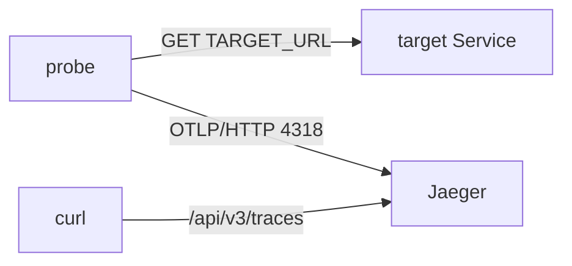

# Finding Failed Spans And Their Exceptions

A service can fail some of its requests while its pod stays `Running` and its log has already rotated away. If the service creates spans, the failure is still recorded in the trace backend. Each span says whether its step worked, and a failed span can carry the exception that the application caught. This part makes the `probe` workload fail on purpose, finds its failed spans in Jaeger, saves the exceptions to a file as evidence, and uses the exception message to fix the cause.

## Span status and exception events

Every span has a **status**. Its code is `UNSET`, `OK` or `ERROR`, and OTLP (OpenTelemetry Protocol) JSON writes those codes as `0`, `1` and `2`. The application sets the status when it ends the span. Jaeger only stores it and shows it.

When the application catches an exception inside a span, it sets the status to `ERROR` and adds a **span event**. A span event is a record with a timestamp inside a span. The event for a caught exception is named `exception`, and it has three attributes: `exception.type` (the error class), `exception.message` (the text of the error) and `exception.stacktrace` (where in the code it happened). These are the same facts the application would write to its log.

The `probe` workload in the playground is a small Python program built to show this. Every 2 seconds it sends an HTTP request to the address in its environment variable `TARGET_URL`, inside one span. It then sends the span straight to Jaeger over OTLP/HTTP on port `4318`, with no Collector in between. When the request fails, `probe` gives the span the status `ERROR` and adds an `exception` event.



The diagram shows that `probe` calls its target and reports each call as a span to Jaeger, where `curl` reads it back through the API.

## Make probe fail

<!-- astrona:playground:renew -->

You read Jaeger through its web interface and its API (application programming interface) on port `16686` of the Service `jaeger`. Start a port-forward in a second terminal and leave it running:

```sh
kubectl -n observability port-forward svc/jaeger 16686:16686
```

`TARGET_URL` starts as `http://scout.starfleet:9898/`, a Service that answers. Point it at `relay.starfleet`, a Service that does not exist, and wait for the new pod. A change to an environment variable changes the pod template, so Kubernetes replaces the pod:

```sh
kubectl -n starfleet set env deployment/probe TARGET_URL=http://relay.starfleet:8080
kubectl -n starfleet rollout status deployment/probe --timeout=120s
```

The output ends with this line:

```text
deployment "probe" successfully rolled out
```

From now on, every request that `probe` sends fails, and every span it creates ends with an error. Wait about 20 seconds so that Jaeger holds a few of these spans.

## Find the failing service

In a real incident you do not know which service fails, so start from all of them. In the web interface at `http://127.0.0.1:16686`, choose **All Services** on the Search page and type `error=true` in the **Attributes** field (older Jaeger versions call it **Tags**). Jaeger adds the tag `error=true` to every span whose status is `ERROR`, so **Find Traces** lists only traces with a failed step. Each row shows a red error marker and the service name.

Through the API, the same question is a filter on `status.code`. This helper reads the newest twenty traces of one service and counts the spans with the error code. Some servers write the code as `STATUS_CODE_ERROR` instead of `2`, so the filter accepts both. The `/api/v3/traces` route needs a time range, so the helper uses a wide one. The loop runs the helper for every service that Jaeger knows:

```sh
count_error_spans() {
  curl -fsSG http://127.0.0.1:16686/api/v3/traces \
    --data-urlencode "query.serviceName=$1" \
    --data-urlencode 'query.startTimeMin=2020-01-01T00:00:00Z' \
    --data-urlencode 'query.startTimeMax=2100-01-01T00:00:00Z' \
    --data-urlencode "query.searchDepth=${2:-20}" |
    jq '[.result.resourceSpans[].scopeSpans[].spans[] | select((.status.code // 0) as $code | $code == 2 or $code == "STATUS_CODE_ERROR")] | length'
}
for service in $(curl -fsS http://127.0.0.1:16686/api/v3/services | jq -r '.services[]'); do
  echo "$service: $(count_error_spans "$service")"
done
```

```text
probe: 13
jaeger: 0
scout: 0
shuttle: 0
```

Your list of services and your counts can differ, but only `probe` has failed spans. The other services succeed on every request, so their count is `0`. The count for `probe` is below twenty here because the older traces in the search are from before the change, when every request still worked.

## Export the exception events

A count tells you where the errors are, but a report or a ticket needs the errors themselves. Jaeger keeps traces in memory, so save the evidence to a file before anything restarts. This command reads the newest five traces of `probe`, keeps the spans with the error code, and collects their `exception` events into one JSON array. The events stay exactly as the API returned them:

```sh
curl -fsSG http://127.0.0.1:16686/api/v3/traces \
  --data-urlencode 'query.serviceName=probe' \
  --data-urlencode 'query.startTimeMin=2020-01-01T00:00:00Z' \
  --data-urlencode 'query.startTimeMax=2100-01-01T00:00:00Z' \
  --data-urlencode 'query.searchDepth=5' |
  jq '[.result.resourceSpans[].scopeSpans[].spans[] | select((.status.code // 0) as $code | $code == 2 or $code == "STATUS_CODE_ERROR") | .events[]? | select(.name == "exception")]' > /tmp/probe-exceptions.json
```

Check what you saved. The first command prints the number of events in the array. The second prints the type and the message of each event:

```sh
jq length /tmp/probe-exceptions.json
jq -r '.[] | (.attributes | map({(.key): .value.stringValue}) | add) | "\(.["exception.type"]): \(.["exception.message"])"' /tmp/probe-exceptions.json
```

```text
5
URLError: <urlopen error [Errno -2] Name does not resolve>
URLError: <urlopen error [Errno -2] Name does not resolve>
URLError: <urlopen error [Errno -2] Name does not resolve>
URLError: <urlopen error [Errno -2] Name does not resolve>
URLError: <urlopen error [Errno -2] Name does not resolve>
```

The second command turns the list of attributes of each event into one object, so it can print the type before the message. Jaeger does not keep the attributes in a fixed order.

The span status says that a step failed. The exception message says why. `Name does not resolve` means that the DNS (Domain Name System) lookup of the host name failed, so `probe` never reached any server.

## Fix the cause and prove it

The message is the clue for the fix. A host that does not resolve points at a wrong Service name, a refused connection points at a wrong port, and a timeout points at a slow or missing backend. Compare the address that `probe` calls with the Services that exist in the namespace:

```sh
kubectl -n starfleet set env deployment/probe --list | grep TARGET_URL
kubectl -n starfleet get services
```

```text
TARGET_URL=http://relay.starfleet:8080
NAME    TYPE        CLUSTER-IP      EXTERNAL-IP   PORT(S)    AGE
scout   ClusterIP   10.96.236.183   <none>        9898/TCP   11m
```

No Service named `relay` exists, and `scout` does, on port `9898`. Point `probe` back at `scout`, wait for the new pod, and wait about 20 seconds for new spans. Then run the helper for `probe` with a depth of `3`, so it reads only the newest three traces:

```sh
kubectl -n starfleet set env deployment/probe TARGET_URL=http://scout.starfleet:9898/
kubectl -n starfleet rollout status deployment/probe --timeout=120s
count_error_spans probe 3
```

The output ends with the rollout line and the count:

```text
deployment "probe" successfully rolled out
0
```

The newest traces of `probe` have no error spans, so the fix works. Jaeger still holds the older failed traces, and the file you saved still holds their exceptions.

You can now find the spans that ended with an error, collect their `exception` events as a JSON array, and read the message to find and fix the cause. You prove the fix with the newest traces, not with a `Running` pod. The status and the events come from the application itself, so a service without instrumentation, or with spans that never reach Jaeger, shows no errors at all.

## Common pitfalls

> [!WARNING]
> Mistakes that waste time:
>
> - **Looking for the host name in the exception message.** A DNS error says only `Name does not resolve`. The address is in the span attribute `target.url` and in the `TARGET_URL` variable of the Deployment.
> - **Filtering only on `2`.** Some servers write the status code as `STATUS_CODE_ERROR`. Accept both.
> - **Saving the whole API response.** A report needs the `exception` events only. The full response holds every span and is hard to read.
> - **Proving the fix with old traces.** Jaeger keeps the failed traces. Read only the newest few traces, after the new pod has run for a few seconds.
> - **Adding a second variable by mistake.** A typo in the variable name, such as `TARGET_ULR`, adds a new variable and leaves the wrong one in place. Check with `kubectl set env --list`.

## Your mission: Export The Exceptions Of A Failed Trace

You can now find the service whose spans fail, save its exceptions and fix the address it calls. The mission gives you three workloads, one of which calls a Service that does not exist, and asks you to name that service, save its exception events to a file and repair the address it calls.

Pause the playground, then start the lab:

```sh
astrona stop ats-020-playground-030-01
```

```sh
astrona run --git ssh://git@github.com/astrona-io/ATS020.git -c sections/section-030/module-10/labs/lab-03
```

The task is on the next page. When you have written both files and fixed the Deployment, grade your work:

```sh
astrona submit --git ssh://git@github.com/astrona-io/ATS020.git -c sections/section-030/module-10/labs/lab-03
```

When the lab is done, remove it and start the playground again:

```sh
astrona destroy ats-020-lab-030-01-03
astrona start ats-020-playground-030-01
```
