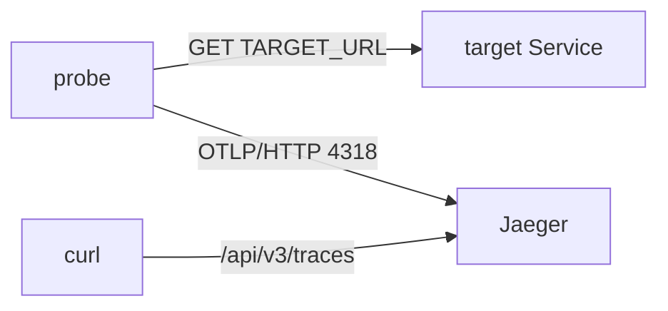

# Finding Failed Spans and Their Exceptions

The `probe` pod can remain `Running` while every request it sends fails. Its trace data records the result of each request, including the exception raised by a failed connection. You will point `probe` at a missing Service, find those failures in Jaeger, and repair the address.

`probe` is a small Python program that requests the address in `TARGET_URL` every two seconds. It sends one span per request directly to Jaeger using the OpenTelemetry Protocol (OTLP) over Hypertext Transfer Protocol (HTTP), on port `4318`.

## Read span status and exception events

A **span** records one operation. Its **status** describes the result reported by the instrumentation:

| Status | Numeric code | Meaning |
| --- | --- | --- |
| `UNSET` | `0` | No explicit status was set |
| `OK` | `1` | The operation was explicitly marked successful |
| `ERROR` | `2` | The operation was marked as failed |

`UNSET` does not itself mean failure. The application or its instrumentation chooses the status; Jaeger stores and displays it.

A **span event** records something that happened at a particular time during an operation. In this playground, a failed request makes `probe` set `ERROR` and attach an event named `exception`. Its attributes include `exception.type`, `exception.message`, and `exception.stacktrace`. Other instrumentation may record errors differently, so an error status does not guarantee an exception event.



`probe` sends application requests to its target and exports the resulting spans to Jaeger. The Collector is not on this workload's export path.

## Make probe call a missing Service

Use Jaeger's web interface and application programming interface (API) on port `16686`. Reuse an existing port-forward if one is running.

<!-- astrona:playground:renew -->

Otherwise, start one in a second terminal:

```sh
kubectl -n observability port-forward svc/jaeger 16686:16686
```

`probe` initially calls `http://scout.starfleet:9898/`. Set `TARGET_URL` to the missing `relay` Service and wait for the replacement pod:

```sh
kubectl -n starfleet set env deployment/probe TARGET_URL=http://relay.starfleet:8080
kubectl -n starfleet rollout status deployment/probe --timeout=120s
```

The rollout ends with:

```text
deployment "probe" successfully rolled out
```

The new pod now makes failing requests. Allow about 20 seconds for it to send several failed spans to Jaeger.

## Find the service with failed spans

Open `http://127.0.0.1:16686`, choose **All Services**, and enter `error=true` in **Attributes**. Select **Find Traces** to find traces with an error span. Jaeger exposes an `ERROR` status through this search tag and marks failed spans in the results.

Through the API, inspect `status.code` on each returned span. This helper searches the newest twenty traces for a service and counts error spans. It accepts both the numeric code `2` and the symbolic form `STATUS_CODE_ERROR`:

```sh
count_error_spans() {
  curl -fsSG http://127.0.0.1:16686/api/v3/traces \
    --data-urlencode "query.serviceName=$1" \
    --data-urlencode 'query.startTimeMin=2020-01-01T00:00:00Z' \
    --data-urlencode 'query.startTimeMax=2100-01-01T00:00:00Z' \
    --data-urlencode "query.searchDepth=${2:-20}" |
    jq '[.result.resourceSpans[].scopeSpans[].spans[] | select((.status.code // 0) as $code | $code == 2 or $code == "STATUS_CODE_ERROR")] | length'
}
for service in $(curl -fsS http://127.0.0.1:16686/api/v3/services | jq -r '.services[]'); do
  echo "$service: $(count_error_spans "$service")"
done
```

The loop lists services and runs the helper for each one. A sample result is:

```text
probe: 13
jaeger: 0
scout: 0
shuttle: 0
```

Names and counts can differ. In this controlled failure, `probe` should be the service with errors. Its count can be below twenty if the result includes successful requests from before the change.

The count covers only spans returned by the search. Zero error spans does not prove that every request succeeded: traces may be missing, outside the window, or beyond the search limit. In a trace crossing services, also check which resource owns the failed span before attributing the failure.

## Export the exception events

Save the evidence before restarting Jaeger, whose playground storage is in memory. The next command requests the newest five `probe` traces, selects error spans, and writes their `exception` events as a JavaScript Object Notation (JSON) array:

```sh
curl -fsSG http://127.0.0.1:16686/api/v3/traces \
  --data-urlencode 'query.serviceName=probe' \
  --data-urlencode 'query.startTimeMin=2020-01-01T00:00:00Z' \
  --data-urlencode 'query.startTimeMax=2100-01-01T00:00:00Z' \
  --data-urlencode 'query.searchDepth=5' |
  jq '[.result.resourceSpans[].scopeSpans[].spans[] | select((.status.code // 0) as $code | $code == 2 or $code == "STATUS_CODE_ERROR") | .events[]? | select(.name == "exception")]' > /tmp/probe-exceptions.json
```

The filter preserves each selected event as returned by the API. It does not preserve the enclosing span's identifiers, so retain the full traces separately if an investigation needs that context.

Check the array length, then print each event's type and message:

```sh
jq length /tmp/probe-exceptions.json
jq -r '.[] | (.attributes | map({(.key): .value.stringValue}) | add) | "\(.["exception.type"]): \(.["exception.message"])"' /tmp/probe-exceptions.json
```

Once five failed traces are available, the output should resemble:

```text
5
URLError: <urlopen error [Errno -2] Name does not resolve>
URLError: <urlopen error [Errno -2] Name does not resolve>
URLError: <urlopen error [Errno -2] Name does not resolve>
URLError: <urlopen error [Errno -2] Name does not resolve>
URLError: <urlopen error [Errno -2] Name does not resolve>
```

The filter looks up attributes by key because their order is not fixed. `Name does not resolve` means that a Domain Name System (DNS) lookup failed. It tells you why the connection failed, but the message alone does not identify the configured destination.

## Repair the address and check new traces

A DNS failure can come from a wrong name or a DNS problem. Compare the application's setting with the Services that actually exist:

```sh
kubectl -n starfleet set env deployment/probe --list | grep TARGET_URL
kubectl -n starfleet get services
```

The playground shows:

```text
TARGET_URL=http://relay.starfleet:8080
NAME    TYPE        CLUSTER-IP      EXTERNAL-IP   PORT(S)    AGE
scout   ClusterIP   10.96.236.183   <none>        9898/TCP   11m
```

There is no `relay` Service. The intended target is `scout` on port `9898`. Restore that address and wait for the rollout:

```sh
kubectl -n starfleet set env deployment/probe TARGET_URL=http://scout.starfleet:9898/
kubectl -n starfleet rollout status deployment/probe --timeout=120s
```

Allow about 20 seconds for new requests, then query the newest three traces:

```sh
count_error_spans probe 3
```

Once those traces come from the repaired pod, the count should be `0`. The rollout and query together produce:

```text
deployment "probe" successfully rolled out
0
```

The zero count is useful only when the search succeeds and returns new spans. Confirm their timestamps in Jaeger so that an empty or stale result does not appear to prove recovery. Older failed traces remain available until Jaeger loses or removes them, and the exported events remain in your file.

Span status identifies a reported failure; the recorded exception helps explain it. Comparing that evidence with the workload's configuration led to the repair, and successful requests recorded after the rollout verify the result.

## Common pitfalls

> [!WARNING]
> - **Expecting every error span to have an exception event.** Check what the application's instrumentation records.
> - **Looking for the destination only in the exception message.** Inspect the span's `target.url` attribute or the Deployment's `TARGET_URL` setting.
> - **Accepting only numeric status codes.** The filter also handles `STATUS_CODE_ERROR`.
> - **Using old or absent traces as proof of recovery.** Confirm that the search returned spans created after the repair.
> - **Misspelling the environment variable.** A new name such as `TARGET_ULR` leaves the original setting unchanged.

## Your mission: Export the Exceptions of a Failed Trace

You can now identify failed spans, export their exception events, and use the messages to investigate a bad destination. The mission gives you three workloads; identify the failing service, save the required evidence, and repair the address it calls.

Pause the playground, then start the lab:

```sh
astrona stop ats-020-playground-030-01
```

```sh
astrona run --git ssh://git@github.com/astrona-io/ATS020.git -c sections/section-030/module-10/labs/lab-03
```

When both evidence files and the repair are ready, grade your work:

```sh
astrona submit --git ssh://git@github.com/astrona-io/ATS020.git -c sections/section-030/module-10/labs/lab-03
```

Remove the lab and restart the playground when you finish:

```sh
astrona destroy ats-020-lab-030-01-03
astrona start ats-020-playground-030-01
```
