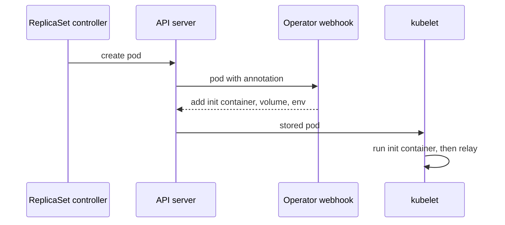

# What the Operator Injects into a Pod

Requests pass through `relay` before reaching `scout`, but Jaeger initially shows only the work in `scout`. The OpenTelemetry Operator can add a Node.js tracing agent to `relay` when Kubernetes creates its pod. The agent records supported operations without changes to the application source.

A **span** records one operation and its timing. A **trace** groups related spans under one trace identifier. Instrumenting `relay` will add its incoming and outgoing requests to the recorded request path.

## Inspect the missing service

Jaeger's application programming interface (API) lets you see which services have exported spans. Its responses use JavaScript Object Notation (JSON), which `jq` can filter.

<!-- astrona:playground:renew -->

Start a port-forward in a second terminal and leave it running:

```sh
kubectl -n observability port-forward svc/jaeger 16686:16686
```

In your first terminal, list the services and define a helper that prints span identifiers. The helper excludes `scout`'s readiness-probe spans so the application requests are easier to see:

```sh
curl -fsS http://127.0.0.1:16686/api/v3/services | jq -c .services

list_spans() {
  curl -fsS "http://127.0.0.1:16686/api/v3/traces?query.service_name=$1&query.start_time_min=2020-01-01T00:00:00Z&query.start_time_max=2100-01-01T00:00:00Z&query.search_depth=${2:-1}" |
    jq -c '.result.resourceSpans[] | (.resource.attributes[] | select(.key=="service.name") | .value.stringValue) as $service | .scopeSpans[].spans[] | select(.name != "GET /readyz") | {service: $service, name, traceId, spanId, parentSpanId}'
}
list_spans scout 3 | head -2
```

The output initially resembles this; identifiers and ordering vary:

```text
["jaeger","scout"]
{"service":"scout","name":"infoHandler","traceId":"a3772cb5867739d7d3e3839dd3ac6b62","spanId":"83e2d5a8703144b0","parentSpanId":"1d5802525a98f026"}
{"service":"scout","name":"GET /","traceId":"a3772cb5867739d7d3e3839dd3ac6b62","spanId":"1d5802525a98f026","parentSpanId":null}
```

`scout`'s `GET /` span has no parent. It starts a trace even though the request passed through `relay` first. `relay` records no spans and sends no tracing context, so Jaeger cannot show its part of the request.

The helper's first argument selects a service; the second limits the requested traces. Both time bounds are required by the search API. The wide range suits this temporary playground; use an incident's time window for operational investigations.

## How the Operator adds the agent

An **Instrumentation** is a custom resource containing settings for injected agents. An **annotation** is a metadata key-value pair; `instrumentation.opentelemetry.io/inject-nodejs` tells the Operator that a pod needs the Node.js agent.

The Operator's **mutating admission webhook** receives pod-creation requests from the Kubernetes API server. For an eligible pod, it reads the annotation, selects an Instrumentation resource, and adds an init container, a shared volume, and environment variables:



The pod is changed before its containers start. The init container copies the agent into the shared volume and exits; `NODE_OPTIONS` then makes Node.js load the agent before the application.

This injection occurs at pod creation. Updating an Instrumentation resource does not rewrite environment variables in a running pod. The Deployment must create replacement pods to use the new settings.

## Create the agent settings

The agent will export spans to the Collector and pass trace context to `scout`. Save this as `instrumentation-nodejs.yaml`:

```yaml
apiVersion: opentelemetry.io/v1alpha1
kind: Instrumentation
metadata:
  name: nodejs
  namespace: starfleet
spec:
  exporter:
    endpoint: http://otel-collector.observability:4318
  propagators:
    - tracecontext
    - baggage
  sampler:
    type: parentbased_traceidratio
    argument: "1"
```

Apply it:

```sh
kubectl apply -f instrumentation-nodejs.yaml
```

`exporter.endpoint` selects the Collector's OpenTelemetry Protocol (OTLP) receiver over Hypertext Transfer Protocol (HTTP), on port `4318`. The `tracecontext` propagator carries trace identity in requests; `baggage` carries additional context key-value pairs.

The **sampler** decides which spans to sample. `parentbased_traceidratio` with argument `"1"` samples every new root trace and follows an existing parent's sampling decision. It does not override an incoming parent marked as unsampled.

Check the resource and the running `relay` pod:

```sh
kubectl -n starfleet get instrumentation
kubectl -n starfleet get pods -l app=relay -o 'custom-columns=NAME:.metadata.name,INIT:.spec.initContainers[*].name'
```

The resource exists, but the pod still has no init container:

```text
NAME     AGE   ENDPOINT                                   SAMPLER                    SAMPLER ARG
nodejs   0s    http://otel-collector.observability:4318   parentbased_traceidratio   1
NAME                     INIT
relay-58cd79c99d-qdvxc   <none>
```

Creating the Instrumentation supplied settings. The existing pod has neither requested injection nor been replaced.

## Request injection on the pod template

The Deployment's **pod template** contains the metadata and container specification used for new pods. Put the annotation there so the resulting pods carry it. Save this as `relay-patch.yaml`:

```yaml
spec:
  template:
    metadata:
      annotations:
        instrumentation.opentelemetry.io/inject-nodejs: "true"
```

`"true"` selects an Instrumentation in the pod's namespace; this playground has only `nodejs`. An explicit value of `nodejs` selects that named resource, while `<namespace>/<name>` selects one in another namespace.

Apply the patch and wait for the rollout:

```sh
kubectl -n starfleet patch deployment relay --patch-file relay-patch.yaml
kubectl -n starfleet rollout status deployment/relay
kubectl -n starfleet get pods -l app=relay
```

A change to the pod template creates a replacement pod:

```text
deployment.apps/relay patched
Waiting for deployment "relay" rollout to finish: 0 out of 1 new replicas have been updated...
Waiting for deployment "relay" rollout to finish: 1 old replicas are pending termination...
Waiting for deployment "relay" rollout to finish: 1 old replicas are pending termination...
deployment "relay" successfully rolled out
NAME                     READY   STATUS        RESTARTS   AGE
relay-58cd79c99d-qdvxc   1/1     Terminating   0          2m25s
relay-78b85c779-jvqnj    1/1     Running       0          6s
```

Wait until the old pod disappears before inspecting `.items[0]` in the following commands. The first command prints the init container's name and image; the second prints the selected environment variables:

```sh
kubectl -n starfleet get pod -l app=relay -o jsonpath='{.items[0].spec.initContainers[0].name}{"\n"}{.items[0].spec.initContainers[0].image}{"\n"}'
kubectl -n starfleet get pod -l app=relay -o json | jq -r '.items[0].spec.containers[0].env[] | select(.name|test("^(NODE_OPTIONS|OTEL_(SERVICE_NAME|EXPORTER_OTLP_ENDPOINT|PROPAGATORS|TRACES_SAMPLER|TRACES_SAMPLER_ARG))$")) | "\(.name)=\(.value)"'
```

The injected values should include:

```text
opentelemetry-auto-instrumentation-nodejs
ghcr.io/open-telemetry/opentelemetry-operator/autoinstrumentation-nodejs:0.78.0
NODE_OPTIONS= --require /otel-auto-instrumentation-nodejs/autoinstrumentation.js
OTEL_SERVICE_NAME=relay
OTEL_EXPORTER_OTLP_ENDPOINT=http://otel-collector.observability:4318
OTEL_PROPAGATORS=tracecontext,baggage
OTEL_TRACES_SAMPLER=parentbased_traceidratio
OTEL_TRACES_SAMPLER_ARG=1
```

The init container shows that the webhook added the agent files. `NODE_OPTIONS` tells the application process to load them. The endpoint, propagators, and sampler match the Instrumentation resource; the service name identifies this workload as `relay`.

These checks establish that injection happened and show what the process will load. Delivery still needs a separate check: Jaeger must receive new `relay` spans, and those spans must link to `scout` through the same trace and parent identifiers.

## Common pitfalls

> [!WARNING]
> - **Creating settings without requesting injection.** The Instrumentation resource alone does not instrument this workload.
> - **Annotating the Deployment's own metadata.** Put the request under `spec.template.metadata.annotations`.
> - **Inspecting a terminating pod.** Wait for the replacement pod before reading its injected settings.
> - **Treating a completed init container as a failure.** This container copies the agent and exits normally.
> - **Assuming injection proves delivery.** Check recent spans in Jaeger as well as the pod's configuration.

## Your mission: Enable Node.js Agent Injection

You can now configure and verify an injected agent. Create the settings, request injection, inspect the replacement pod, and confirm that Jaeger receives its spans.

Pause the playground and start the lab:

```sh
astrona stop ats-020-playground-030-02
astrona run --git ssh://git@github.com/astrona-io/ATS020.git -c sections/section-030/module-20/labs/lab-03
```

Grade the completed tasks:

```sh
astrona submit -c sections/section-030/module-20/labs/lab-03
```

Remove the lab and resume the playground:

```sh
astrona destroy ats-020-lab-030-02-03
astrona start ats-020-playground-030-02
```
