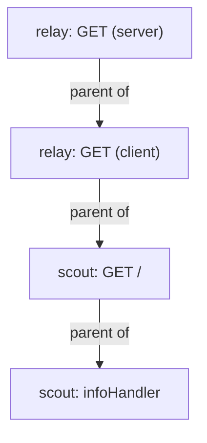

# Reading One Trace across Two Services

A request to `relay` makes a second request to `scout`. With both services instrumented, Jaeger can show the caller, the downstream request, and the work inside `scout` as one trace. The parent identifiers explain how these operations relate; their timings help locate a delay.

These exercises need an injected `relay` pod using the `nodejs` Instrumentation in `starfleet`, with `tracecontext` and `baggage` configured. The Collector and Jaeger must be receiving spans from both services.

## Follow the parent identifiers

The Jaeger application programming interface (API) is available on port `16686`. Keep its port-forward running in a second terminal.

<!-- astrona:playground:renew -->

If needed, start it with `kubectl -n observability port-forward svc/jaeger 16686:16686`. In your first terminal, define this helper and request a trace from `relay`:

```sh
list_spans() {
  curl -fsS "http://127.0.0.1:16686/api/v3/traces?query.service_name=$1&query.start_time_min=2020-01-01T00:00:00Z&query.start_time_max=2100-01-01T00:00:00Z&query.search_depth=${2:-1}" |
    jq -c '.result.resourceSpans[] | (.resource.attributes[] | select(.key=="service.name") | .value.stringValue) as $service | .scopeSpans[].spans[] | select(.name != "GET /readyz") | {service: $service, name, traceId, spanId, parentSpanId}'
}
list_spans relay 1
```

The helper walks through each resource's spans and attaches its `service.name` to the output. It prints operation names and identifiers, excluding readiness-probe spans. A complete request produces these relationships:

```text
{"service":"relay","name":"GET","traceId":"e1b605f2f564e70188dd9b387f651805","spanId":"66604d233db6d049","parentSpanId":"8cff97019427b3e1"}
{"service":"relay","name":"GET","traceId":"e1b605f2f564e70188dd9b387f651805","spanId":"8cff97019427b3e1","parentSpanId":null}
{"service":"scout","name":"GET /","traceId":"e1b605f2f564e70188dd9b387f651805","spanId":"bfa6a49a27e5ecc7","parentSpanId":"66604d233db6d049"}
{"service":"scout","name":"infoHandler","traceId":"e1b605f2f564e70188dd9b387f651805","spanId":"121c76f32f79a525","parentSpanId":"bfa6a49a27e5ecc7"}
```

Your identifiers will differ. Both services export in batches, so the newest trace can arrive in pieces. If `scout` is missing, wait and use `list_spans relay 5` to inspect several traces. Compare spans within the same `traceId`.

The `relay` span without a parent is the incoming request. Its child records the outgoing request to `scout`. `scout`'s `GET /` span names that outgoing span as its parent, and `infoHandler` records the work inside the handler:



The parent link from `relay` to `scout` proves that the recorded request crosses the service boundary. Listing both service names in Jaeger would not establish that relationship.

The Node.js agent adds a `traceparent` HTTP header to its outgoing request. `scout` reads it and continues the same trace. This is **context propagation**: carrying trace identity and parent information with an application request. Exporting the resulting spans to the Collector is a separate operation.

## Locate the delay

Every fifth round, `shuttle` calls `/slow` on `relay`. That route calls `/delay/1` on `scout`, which waits about one second. Search for a trace lasting at least 500 milliseconds and print each span's duration:

```sh
slow_trace() {
  curl -fsS "http://127.0.0.1:16686/api/v3/traces?query.service_name=relay&query.start_time_min=2020-01-01T00:00:00Z&query.start_time_max=2100-01-01T00:00:00Z&query.search_depth=1&query.duration_min=500ms" |
    jq -c '.result.resourceSpans[] | (.resource.attributes[] | select(.key=="service.name") | .value.stringValue) as $service | .scopeSpans[].spans[] | {service: $service, name, kind, ms: (((.endTimeUnixNano|tonumber) - (.startTimeUnixNano|tonumber)) / 1000000 | round)}'
}
slow_trace
```

The helper subtracts the start timestamp from the end timestamp and converts nanoseconds to rounded milliseconds. The `kind` field describes the operation: `1` is internal work, `2` is a server handling a request, and `3` is a client sending one.

A slow trace produces timings like these:

```text
{"service":"scout","name":"delayHandler","kind":1,"ms":1000}
{"service":"scout","name":"GET /delay/{wait:[0-9]+}","kind":2,"ms":1000}
{"service":"relay","name":"GET","kind":3,"ms":1001}
{"service":"relay","name":"GET","kind":2,"ms":1002}
```

The longest span is the incoming `relay` request, but it includes the time spent waiting for `scout`. In this sequential request, `delayHandler` accounts for about a second inside `scout`, and the parent operations wait for it. That identifies the delayed operation in this example.

The small differences between these rounded durations include processing and transport overhead. They do not measure network latency precisely. Do not add all four durations: the intervals overlap, so the same wait would be counted several times.

Open `http://127.0.0.1:16686`, search for `relay`, and open a slow trace. Expand the spans on the timeline to compare their start times, durations, and parent relationships. In applications with parallel or asynchronous work, parent-child relationships alone do not tell you which work delayed the response; read the actual intervals.

## Keep evidence of the slow request

A saved response lets you report the trace and span identifiers together with the observed duration. Query a slow trace and save the full JSON response:

```sh
curl -fsSG http://127.0.0.1:16686/api/v3/traces \
  --data-urlencode 'query.service_name=relay' \
  --data-urlencode 'query.start_time_min=2020-01-01T00:00:00Z' \
  --data-urlencode 'query.start_time_max=2100-01-01T00:00:00Z' \
  --data-urlencode 'query.search_depth=1' \
  --data-urlencode 'query.duration_min=500ms' > /tmp/relay-slow-trace.json
```

Check that the request succeeds and the saved trace contains both services. A search can return a partially ingested trace, so repeat it after a short wait if required. Keep the returned span fields intact when exporting evidence.

The trace identifiers connect the operations, while the timeline shows how their elapsed time relates. Together they let you name the slow operation and provide evidence that another reader can inspect.

## Common pitfalls

> [!WARNING]
> - **Choosing the longest span as the cause.** A request span can include time spent waiting for another service.
> - **Adding overlapping durations.** Parent and child spans often cover the same wait.
> - **Combining identifiers from different traces.** Match both the trace identifier and the parent span identifier.
> - **Treating a partial result as broken propagation.** Allow batches to arrive and inspect several recent traces.
> - **Relying on in-memory storage for evidence.** A Jaeger pod restart removes the playground's stored traces.

## Your mission: Identify the Slow Operation in a Trace

You can now follow a request through both services and explain where it waits. The mission gives you a working tracing setup; export a real slow trace and record the service, operation, span identifier, and duration that explain the delay.

Pause the playground, then start the lab:

```sh
astrona stop ats-020-playground-030-02
astrona run --git ssh://git@github.com/astrona-io/ATS020.git -c sections/section-030/module-20/labs/lab-02
```

When the evidence and findings are ready, grade your work:

```sh
astrona submit -c sections/section-030/module-20/labs/lab-02
```

Remove the lab and restart the playground when you finish:

```sh
astrona destroy ats-020-lab-030-02-02
astrona start ats-020-playground-030-02
```
