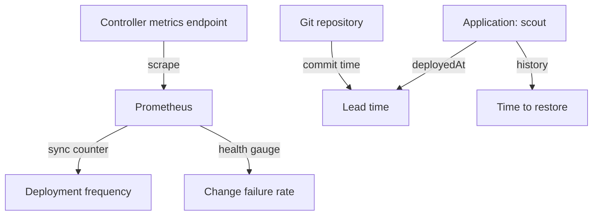

# The Four DORA Metrics And Where The Data Lives

A platform team cannot improve delivery that it does not measure. The DevOps Research and Assessment (DORA) group found that four numbers describe software delivery well. Two of them describe speed and two describe stability. This part defines the four numbers and then finds, in the cluster, the raw data that each one needs.

## The four metrics

Deployment frequency is how often the team deploys to production. It counts deployments in a time window, for example per day. A higher number means smaller, safer changes.

Lead time for changes is the time from a commit to the moment that commit runs in production. It starts when the developer commits and ends when the deployment is done. A shorter time means less waiting between writing code and using it.

Change failure rate is the share of deployments that cause a failure in production and need a fix or a rollback. It is a ratio: failed deployments divided by all deployments.

Time to restore service is how long production stays broken after a failed deployment, until service is healthy again.

Frequency and lead time measure speed. Change failure rate and time to restore measure stability. A team that only watches speed ships faster and breaks more. A team that only watches stability stops shipping.

## Where the data lives

The module uses GitOps. GitOps is a way to run a cluster where a Git repository holds the wanted state and a controller applies it. The controller here is Argo CD. It watches the repository and applies each new commit to the cluster. The Argo CD resource that describes one watched path is an Application. The playground has one Application named `scout`.

Three places hold the data for the four metrics.



The diagram shows that Git and the Application hold timestamps, which give the two time-based metrics, and that Prometheus holds counters and gauges, which give the two counted metrics. The next sections look at each place with a real command.

## The Application and its history

The playground bootstrap has already made ten commits and deployed each one. Check the Application first. The columns show whether the cluster matches Git (`SYNC STATUS`) and whether the workload works (`HEALTH STATUS`).

<!-- astrona:playground:renew -->

```sh
kubectl -n argocd get application scout
```

```text
NAME    SYNC STATUS   HEALTH STATUS
scout   Synced        Healthy
```

Argo CD stores every deployment it makes in `.status.history` of the Application. Each entry has an `id`, the Git `revision` (the commit hash), `deployStartedAt` and `deployedAt`. The next command prints the four fields as a table, with the hash cut to seven characters:

```sh
kubectl -n argocd get application scout -o json | jq -r '.status.history[] | [.id, .revision[0:7], .deployStartedAt, .deployedAt] | @tsv'
```

```text
0	febe9c0	2026-11-02T19:48:36Z	2026-11-02T19:48:46Z
1	8bede20	2026-11-02T19:49:08Z	2026-11-02T19:49:09Z
2	c36bf2a	2026-11-02T19:49:33Z	2026-11-02T19:49:33Z
3	8310751	2026-11-02T19:50:27Z	2026-11-02T19:50:27Z
4	d091bc7	2026-11-02T19:50:52Z	2026-11-02T19:50:52Z
5	d358bed	2026-11-02T19:51:16Z	2026-11-02T19:51:17Z
6	81fae5f	2026-11-02T19:51:41Z	2026-11-02T19:51:42Z
7	e65a4cf	2026-11-02T19:52:35Z	2026-11-02T19:52:35Z
8	7877936	2026-11-02T19:53:00Z	2026-11-02T19:53:01Z
9	736f9f2	2026-11-02T19:53:25Z	2026-11-02T19:53:26Z
```

Ten rows mean ten deployments. The history holds the time of each deployment (`deployedAt`) and the commit that was deployed. It does not hold the time of the commit, and it does not say whether a deployment went well. The playground sets `revisionHistoryLimit: 20` on the Application. The Argo CD default is 10, and older entries are dropped, so a history is a short-term source.

## The commit times in Git

The commit time lives in the Git repository. The repository is held by Gitea, a small Git server that the playground installs only as plumbing. Gitea has an HTTP API that lists commits, so you do not need a Git client. Open a second terminal and leave this port-forward running:

```sh
kubectl -n gitea port-forward svc/gitea 3000:3000
```

If port `3000` is in use on your machine, choose another local port, for example `23000:3000`, and use it in the URL below. The repository is public, so the request needs no login. The command prints the short hash, the committer date and the message of each commit:

```sh
curl -s "http://127.0.0.1:3000/api/v1/repos/starfleet/starfleet-deploy/commits?limit=20&stat=false&verification=false&files=false" | jq -r '.[] | [.sha[0:7], .commit.committer.date, (.commit.message | rtrimstr("\n"))] | @tsv'
```

```text
736f9f2	2026-11-02T19:47:24Z	Run three replicas
7877936	2026-11-02T19:32:59Z	Change the welcome message once more
e65a4cf	2026-11-02T19:49:34Z	Revert the other image build
81fae5f	2026-11-02T19:43:41Z	Try another image build
d358bed	2026-11-02T19:41:16Z	Change the welcome message again
d091bc7	2026-11-02T19:25:51Z	Run two replicas
8310751	2026-11-02T19:46:26Z	Revert the new image build
c36bf2a	2026-11-02T19:37:33Z	Try a new image build
8bede20	2026-11-02T19:19:08Z	Change the welcome message
febe9c0	2026-11-02T19:02:12Z	Start scout 6.15.0
```

The hashes match the `revision` column of the Application history. That match lets you join the two sources: the commit time from Git belongs to the deployment time from Argo CD. The committer dates are earlier than the deployment times by 3 to 45 minutes. The playground seed sets them that way on purpose: in a real team a developer commits first and a deployment follows later, but the seed pushes all ten commits within a few minutes. Without the earlier dates, every lead time would be a few seconds.

## The metrics endpoint

The third place is the metrics endpoint of the Argo CD application controller. The controller serves it on port `8082` through the Service `argocd-metrics`. Prometheus scrapes it every 15 seconds, because the playground has a ServiceMonitor for it. You can read the same page by hand. Start a port-forward in the second terminal:

```sh
kubectl -n argocd port-forward svc/argocd-metrics 8082:8082
```

Then read one counter from the page:

```sh
curl -s http://127.0.0.1:8082/metrics | grep '^argocd_app_sync_total'
```

```text
argocd_app_sync_total{dest_server="https://kubernetes.default.svc",dry_run="false",name="scout",namespace="argocd",phase="Succeeded",project="default"} 10
```

The counter `argocd_app_sync_total` counts sync operations. Argo CD adds one for every sync, labelled with the `phase` of the operation. It reads `10`, the same as the ten history entries. The next part turns this counter into deployment frequency. The page has a second metric, `argocd_app_info`, which carries the sync status and the health status of each Application. The third part uses it for the change failure rate.

You now know what the four metrics mean and where each one starts. Git holds commit times, the Application history holds deployment times, and the metrics endpoint holds a counter and a health gauge. The open question is how to turn the counter into a number that a team can track, and the next part answers it.

## Common pitfalls

> [!WARNING]
> - **Treating the Application history as a log.** It keeps only the last entries (`revisionHistoryLimit`). For a long window, use Prometheus.
> - **Joining Git and Argo CD by message or by time.** Join on the commit hash. The `revision` field is the full hash.
> - **Expecting a lead time from a seed that pushes commits in a burst.** Lead time is the gap between commit and deployment. A repository with all commits pushed at once shows a lead time of seconds.
> - **Reading `SYNC STATUS Synced` as success.** It means the cluster matches Git. It does not mean the workload runs. The health status says that.
