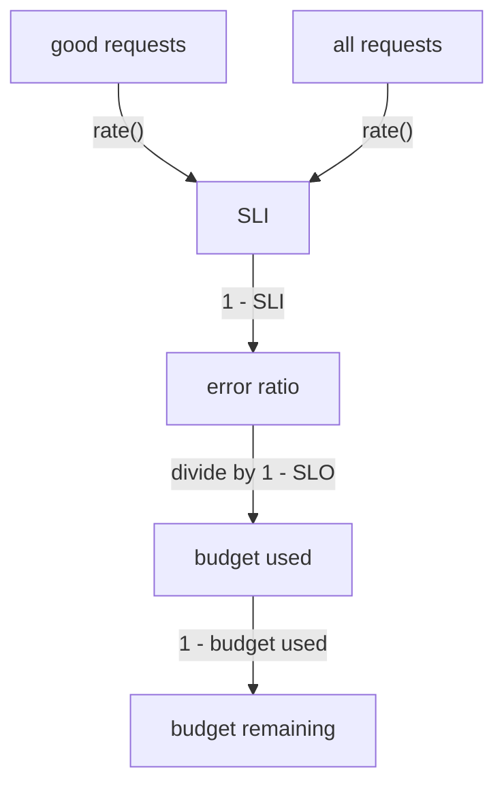

# SLI, SLO And Error Budget From Request Counters

Measure availability from good requests divided by all requests, using matching rate windows. Compare that service level indicator (SLI) with a 99% service level objective (SLO), then calculate how much of its error budget remains.

## Three terms for one promise

A service level indicator (SLI) is a number that measures how well a service works. For an HTTP service, the most common SLI is availability: the share of requests that ended well. A service level objective (SLO) is the target for that number, for example "99 percent of requests end well over 30 days". The error budget is what the target still allows: with a 99 percent SLO, 1 percent of the requests may fail.

The budget turns a target into a number you can spend. With 1,000,000 requests in 30 days, a 99 percent SLO allows 10,000 failed requests. The SLI says how many failed so far. The budget says how many are left.

The only data this needs is a counter of requests with a status label. `scout` serves one on its `/metrics` endpoint. Prometheus scrapes that endpoint through a ServiceMonitor, a Prometheus Operator resource that tells Prometheus which Services to scrape. Read the raw counter from the `shuttle` pod first.

<!-- astrona:playground:renew -->

```sh
kubectl -n starfleet exec deploy/shuttle -- curl -s scout.starfleet:9898/metrics | grep http_requests_total
```

```text
# HELP http_requests_total The total number of HTTP requests.
# TYPE http_requests_total counter
http_requests_total{status="200"} 5137
http_requests_total{status="500"} 268
```

The metric `http_requests_total` is a counter, a value that only goes up. It has one time series for each `status` label value. The playground traffic loop sends one request to `/status/500` for every 19 normal requests, so about 5 percent of the requests fail. Your numbers differ, because they grow with time.

## The SLI as a ratio of good requests to all requests

A raw counter only grows, so it says little. The function `rate()` turns it into a per-second value over a time range. The SLI divides the rate of good requests by the rate of all requests. A request is good when its status is not a `5xx` code.

Open a port-forward to Prometheus and define a helper that runs a query and prints one line for each result series:

```sh
kubectl -n monitoring port-forward svc/kps-prometheus 9090:9090 &
promql() {
  curl -fsS --data-urlencode "query=$1" http://127.0.0.1:9090/api/v1/query |
    jq -c '.data.result[] | {metric: (.metric | del(.endpoint, .instance, .job, .service, .namespace)), value: .value[1]}'
}
```

First look at the rate for each status over five minutes:

```sh
promql 'sum by (status) (rate(http_requests_total{namespace="starfleet",container="scout"}[5m]))'
```

```text
{"metric":{"status":"200"},"value":"32.572975937908495"}
{"metric":{"status":"500"},"value":"1.698891316993464"}
```

`scout` serves about 32.6 good requests and 1.7 failed requests each second. Now divide the good ones by all of them. The selector `status!~"5.."` keeps every status that does not match the regular expression `5..`, which is a `5` followed by any two characters:

```sh
promql 'sum(rate(http_requests_total{namespace="starfleet",container="scout",status!~"5.."}[5m])) / sum(rate(http_requests_total{namespace="starfleet",container="scout"}[5m]))'
```

```text
{"metric":{},"value":"0.950428982829632"}
```

The SLI is `0.95`: 95 percent of the requests end well. The SLO target is `0.99`, so `scout` is below its target.

## Store the SLI and the remaining budget

A query you type works once. A recording rule runs a PromQL expression on a schedule and stores the result as a new time series, so a dashboard or an alert can use it by name. Recording rules live in a PrometheusRule, a Prometheus Operator resource. Prometheus in this playground only selects rules with the label `release: kps`.

The remaining error budget is `1 - (1 - SLI) / (1 - SLO)`. The part `1 - SLI` is the error ratio. Dividing it by the budget `1 - SLO` says how many budgets the errors used. Subtracting from `1` gives what is left. Save this as `prometheusrule-scout-sli.yaml`:

```yaml
apiVersion: monitoring.coreos.com/v1
kind: PrometheusRule
metadata:
  name: scout-sli
  namespace: monitoring
  labels:
    release: kps
spec:
  groups:
    - name: scout-sli
      rules:
        - record: scout:sli:ratio_rate5m
          expr: sum(rate(http_requests_total{namespace="starfleet",container="scout",status!~"5.."}[5m])) / sum(rate(http_requests_total{namespace="starfleet",container="scout"}[5m]))
        - record: scout:sli:ratio_rate1h
          expr: sum(rate(http_requests_total{namespace="starfleet",container="scout",status!~"5.."}[1h])) / sum(rate(http_requests_total{namespace="starfleet",container="scout"}[1h]))
        - record: scout:error_budget_remaining:ratio1h
          expr: 1 - (1 - scout:sli:ratio_rate1h) / (1 - 0.99)
```

Apply it:

```sh
kubectl apply -f prometheusrule-scout-sli.yaml
```

A new rule reaches Prometheus after about a minute. Then check the three series:

```sh
promql 'scout:sli:ratio_rate1h'
promql 'scout:error_budget_remaining:ratio1h'
```

```text
{"metric":{"__name__":"scout:sli:ratio_rate1h"},"value":"0.9504302581180923"}
{"metric":{"__name__":"scout:error_budget_remaining:ratio1h"},"value":"-3.9569741881907614"}
```

The remaining budget is `-3.96`. A value of `1` means the whole budget is left, `0` means it is used up, and a negative value means `scout` failed almost four times more often than the SLO allows. The error ratio is `0.05` and the budget is `0.01`, so the errors used `4.96` budgets, and `1 - 4.96` is `-3.96`.

The window is one hour, because the playground keeps 6 hours of data. A real SLO uses a window such as 30 days. Then you change `[1h]` to `[30d]`, and Prometheus must keep 30 days of data. The formula stays the same.



The diagram shows how the two request rates become the SLI, the error ratio and the remaining budget.

## Common pitfalls

> [!WARNING]
> - **Dividing counters instead of rates.** `http_requests_total` counts since the process started, so the ratio of two counters averages over the whole lifetime of the pod. Use `rate()` over a window.
> - **Forgetting `sum`.** Without `sum`, the division works for each pod series and returns one SLI for each pod, not one for the service.
> - **A regex that matches nothing.** Prometheus anchors regular expressions at both ends. `status!~"5.."` works. `status=~"5xx"` looks for the literal text `5xx` and matches no status.
> - **A new rule that reads the wrong label.** A PrometheusRule without `release: kps` is valid, but Prometheus does not select it and the series never appears.
> - **Reading a negative budget as a bug.** A negative remaining budget is correct when the SLI is below the SLO. It means the budget is overspent.

## Your mission: Record Availability And Error Budget

Traffic to `scout` includes HTTP 500 responses. Create recording rules that measure availability and the remaining budget for a 99% objective.

This independent lab has 4 tasks. Allow 10–15 minutes for task work, plus environment startup and telemetry collection.

Pause the playground and start the lab:

```sh
astrona stop ats-020-playground-040-02
astrona run --git ssh://git@github.com/astrona-io/ATS020.git -c sections/section-040/module-20/labs/lab-04
```

Submit after verifying the result:

```sh
astrona submit -c sections/section-040/module-20/labs/lab-04
```

Remove the lab and resume the playground:

```sh
astrona destroy ats-020-lab-040-02-04
astrona start ats-020-playground-040-02
```
