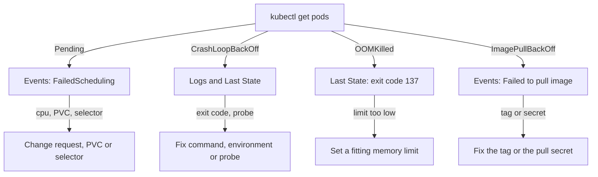

# A Triage Order And Pending Pods

When several workloads are broken, the worst habit is to guess. A pod status such as `Pending` or `CrashLoopBackOff` only tells you where the pod stopped, not why. This part sets a fixed order of commands that finds the cause, and uses it on two pods that the scheduler cannot place. The scheduler is the control plane component that picks a node for each new pod.

The commands need the playground as it starts: the namespace `starfleet` with the workloads `scout` and `bridge`, both `Pending`.

## The triage order

Every failure leaves evidence in a few known places. You read them from the cheapest to the most detailed, and you stop when one of them names the cause.

1. **Status.** `kubectl get pods` shows the phase, the `READY` count and the number of restarts. This tells you which family of failure you have.
2. **Events.** An event is a short Kubernetes record of something that happened to an object. The scheduler and the kubelet, the agent on each node that starts containers, write events about the pod. `kubectl get events` and the end of `kubectl describe pod` show them.
3. **Describe.** `kubectl describe pod` adds the container state, the last state, the exit code, the resource requests and limits, and the probes.
4. **Logs.** `kubectl logs` shows what the process wrote. `kubectl logs --previous` shows the run before the last restart.
5. **Fix and prove.** You change the object that owns the pod, almost always the Deployment. You then prove the fix with a request and with the state of the pod.

The diagram maps each status to the evidence that names the cause and to the usual fix:



The diagram shows that the status only chooses the next command. The events, the last state or the logs name the cause. The next sections use the order on `Pending` pods.

## What Pending means

A pod is `Pending` when the API server has stored it but no container runs yet. For a pod with no node, the scheduler has not found a node that fits. The scheduler checks the resource requests of the pod, the node selector, taints, and the volumes the pod needs. If one check fails for every node, the pod waits and the scheduler writes a `FailedScheduling` event with the reason.

Start with the status of all pods in the namespace:

<!-- astrona:playground:renew -->

```sh
kubectl -n starfleet get pods
```

```text
NAME                       READY   STATUS             RESTARTS      AGE
beacon-87b6df55b-crnq7     0/1     ImagePullBackOff   0             22s
bridge-f56969bd-r64nv      0/1     Pending            0             22s
cargo-666d87f89d-krbgj     0/1     OOMKilled          2 (20s ago)   22s
engine-6796746f47-bqs75    0/1     Error              2 (20s ago)   22s
probe-5589b495bc-nbt6g     1/1     Running            2 (1s ago)    22s
scout-6bf8b465d4-nkz8l     0/1     Pending            0             22s
shuttle-79b9fbf7c8-jwcmv   1/1     Running            0             22s
```

Four statuses are visible here. The status of `cargo` and `engine` changes between `Error`, `OOMKilled` and `CrashLoopBackOff` while the kubelet restarts them, so your output may differ. This part is about the two `Pending` pods, `scout` and `bridge`. Ask for the warning events, the ones that say something went wrong:

```sh
kubectl -n starfleet get events --field-selector type=Warning,reason=FailedScheduling
```

```text
LAST SEEN   TYPE      REASON             OBJECT                       MESSAGE
28s         Warning   FailedScheduling   pod/bridge-f56969bd-r64nv    0/1 nodes are available: persistentvolumeclaim "bridge-data" not found. not found
28s         Warning   FailedScheduling   pod/scout-6bf8b465d4-nkz8l   0/1 nodes are available: 1 Insufficient cpu. no new claims to deallocate, preemption: 0/1 nodes are available: 1 Preemption is not helpful for scheduling.
```

The scheduler names a different cause for each pod. `scout` has `Insufficient cpu`, which means no node has enough unreserved CPU for the request of the pod. `bridge` waits for a PersistentVolumeClaim that does not exist.

## A request that no node can satisfy

A resource request is the amount of CPU or memory that the scheduler reserves on a node for a container. The scheduler sums the requests of the pods already on a node and compares the sum with the allocatable amount of the node. It does not look at real use. Compare the allocatable CPU of the node with what is already requested:

```sh
kubectl describe node | grep -A5 'Allocated resources'
```

```text
Allocated resources:
  (Total limits may be over 100 percent, i.e., overcommitted.)
  Resource           Requests     Limits
  --------           --------     ------
  cpu                1100m (18%)  0 (0%)
  memory             618Mi (2%)   724Mi (3%)
```

The node has 6 CPUs allocatable, and 1100 millicores are already requested. The container of `scout` asks for `cpu: "64"`, which is 64 cores, so it can never fit on this node. Lower the request to `100m`, which is 100 millicores, and wait for the new pod:

```sh
kubectl -n starfleet set resources deployment/scout --requests=cpu=100m
kubectl -n starfleet rollout status deployment/scout --timeout=120s
```

```text
deployment.apps/scout resource requirements updated
deployment "scout" successfully rolled out
```

The `rollout status` command printed a few "Waiting for deployment" lines before the last line. They are left out here. Changing the pod template made the Deployment create a new ReplicaSet and a new pod, and the scheduler placed it at once.

## A volume that does not exist

The pod of `bridge` mounts a volume from the PersistentVolumeClaim `bridge-data`. A PersistentVolumeClaim (PVC) is a request for storage that a pod mounts by name. The scheduler does not place a pod whose claim does not exist, and the event says so. You do not change the Deployment here. You create the missing claim. Save this as `pvc-bridge-data.yaml`:

```yaml
apiVersion: v1
kind: PersistentVolumeClaim
metadata:
  name: bridge-data
  namespace: starfleet
spec:
  accessModes:
    - ReadWriteOnce
  resources:
    requests:
      storage: 100Mi
```

Apply it, and then check the claim:

```sh
kubectl apply -f pvc-bridge-data.yaml
kubectl -n starfleet get pvc
```

```text
persistentvolumeclaim/bridge-data created
NAME          STATUS   VOLUME                                     CAPACITY   ACCESS MODES   STORAGECLASS   VOLUMEATTRIBUTESCLASS   AGE
bridge-data   Bound    pvc-e9299762-eafb-4ec8-a137-fdbe7ae050c5   100Mi      RWO            standard       <unset>                 20s
```

The claim is `Bound`, which means a volume exists for it. The pod of `bridge` left `Pending` without any change to the Deployment, because the scheduler checks a pending pod again when a claim appears. The storage class `standard` of this cluster creates the volume only when a pod that uses the claim is scheduled. For that reason the claim shows `Pending` for a moment before it shows `Bound`. The volume name in your output differs.

A third common cause is a node selector that matches no node. The event then reads `1 node(s) didn't match Pod's node affinity/selector`. The fix is to correct the selector in the pod template, or to label a node with the key and value the selector asks for. A taint that the pod does not tolerate gives a similar message that names the taint.

## Prove the fix

A `Running` pod is not yet proof that the workload serves. Send a request from `shuttle` to each Service and print the HTTP status code:

```sh
kubectl -n starfleet exec deploy/shuttle -- curl -s -o /dev/null -w '%{http_code}\n' http://scout:9898/
kubectl -n starfleet exec deploy/shuttle -- curl -s -o /dev/null -w '%{http_code}\n' http://bridge:9898/
```

```text
200
200
```

The `shuttle` pod sent each request to the Service, the Service chose the ready pod, and `podinfo` in that pod answered with `200`. This proves that the pod is placed, that the container started and that the Service reaches it.

You now know the five-step order and how to read a `FailedScheduling` event. A `Pending` pod has a cause in the events. The next question is what to do with a pod that is placed and starts, but does not stay up.

## Common pitfalls

> [!WARNING]
> - **Reading logs of a `Pending` pod.** A pod with no node has no container and no log. Read the events.
> - **Judging fit by real use.** The scheduler compares requests with the allocatable amount, not with what the node uses. `kubectl top node` can show a free node while the node is full of requests.
> - **Fixing the pod instead of the Deployment.** A change to a pod is lost when the Deployment replaces it. Change the pod template of the Deployment.
> - **Stopping at `Running`.** Prove the fix with a request from `shuttle` that returns `200`.
