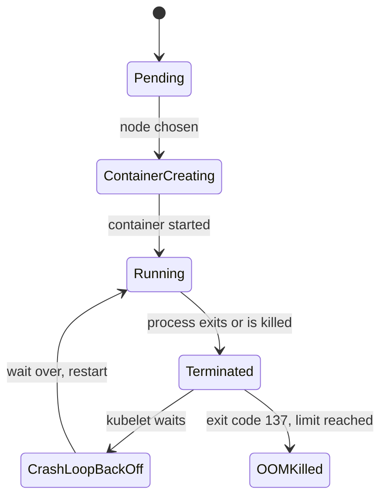

# CrashLoopBackOff And Failing Probes

A container that starts and then stops is harder to read than a pod that never starts. The container has run, so it can leave an exit code, a log and a probe failure behind. This part shows where to find each of them. It fixes two workloads that restart for different reasons: `engine`, whose process exits, and `probe`, whose process is healthy but is stopped by the kubelet.

The commands need the playground as it starts: the Deployments `engine` and `probe` in `starfleet`, both restarting.

## What CrashLoopBackOff means

`CrashLoopBackOff` is not an error from the container. It is the state of a container that the kubelet wants to restart but that must wait first. After each failed start, the kubelet doubles the wait: 10 seconds, 20 seconds, 40 seconds, and so on up to 5 minutes. The status then switches between `Error` or `OOMKilled` while the container runs and `CrashLoopBackOff` while it waits.

A container stops for one of two reasons. Its process ends by itself, or the kubelet kills it because of a failed liveness probe or a memory limit. The exit code and the events tell you which one.



The diagram shows that a restart loop is a cycle between `Running`, `Terminated` and `CrashLoopBackOff`. A `Terminated` container carries a reason and an exit code, and those two fields are the evidence you read first.

## A process that exits

`engine` runs a short shell program that checks the environment variable `ENGINE_MODE` and exits when it is not set. Read what the process wrote:

<!-- astrona:playground:renew -->

```sh
kubectl -n starfleet logs deploy/engine
```

```text
fatal: ENGINE_MODE is not set
```

The log names the cause, but you often have to confirm it with the exit code. The `describe` command shows the current state and the last state of the container. Print only those lines:

```sh
kubectl -n starfleet describe pod -l app=engine | sed -n '/State:/,/Ready:/p'
```

```text
    State:          Terminated
      Reason:       Error
      Exit Code:    3
      Started:      Mon, 02 Nov 2026 21:19:40 +0100
      Finished:     Mon, 02 Nov 2026 21:19:40 +0100
    Last State:     Terminated
      Reason:       Error
      Exit Code:    3
      Started:      Mon, 02 Nov 2026 21:19:13 +0100
      Finished:     Mon, 02 Nov 2026 21:19:13 +0100
    Ready:          False
```

The process started and finished in the same second, with exit code `3`. The program chose that code, so `3` has no general meaning. Some codes do: `0` is a normal end, `137` is `128 + 9` (the kernel sent `SIGKILL`), and `143` is `128 + 15` (the process got `SIGTERM`).

The current container is already dead when you run `kubectl logs`, so the plain command shows the last run. The flag `--previous` asks for the container before the current one, and it matters when the current container is running again. It works while the pod status is `CrashLoopBackOff`:

```sh
kubectl -n starfleet logs deploy/engine --previous
```

```text
fatal: ENGINE_MODE is not set
```

Right after an exit, while the status is still `Error`, the same command can fail with `unable to retrieve container logs for containerd://...`. The kubelet keeps only the log of the last dead container, so wait until the status is `CrashLoopBackOff`, or use the plain command.

The fix is to set the variable in the pod template. Then read the log of the new pod:

```sh
kubectl -n starfleet set env deployment/engine ENGINE_MODE=cruise
kubectl -n starfleet rollout status deployment/engine --timeout=90s
kubectl -n starfleet logs deploy/engine
```

```text
deployment.apps/engine env updated
deployment "engine" successfully rolled out
engine started in cruise mode
```

The output is shortened: `rollout status` prints some "Waiting" lines first, and `logs` can print `Found 2 pods, using pod/...` while the old pod is still ending. The proof for `engine` is the start message and a pod that stays `Running` with no new restarts.

## A healthy process that a probe stops

A liveness probe is a check that the kubelet runs against a container on a schedule. When it fails more times in a row than `failureThreshold`, the kubelet kills the container and restarts it. `probe` runs `go-httpbin`, which works, but its probe asks for `/healthz`, a path the server does not have. Look at the last state, the probe and the events:

```sh
kubectl -n starfleet describe pod -l app=probe | sed -n '/Liveness/p;/Last State/,/Ready:/p;/^Events/,$p'
```

```text
    Last State:     Terminated
      Reason:       Completed
      Exit Code:    0
      Started:      Mon, 02 Nov 2026 21:19:28 +0100
      Finished:     Mon, 02 Nov 2026 21:19:38 +0100
    Ready:          False
    Liveness:     http-get http://:http/healthz delay=3s timeout=1s period=5s successThreshold=1 failureThreshold=2
Events:
  Type     Reason     Age                From               Message
  ----     ------     ----               ----               -------
  Normal   Scheduled  59s                default-scheduler  Successfully assigned starfleet/probe-5589b495bc-nbt6g to astro-ats-020-playground-050-01-control-plane
  Normal   Pulled     28s (x4 over 58s)  kubelet            spec.containers{probe}: Container image "mccutchen/go-httpbin:2.25.0" already present on machine and can be accessed by the pod
  Normal   Created    28s (x4 over 58s)  kubelet            spec.containers{probe}: Container created
  Normal   Started    28s (x4 over 58s)  kubelet            spec.containers{probe}: Container started
  Warning  Unhealthy  18s (x8 over 53s)  kubelet            spec.containers{probe}: Liveness probe failed: HTTP probe failed with statuscode: 404
  Warning  Unhealthy  18s (x8 over 53s)  kubelet            spec.containers{probe}: Liveness probe failed: HTTP probe failed with statuscode: 404
  Normal   Killing    18s (x4 over 48s)  kubelet            spec.containers{probe}: Container probe failed liveness probe, will be restarted
  Warning  BackOff    18s (x2 over 18s)  kubelet            spec.containers{probe}: Back-off restarting failed container probe in pod probe-5589b495bc-nbt6g_starfleet(bb7297a4-ba86-4020-8b65-6fca2112a56a)
```

Three facts point to the probe. The exit code is `0`, because `go-httpbin` shuts down cleanly when the kubelet sends `SIGTERM`. The events say `Liveness probe failed` with status code `404`. The event `Killing` says that the kubelet restarts the container because of the probe. A crash would show a non-zero exit code and no `Unhealthy` events.

The log of the previous run confirms that the server is fine and that the kubelet was the caller:

```sh
kubectl -n starfleet logs deploy/probe --previous | tail -5
```

```text
time=2026-11-02T20:20:51.100Z level=INFO msg="go-httpbin listening on http://0.0.0.0:8080"
time=2026-11-02T20:20:58.106Z level=WARN msg="404 GET /healthz 0.1ms" status=404 method=GET uri=/healthz route="" size_bytes=19 duration_ms=0.054833999999999994 user_agent=kube-probe/1.35 client_ip=10.244.0.1 request_size_bytes=0
time=2026-11-02T20:21:03.105Z level=WARN msg="404 GET /healthz 0.0ms" status=404 method=GET uri=/healthz route="" size_bytes=19 duration_ms=0.035500000000000004 user_agent=kube-probe/1.35 client_ip=10.244.0.1 request_size_bytes=0
time=2026-11-02T20:21:03.118Z level=INFO msg="shutting down ..."
```

The user agent `kube-probe/1.35` is the kubelet. The server answered `404` twice, which equals `failureThreshold: 2`, and then shut down. The fix is to point the probe at a path the server serves. Removing the probe also stops the restarts, but it hides the problem, so you change the path. Save this as `probe-liveness-fix.yaml`. It is a patch that the Deployment merges into the container named `probe`:

```yaml
spec:
  template:
    spec:
      containers:
        - name: probe
          livenessProbe:
            httpGet:
              path: /status/200
```

Apply it, wait for the new pod, and send a request from `shuttle`:

```sh
kubectl -n starfleet patch deployment probe --patch-file probe-liveness-fix.yaml
kubectl -n starfleet rollout status deployment/probe --timeout=90s
kubectl -n starfleet exec deploy/shuttle -- curl -s -o /dev/null -w '%{http_code}\n' http://probe:8080/
```

```text
deployment.apps/probe patched
deployment "probe" successfully rolled out
200
```

Wait about 30 seconds and list the pods of `probe`. The restart count must stay `0`, because a probe that passes does not restart the container:

```text
NAME                     READY   STATUS    RESTARTS   AGE
probe-69fb974b64-778kf   1/1     Running   0          31s
```

A path the server answers with `200` ends the loop. The same reading works for a readiness probe, which decides whether the Service sends requests to the pod. A failing readiness probe does not restart the container. It keeps the pod at `0/1` in the `READY` column, with the same `Unhealthy` event.

You can now tell a process that exits from a container that a probe stops, using the exit code, the log and the events. Both fixes changed the pod template. The next question is a container that is killed with exit code `137` and leaves no log at all.

## Common pitfalls

> [!WARNING]
> - **Reading only the current log.** The current container may have just started. Read `--previous` when the status is `CrashLoopBackOff`.
> - **Treating exit code `0` as healthy.** A container that a probe stops can exit with `0`. Read the `Unhealthy` events.
> - **Removing the probe.** The restarts stop, but the workload is no longer checked. Fix the path, the port or the timing.
> - **Waiting for the back-off.** After a fix to the Deployment, the Deployment creates a new pod at once. You do not wait for the old wait time to pass.
