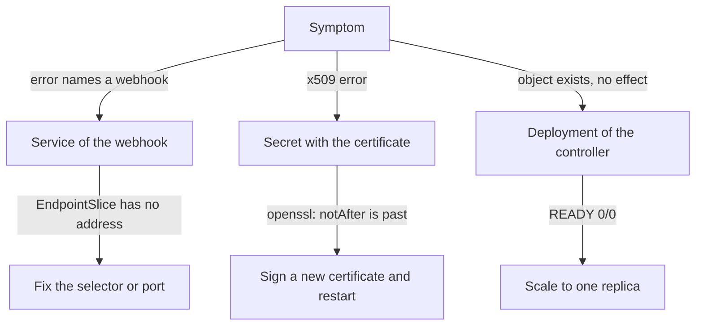

# A Controller Scaled To Zero

The last two failures gave an error message. A stopped controller gives none. You create a resource, the API server accepts it, and then nothing happens. This part shows how to find a controller that does not run, why the status of its resources can still look healthy, and how to prove that the platform reconciles again. It uses the Prometheus Operator, the controller behind the Prometheus in `monitoring`.

The commands need the playground as it starts: the Deployment `kps-operator` in `monitoring` scaled to zero, the Prometheus `kps-prometheus`, and the ServiceMonitor `scout` and PrometheusRule `scout-alerts` in `starfleet`. Prometheus needs about a minute to reflect a change, so wait a little before you query.

## What a controller does

A controller is a program that watches Kubernetes objects and changes the world to match them. This loop is called reconciliation. The Prometheus Operator is a controller. It watches the custom resources `Prometheus`, `ServiceMonitor` and `PrometheusRule`. It turns them into the configuration files that the Prometheus pod reads, and it tells Prometheus to reload them.

The API server stores a `ServiceMonitor` whether the operator runs or not. Storing an object and acting on it are two different jobs, done by two different components. If the operator stops, Prometheus keeps running with the last configuration it received, and new or changed monitors never reach it.

## Find the symptom

The `scout` Service has a ServiceMonitor, so Prometheus should scrape it. The PrometheusRule `scout-alerts` should add the alerting rule `ScoutDown`. Ask Prometheus from `shuttle`. The helper below sends a query to the Prometheus HTTP API and prints the JSON answer:

<!-- astrona:playground:renew -->

```sh
prom_query() {
  kubectl -n starfleet exec deploy/shuttle -- curl -s -G http://kps-prometheus.monitoring:9090/api/v1/query --data-urlencode "query=$1"
}
prom_query 'up{job="scout"}'
kubectl -n starfleet exec deploy/shuttle -- curl -s http://kps-prometheus.monitoring:9090/api/v1/rules
```

```text
{"status":"success","data":{"resultType":"vector","result":[]}}
{"status":"success","data":{"groups":[]}}
```

The query for `up{job="scout"}` returns an empty result, so Prometheus does not know the target. The list of rules is empty, so `ScoutDown` is not loaded. Both objects exist in the cluster, and neither reached Prometheus. That pattern points to the component that moves them: the operator.

## Read the status with care

Check the objects that belong to the operator. The `Prometheus` resource has a status that the operator writes. Then look at the operator Deployment and at the pods in `monitoring`:

```sh
kubectl -n monitoring get prometheus
kubectl -n monitoring get deployment kps-operator
kubectl -n monitoring get pods
```

```text
NAME             VERSION              DESIRED   READY   RECONCILED   AVAILABLE   AGE
kps-prometheus   v3.15.0-distroless   1         1       True         True        91s
NAME           READY   UP-TO-DATE   AVAILABLE   AGE
kps-operator   0/0     0            0           91s
NAME                          READY   STATUS    RESTARTS   AGE
prometheus-kps-prometheus-0   2/2     Running   0          89s
```

The `Prometheus` resource says `RECONCILED True`, and the operator has `0/0` pods. The `True` is the last result that the operator wrote before it stopped. A status written by a controller is only as fresh as the controller. A stopped controller leaves the old status in place, so the status does not warn you. The only pod in `monitoring` is Prometheus itself, and no operator pod exists.

## Find who scaled it down

A Deployment with `0/0` can be scaled to zero on purpose, or it can lose its pods for another reason. Read the Deployment and its ReplicaSet to see which one it is:

```sh
kubectl -n monitoring describe deployment kps-operator | grep -E 'Replicas|Scaled'
kubectl -n monitoring get replicasets
```

```text
Replicas:               0 desired | 0 updated | 0 total | 0 available | 0 unavailable
  Normal  ScalingReplicaSet  91s   deployment-controller  Scaled up replica set kps-operator-59d9bf85f from 0 to 1
  Normal  ScalingReplicaSet  73s   deployment-controller  Scaled down replica set kps-operator-59d9bf85f from 1 to 0
NAME                     DESIRED   CURRENT   READY   AGE
kps-operator-59d9bf85f   0         0         0       91s
```

The line `0 desired` shows that the desired replica count itself is zero. The events show that the Deployment controller first scaled the ReplicaSet up to one pod and then down to zero 18 seconds later. Nothing crashed. Someone, or a script, set the replica count to zero. When a controller pod crashes instead, you see a pod in `CrashLoopBackOff` and you read its logs, as for any workload.

## Scale it back and prove it

Set the replica count to one and wait for the rollout. Then wait about a minute for the operator to write the configuration and for Prometheus to reload it, and ask the same two questions again:

```sh
kubectl -n monitoring scale deployment/kps-operator --replicas=1
kubectl -n monitoring rollout status deployment/kps-operator
```

```text
deployment.apps/kps-operator scaled
Waiting for deployment "kps-operator" rollout to finish: 0 of 1 updated replicas are available...
deployment "kps-operator" successfully rolled out
```

After about a minute, repeat the queries:

```sh
prom_query 'up{job="scout"}'
kubectl -n starfleet exec deploy/shuttle -- curl -s http://kps-prometheus.monitoring:9090/api/v1/rules | head -c 300
```

```text
{"status":"success","data":{"resultType":"vector","result":[{"metric":{"__name__":"up","container":"scout","endpoint":"http","instance":"10.244.0.8:9898","job":"scout","namespace":"starfleet","pod":"scout-6cbc7bb69b-qmcxd","service":"scout"},"value":[1793653166.799,"1"]}]}}
{"status":"success","data":{"groups":[{"name":"scout","file":"/etc/prometheus/rules/prometheus-kps-prometheus-rulefiles-0/starfleet-scout-alerts-24d11f21-2f64-4e06-b4b2-9255aff2c442.yaml","rules":[{"state":"inactive","name":"ScoutDown","query":"up{job=\"scout\"} == 0","duration":60,"keepFiringFor":0
```

The first answer ends with `"1"`, so Prometheus scrapes `scout` and the target is up. The second answer lists the rule `ScoutDown` in its group `scout`, in the state `inactive`, because `scout` is up and the alert does not fire. The `head -c 300` command cut the second answer. The operator reconciled the `ServiceMonitor` and the `PrometheusRule` that it had missed while it was stopped.

The three failures in this module have one method in common. Read the symptom, name the component that should have done the work, read the field or object that component owns, and prove the fix with the behaviour that was lost.



The diagram shows which object to read for each symptom and which field names the cause. You can now find a webhook with no endpoints, an expired serving certificate and a stopped controller, and prove each fix. The mission puts all three in front of you at once.

## Your mission: Restore A Platform After Three Failures Lab

You can now read an admission webhook error, check a certificate with `openssl`, and find a controller that does not run. The mission starts a cluster in which a webhook Service refuses connections, a webhook certificate has expired, and the Prometheus Operator is stopped. You fix all three and prove each fix with a real request or query. The grader rejects the fixes that only hide the fault, such as `failurePolicy: Ignore` or deleting a webhook configuration.

Pause the playground first, so that only one cluster runs:

```sh
astrona stop ats-020-playground-050-02
```

Start the lab, and read the task:

```sh
astrona run --git ssh://git@github.com/astrona-io/ATS020.git -c sections/section-050/module-02/labs/lab-01
```

When you finish, submit your work for grading:

```sh
astrona submit -c sections/section-050/module-02/labs/lab-01
```

After the grader passes, remove the lab and start the playground again:

```sh
astrona destroy ats-020-lab-050-02
astrona start ats-020-playground-050-02
```

## Common pitfalls

> [!WARNING]
> - **Trusting `RECONCILED True`.** The status is the last thing the controller wrote. If the controller does not run, the status is old.
> - **Looking for an error message.** A stopped controller logs nothing and the API server reports nothing. Look for the objects that exist but have no effect.
> - **Querying Prometheus right after the fix.** The operator writes the configuration and Prometheus reloads it, which takes about a minute. Wait and query again.
> - **Starting a second Prometheus.** The target and the rule come from the operator. A new Prometheus does not fix the stopped controller.
