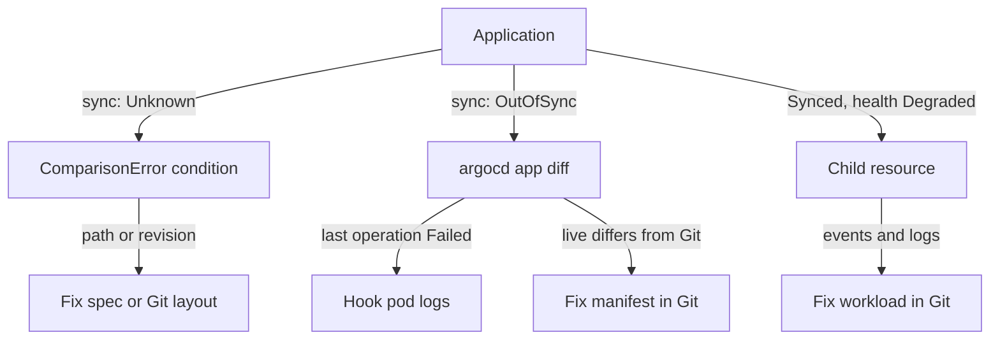

# A GitOps Application Out Of Sync Or Degraded

The three earlier failures broke a component inside the cluster. A GitOps failure breaks the link between Git and the cluster. Argo CD is a GitOps controller: it reads manifests from a Git repository and applies them to the cluster. When something goes wrong, the Application shows `OutOfSync`, `Degraded` or an error, and the cause can sit in Git, in Argo CD or in one resource that Argo CD created. This part shows how to read the two status fields of an Application, how to find the cause with `argocd` and `kubectl`, and how to fix it in the right place.

The commands in this part need a cluster with Argo CD and one Application. The playground of this module does not install Argo CD, so this part is read-only. It shows what each command asks and what the answer means. It does not show captured output, because nothing was run for it. Where a message is quoted, the exact wording can differ a little between Argo CD versions.

## Two status fields, two questions

An Argo CD Application is a custom resource that names a Git source (a repository, a revision and a path) and a destination (a cluster and a namespace). The Application has two separate status fields, and each answers a different question.

The field `status.sync.status` answers "does the cluster match Git?". Its values are `Synced`, `OutOfSync` and `Unknown`. `Synced` means the live resources equal the manifests in Git. `OutOfSync` means they differ, or that Git holds something not yet applied. `Unknown` means Argo CD could not compare at all, usually because it could not read or render the manifests.

The field `status.health.status` answers "do the resources work?". Its values are `Healthy`, `Progressing`, `Degraded`, `Suspended`, `Missing` and `Unknown`. Argo CD checks each resource it manages with a health rule, for example a Deployment is `Healthy` when its rollout finished. The health of the Application is the worst health among its resources. An Application can be `Synced` and `Degraded` at once: the cluster matches Git, and Git describes something that does not work.

Read both fields with `kubectl`, which works without the `argocd` command line tool:


```sh
kubectl -n argocd get applications
```

The output lists each Application with the columns `SYNC STATUS` and `HEALTH STATUS`. The combination points to the next step, as the table shows.

| Sync status | Health status | Usual cause |
| --- | --- | --- |
| `Unknown` | any | Argo CD cannot read the manifests: bad `path`, bad `targetRevision`, a repository error or a rendering error |
| `OutOfSync` | `Healthy` or `Missing` | The sync did not run or did not finish, or the live resources drifted from Git |
| `OutOfSync` | `Degraded` | A sync ran and failed, for example a failing hook, or a resource that does not start |
| `Synced` | `Degraded` | Git was applied, and a child resource such as a Deployment does not become healthy |
| `Synced` | `Progressing` | A child resource is still starting, or it waits for something that never arrives |

The table gives a first guess. The next sections confirm the guess with evidence.

## Read the conditions and the last operation

An Application records why it is unhappy. The array `status.conditions` holds errors such as `ComparisonError`, `InvalidSpecError` and `SyncError`, each with a message. The object `status.operationState` holds the last sync: its `phase` (`Running`, `Succeeded`, `Failed` or `Error`), a `message`, and the result of each resource. Both appear in the output of two commands:

```sh
kubectl -n argocd describe application scout
argocd app get scout
```

The `describe` command prints the spec, the status and the events of the Application. The command `argocd app get` prints a summary, the conditions, the last operation and a table of every resource with its sync and health status. Read the conditions first. When `status.conditions` is empty and the last operation succeeded, the cause is probably in a child resource, and the resource table in `argocd app get` shows which one.

## Compare Git with the cluster

When the status is `OutOfSync`, ask what differs. The command `argocd app diff` renders the manifests from Git and compares them with the live resources. It prints a diff for each resource that differs, in the same style as `diff`. It exits with status `1` when there are differences, so a script can test for them.

```sh
argocd app diff scout
```

A diff has two common meanings. A line that exists in Git and not in the cluster means Git was not applied yet, so check the last operation. A line that exists in the cluster and differs from Git means someone changed the live resource, for example with `kubectl edit`. If the Application has `automated.selfHeal: true`, Argo CD reverts that change on its own. If it does not, the Application stays `OutOfSync` until a sync runs. In both cases Git is the source of truth, so you fix the manifest in Git, not the live object.

Use `argocd app diff` only to read. A diff that is empty while the status says `OutOfSync` usually means the view is old, and `argocd app get scout --hard-refresh` makes Argo CD read Git again.

## A bad path or a bad revision

The most common GitOps error is a source that does not exist. Two spec fields name it. The field `spec.source.path` is the folder in the repository that holds the manifests. The field `spec.source.targetRevision` is the branch, tag or commit to read.

With a wrong `path`, the repository server of Argo CD cannot find the folder. The Application gets a `ComparisonError` condition, and its message says that the app path does not exist. The sync status becomes `Unknown`, because Argo CD has nothing to compare. No resource is changed in the cluster, and the old resources keep running.

With a wrong `targetRevision`, such as a branch name with a typo, the repository server cannot resolve the revision to a commit. The condition is again a `ComparisonError`, and the message says that the revision cannot be resolved. The sync status is `Unknown` here too.

The spec shows both values, and you compare them with the repository:

```sh
kubectl -n argocd get application scout -o jsonpath='{.spec.source.path}{"\n"}{.spec.source.targetRevision}{"\n"}'
```

Then you check that the folder and the revision exist in Git. The fix is either to correct the Application spec, or to move the files to the path the Application expects. If the Application itself is stored in Git, fix it there, or Argo CD or your pipeline writes the wrong value back. After the fix, the next refresh clears the condition and the sync status becomes `Synced` or `OutOfSync`.

## A failing hook

A hook is a resource, usually a Job, that Argo CD runs at a fixed point of a sync. The annotation `argocd.argoproj.io/hook` sets the point: `PreSync` runs before the manifests are applied, `Sync` during the apply, `PostSync` after all resources are healthy, and `SyncFail` when the sync fails. A `PreSync` Job often runs a database migration.

A failing hook stops the sync. If a `PreSync` Job fails, Argo CD does not apply the other manifests. The `phase` of the operation is `Failed`, and its message says that one or more synchronization tasks did not complete successfully. The Application stays `OutOfSync`, and its health can show `Degraded`. The live application keeps the last good version.

The Application message does not hold the reason. The reason is in the hook's own pod. Find the Job and its pod in the destination namespace, then read the logs, as for any failing workload:

```sh
kubectl -n starfleet get jobs,pods
kubectl -n starfleet logs job/migrate
```

The fix is in Git: correct the Job, then sync. A hook with the annotation `argocd.argoproj.io/hook-delete-policy: HookSucceeded` is deleted after it succeeds, but a failed hook stays so that you can read it. If the old failed Job blocks the next run, Argo CD replaces it on the next sync.

## A degraded child resource

When the sync status is `Synced` and the health is `Degraded`, Argo CD applied exactly what Git says, and one resource does not work. The resource table of `argocd app get` shows which resource is `Degraded` or `Progressing`. The Application never contains the reason, so you go to that resource and use the triage order for workloads: status, events, `describe`, logs.

```sh
argocd app get scout
kubectl -n starfleet describe deployment scout
kubectl -n starfleet get pods
```

A Deployment is `Degraded` when its rollout exceeds `progressDeadlineSeconds`, and it is `Progressing` while the rollout is still running. The pods below it then show the real cause: an `ImagePullBackOff` for an image tag that does not exist, a `CrashLoopBackOff` from a failing liveness probe, a `Pending` pod that requests too much CPU. Each cause has a fix in the workload manifest.

The fix goes into Git, because the manifest in Git created the fault. A change made with `kubectl edit` fixes the live object for a moment. With self-heal on, Argo CD reverts it. With self-heal off, the Application becomes `OutOfSync` and the next sync brings the fault back. Commit the corrected manifest, let Argo CD sync it, or run `argocd app sync scout`.

## Prove the fix

The proof is the behaviour that was lost. After the fix, the Application shows `Synced` for the sync status and `Healthy` for the health status. The last operation has the phase `Succeeded` for the revision of your commit, and `argocd app diff scout` prints nothing. For a workload, the pods are `Ready` and a request to the Service works.



The diagram shows which status leads to which evidence. You can now read the two status fields of an Application, find a bad path, a bad revision, a failing hook and a degraded child resource, and fix each one in Git. The open question for the module is how to keep a fix honest, and the answer is the same in every part: prove it with the behaviour it restores.

## Common pitfalls

> [!WARNING]
> - **Reading only the health status.** `Synced` and `Healthy` are two questions. A `Synced` Application can still be `Degraded`, and an `OutOfSync` one can be `Healthy`.
> - **Fixing the live object.** A `kubectl edit` is reverted by self-heal, or it leaves the Application `OutOfSync`. Fix the manifest in Git.
> - **Looking for a hook error in the Application.** The Application only says that the sync failed. The reason is in the logs of the hook's pod.
> - **Trusting an old status.** After a Git change, run a refresh before you decide that the fix did not work.
