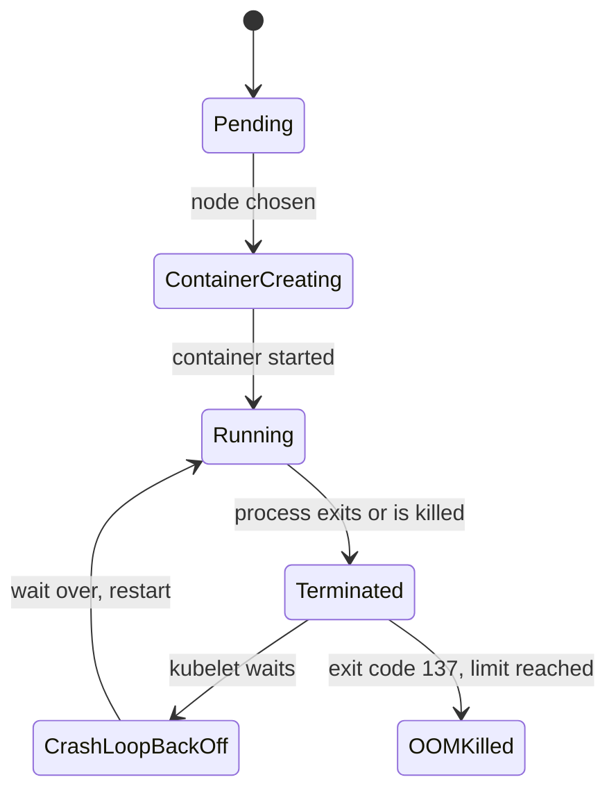

# Diagnose A Crashing Process

The `engine` process exits because its configuration is incomplete. Read its logs and termination state, repair the pod template, then check that its replacement stays running.

## What CrashLoopBackOff means

`CrashLoopBackOff` is not an error from the container. It is the state of a container that the kubelet wants to restart but that must wait first. After each failed start, the kubelet doubles the wait: 10 seconds, 20 seconds, 40 seconds, and so on up to 5 minutes. A terminated container records a reason such as `Error` or `OOMKilled`; while waiting to restart, it can show `CrashLoopBackOff`.

A container stops for one of two reasons. Its process ends by itself, or the runtime stops it after a failed liveness probe or the kernel kills it under memory pressure. The exit code and the events tell you which one.



The diagram shows that a restart loop is a cycle between `Running`, `Terminated` and `CrashLoopBackOff`. A `Terminated` container carries a reason and an exit code, and those two fields are the evidence you read first.

## A process that exits

`engine` runs a short shell program that checks the environment variable `ENGINE_MODE` and exits when it is not set. Read what the process wrote:

<!-- astrona:playground:renew -->

```sh
kubectl -n starfleet logs deploy/engine
```

```text
fatal: ENGINE_MODE is not set
```

The log names the cause, but you often have to confirm it with the exit code. The `describe` command shows the current state and the last state of the container. Print only those lines:

```sh
kubectl -n starfleet describe pod -l app=engine | sed -n '/State:/,/Ready:/p'
```

```text
    State:          Terminated
      Reason:       Error
      Exit Code:    3
      Started:      Mon, 02 Nov 2026 21:19:40 +0100
      Finished:     Mon, 02 Nov 2026 21:19:40 +0100
    Last State:     Terminated
      Reason:       Error
      Exit Code:    3
      Started:      Mon, 02 Nov 2026 21:19:13 +0100
      Finished:     Mon, 02 Nov 2026 21:19:13 +0100
    Ready:          False
```

The process started and finished in the same second, with exit code `3`. The program chose that code, so `3` has no general meaning. Some codes do: `0` is a normal end, `137` is `128 + 9` (the kernel sent `SIGKILL`), and `143` is `128 + 15` (the process got `SIGTERM`).

The current container is already dead when you run `kubectl logs`, so the plain command shows the last run. The flag `--previous` asks for the container before the current one, and it matters when the current container is running again. It works while the pod status is `CrashLoopBackOff`:

```sh
kubectl -n starfleet logs deploy/engine --previous
```

```text
fatal: ENGINE_MODE is not set
```

Right after an exit, while the status is still `Error`, the same command can fail with `unable to retrieve container logs for containerd://...`. The kubelet keeps only the log of the last dead container, so wait until the status is `CrashLoopBackOff`, or use the plain command.

The fix is to set the variable in the pod template. Then read the log of the new pod:

```sh
kubectl -n starfleet set env deployment/engine ENGINE_MODE=cruise
kubectl -n starfleet rollout status deployment/engine --timeout=90s
kubectl -n starfleet logs deploy/engine
```

```text
deployment.apps/engine env updated
deployment "engine" successfully rolled out
engine started in cruise mode
```

The output is shortened: `rollout status` prints some "Waiting" lines first, and `logs` can print `Found 2 pods, using pod/...` while the old pod is still ending. The proof for `engine` is the start message and a pod that stays `Running` with no new restarts.


## Common pitfalls

> [!WARNING]
> - Read `--previous` when the current container has restarted.
> - An exit code describes termination; the log usually explains the application error.
> - Change the Deployment template so replacement pods use the repair.

The graded exercise uses `beacon` with an invalid startup option. Apply the same method: compare the command override with the image default, read the process error, and remove the invalid override.

## Your mission: Repair A Crashing Process

The `beacon` image exists, but its process exits during startup. The Service and `shuttle` client are healthy.

This independent lab has 4 tasks. Allow 10–15 minutes for task work, plus environment startup and telemetry collection.

Pause the playground and start the lab:

```sh
astrona stop ats-020-playground-050-01
astrona run --git ssh://git@github.com/astrona-io/ATS020.git -c sections/section-050/module-10/labs/lab-05
```

Submit after verifying the result:

```sh
astrona submit -c sections/section-050/module-10/labs/lab-05
```

Remove the lab and resume the playground:

```sh
astrona destroy ats-020-lab-050-01-05
astrona start ats-020-playground-050-01
```
