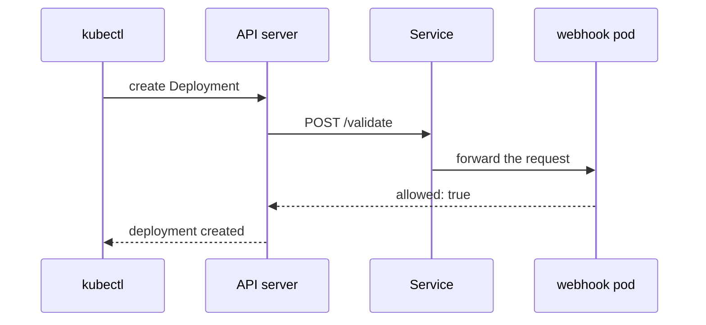

# A Webhook Service Without Endpoints

A Deployment create fails because the API server cannot reach an admission webhook. Trace the webhook reference through its Service, endpoints and server port. Repair the connection while preserving admission enforcement.

The commands need the playground as it starts: the namespace `starfleet`, the namespace `webhook-system` with the webhook server `starfleet-policy`, and the `ValidatingWebhookConfiguration` of the same name.

## How the API server calls a webhook

An admission webhook is an HTTPS service that the API server calls before it stores an object. The API server sends it the request in an `AdmissionReview` document, and the webhook answers with `allowed: true` or `allowed: false`. A `ValidatingWebhookConfiguration` is the Kubernetes object that tells the API server which requests to send to which webhook, and which Service to call.

Two fields decide what happens when the call fails. The field `failurePolicy` is `Fail` or `Ignore`. With `Fail`, the API server rejects the request when it cannot get an answer. With `Ignore`, the API server lets the request through. The field `timeoutSeconds` sets how long the API server waits. In this playground both webhooks use `failurePolicy: Fail` and `timeoutSeconds: 5`, so a broken webhook blocks every create it matches.



The diagram shows the working path. The API server, not `kubectl`, calls the Service. If the Service cannot forward the request, the answer never arrives, and the API server reports the failure to `kubectl`.

## Read the error

Try to create a Deployment in `starfleet`. The command is correct, so the failure must come from somewhere else:

<!-- astrona:playground:renew -->

```sh
kubectl -n starfleet create deployment probe --image=mccutchen/go-httpbin:2.25.0
```

```text
error: failed to create deployment: Internal error occurred: failed calling webhook "starfleet-policy.astrona.io": failed to call webhook: Post "https://starfleet-policy.webhook-system.svc:443/validate?timeout=5s": dial tcp 10.96.155.36:443: connect: connection refused
```

Read the message from left to right. `Internal error occurred` and `failed calling webhook` say that the API server could not call a webhook. The name `starfleet-policy.astrona.io` is the webhook. The URL names the target: the Service `starfleet-policy` in the namespace `webhook-system`, port `443`, path `/validate`. The last part, `connect: connection refused`, says the connection was refused at the network level. The webhook server never saw the request.

> [!TIP]
> An error with `failed calling webhook` always names the webhook, the Service and the reason. Copy the Service name and namespace from the message before you run any other command.

## Follow the error to the Service

List the webhook configurations, then ask the one from the error which Service it calls:

```sh
kubectl get validatingwebhookconfigurations
kubectl get validatingwebhookconfiguration starfleet-policy -o jsonpath='{.webhooks[0].clientConfig.service.namespace}/{.webhooks[0].clientConfig.service.name}:{.webhooks[0].clientConfig.service.port}{"\n"}'
```

```text
NAME               WEBHOOKS   AGE
outpost-policy     1          31s
starfleet-policy   1          31s
webhook-system/starfleet-policy:443
```

The configuration calls the Service `starfleet-policy` on port `443`, as the error said. The configuration is correct. Next, look at what stands behind the Service. A Service sends traffic to the pods that match its selector. The control plane records the ready pods of a Service in an EndpointSlice, an object that lists their IP addresses and ports:

```sh
kubectl -n webhook-system get pods --show-labels
kubectl -n webhook-system get endpointslices
kubectl -n webhook-system get service starfleet-policy -o jsonpath='{.spec.selector}{"\n"}'
```

```text
NAME                                READY   STATUS    RESTARTS   AGE   LABELS
outpost-policy-69c6c7cbf8-2rm82     1/1     Running   0          31s   app=outpost-policy,pod-template-hash=69c6c7cbf8
starfleet-policy-5b5c8f84f8-6pcvf   1/1     Running   0          31s   app=starfleet-policy,pod-template-hash=5b5c8f84f8
NAME                     ADDRESSTYPE   PORTS     ENDPOINTS     AGE
outpost-policy-tkpdr     IPv4          8443      10.244.0.11   31s
starfleet-policy-8ktwf   IPv4          <unset>   <unset>       31s
{"app":"starfleet-policy-v2"}
```

The webhook pod is `Running` and `Ready`, so the server itself is healthy. The EndpointSlice of `starfleet-policy` has no endpoints, while the one of `outpost-policy` has one. The selector of the Service is `app=starfleet-policy-v2`, and the pod has the label `app=starfleet-policy`. No pod matches the selector, so the Service has nowhere to send traffic. The rules on the node reject a connection to a Service without endpoints, and that is the `connection refused` in the error.

## Fix the selector and prove it

The pod is right and the Service is wrong, so you change the Service. Patch its selector, then check that the EndpointSlice now lists the pod:

```sh
kubectl -n webhook-system patch service starfleet-policy --type merge -p '{"spec":{"selector":{"app":"starfleet-policy"}}}'
kubectl -n webhook-system get endpointslices
```

```text
service/starfleet-policy patched
NAME                     ADDRESSTYPE   PORTS   ENDPOINTS     AGE
outpost-policy-tkpdr     IPv4          8443    10.244.0.11   31s
starfleet-policy-8ktwf   IPv4          8443    10.244.0.10   31s
```

The EndpointSlice has an address and port `8443` now. The proof is the behaviour the platform lost. Create the Deployment again, and read the log of the webhook server to see that the API server really called it:

```sh
kubectl -n starfleet create deployment probe --image=mccutchen/go-httpbin:2.25.0
kubectl -n webhook-system logs deploy/starfleet-policy
```

```text
deployment.apps/probe created
listening on 8443
POST /validate?timeout=5s uid=940a0304-8b9b-445b-b255-468aa3f75fa9 allowed
```

The create works, and the server logged one `POST /validate` request that it allowed. The log line is the difference between a fix and a bypass. If the create had worked because the webhook was deleted, the server would have logged nothing.

## Common pitfalls

> [!WARNING]
> - **Setting `failurePolicy: Ignore` to make the error go away.** The create works, but the policy no longer runs. The request skips the webhook, and the log of the server stays empty.
> - **Deleting the `ValidatingWebhookConfiguration`.** It removes the broken call and also the policy. Fix the cause instead.
> - **Checking only that the webhook pod is `Running`.** The pod can be healthy while the Service has no endpoints. Read the EndpointSlice.
> - **Testing with the wrong namespace.** A webhook matches a namespace with its `namespaceSelector`. A create in `outpost` does not reach `starfleet-policy`.

## Your mission: Repair A Webhook Service Port

The `starfleet-policy` admission webhook blocks Deployment creation in `starfleet`. Its server and Service run in `webhook-system`.

This independent lab has 4 tasks. Allow 10–15 minutes for task work, plus environment startup and telemetry collection.

Pause the playground and start the lab:

```sh
astrona stop ats-020-playground-050-02
astrona run --git ssh://git@github.com/astrona-io/ATS020.git -c sections/section-050/module-20/labs/lab-01
```

Submit after verifying the result:

```sh
astrona submit -c sections/section-050/module-20/labs/lab-01
```

Remove the lab and resume the playground:

```sh
astrona destroy ats-020-lab-050-02
astrona start ats-020-playground-050-02
```
